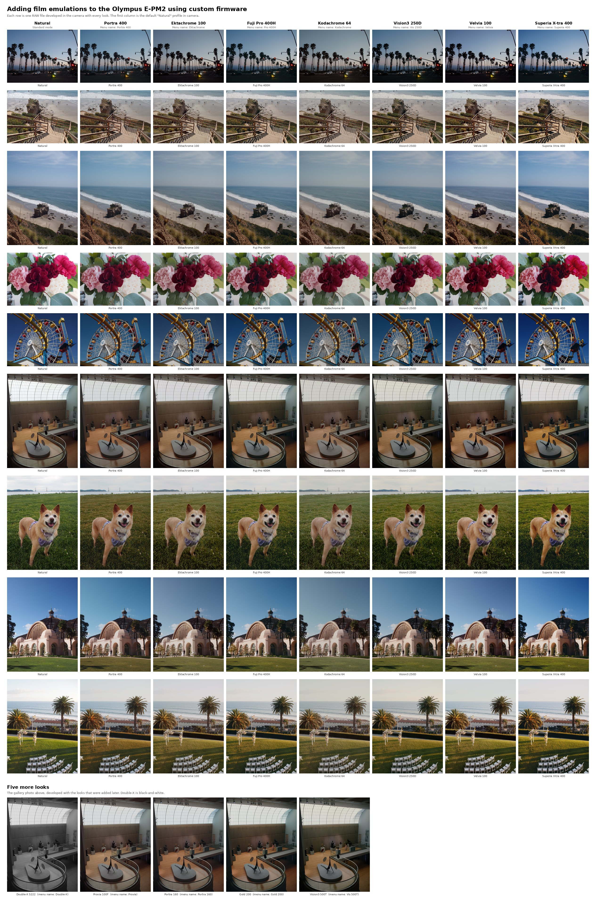

# EPM2Mod


Repository containing the current work for creating a custom firmware mod for the Olympus PEN **E-PM2**. We've implemented replacing the default art filters with film simulations like Portra, Ektachrome, etc. You can load your own looks from the SD card: choose and order them on [the film looks page](https://cfu288.github.io/EPM2Mod/), no command line needed. We also enabled interval shooting (up to 240 shots), added a level gauge, and added focus peaking.

## Added Features

| Feature | 
|---|
| [Film simulations](docs/guide/film-looks.md) |
| [Looks from the SD card](docs/guide/card-looks.md) |
| [Interval shooting](docs/guide/interval-shooting.md) | 
| [Level gauge](docs/guide/level-gauge.md) | 
| [Focus peaking](docs/guide/focus-peaking.md) | 

## Dependencies

- [uv](https://docs.astral.sh/uv/getting-started/installation/)

## Install

This firmware is only for an E-PM2. The firmware is unofficial, use it at your own risk. Ensure your battery is full prior to flashing.

1. To build a copy of the firmware, run

   ```sh
   uv run tools/make_firmware.py
   ```

   This downloads the Olympus firmware, applies the patches and writes `build/card/DCOLYMP/E1019999.BIN`.

   Alternatively, build and install the firmware directly to the SD card (allowing you to skip step 2)

   ```sh
   uv run tools/make_firmware.py --card /path/to/card
   ```
2. Copy the folder `build/card/DCOLYMP` to the top folder of an SD card, beside `DCIM`. `E1019999.BIN` must be the only file in `DCOLYMP`.
3. Put the card in the camera. With the camera off, hold **OK** and switch the camera on. An orange lamp shows the progress.
   - While the lamp is steady, the camera is writing the firmware. This takes 1 to 2 minutes. Do not switch the camera off.
   - When the lamp blinks, the update is done. Switch the camera off and on again.

To go back to the original firmware, see [docs/install.md](docs/install.md).


