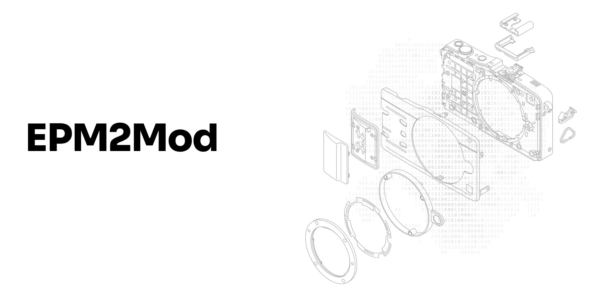
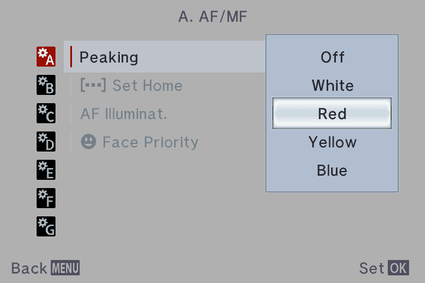

<h1></h1>

Repository containing the current work for creating a custom firmware mod for the Olympus PEN **E-PM2**. It swaps the art filters for [film simulations](https://cfu288.github.io/EPM2Mod/films) and adds interval shooting, a level gauge, focus peaking, a lowest shutter speed and AF-point spot metering. Light Box shows two photos side by side in playback, and ART BKT in RAW Data Edit develops one RAW in several film simulations.

> This project was created with heavy use of AI assistance.

## Added Features

| Feature | |
|---|---|
| [Film simulations](docs/guide/film-looks.md) |  |
| [Interval shooting](docs/guide/interval-shooting.md) |  |
| [Level gauge](docs/guide/level-gauge.md) |  |
| [Focus peaking](docs/guide/focus-peaking.md) |  |
| [Lowest shutter speed for ISO Auto](docs/guide/lowest-shutter-speed.md) |  |
| [Spot metering at the AF point](docs/guide/spot-metering.md) |  |
| [Light Box](docs/guide/light-box.md) |  |
| [ART BKT in RAW Data Edit](docs/guide/art-bkt.md) |  |

[](https://cfu288.github.io/EPM2Mod/films)

## Landscape of Olympus Custom Firmware

The E-PM2 came out in 2012. The [landscape page](docs/reference/landscape.md) lists the other Olympus custom firmware projects we know of.

[](docs/reference/landscape.md)

## Install

This firmware is only for an E-PM2. The firmware is unofficial, use it at your own risk. Ensure your battery is full prior to flashing. You can either use the installer or the CLI/command line. CLI is preferred.

### Using the installer

Download from [Releases](https://github.com/cfu288/EPM2Mod/releases): the `.dmg` for a Mac, the zip for Windows and Linux. On a Mac, open the `.dmg` and double-click **EPM2Mod** (drag it to Applications to keep it), then select **Open** when macOS asks. On Windows, unzip and double-click **Start (Windows).bat** (Linux: `./start.sh`). Follow the page that opens.

### Using the command line

You need [uv](https://docs.astral.sh/uv/getting-started/installation/) and [git](https://git-scm.com/downloads).

Format the card in the camera and put it in the computer (`uv run epm2mod cards` shows its folder). Then:

```sh
git clone https://github.com/cfu288/EPM2Mod.git && cd EPM2Mod
uv run epm2mod install --card /path/to/card --film ART1=portra-400 --film ART2=ektachrome --film ART3=pro-400h --film ART4=kodachrome --film ART5=double-x --film ART6=vision3-250d --film ART7=velvia --film ART8=superia-400 --film ART9=provia --film ART10=portra-160 --film ART11=gold-200 --film ART12=vision3-500t
```

Do the steps that `install` prints. To use other film simulations, change the names ([film table](docs/guide/film-looks.md#available-film-simulations)).

To go back to the original firmware, see [docs/user/install.md](docs/user/install.md).

