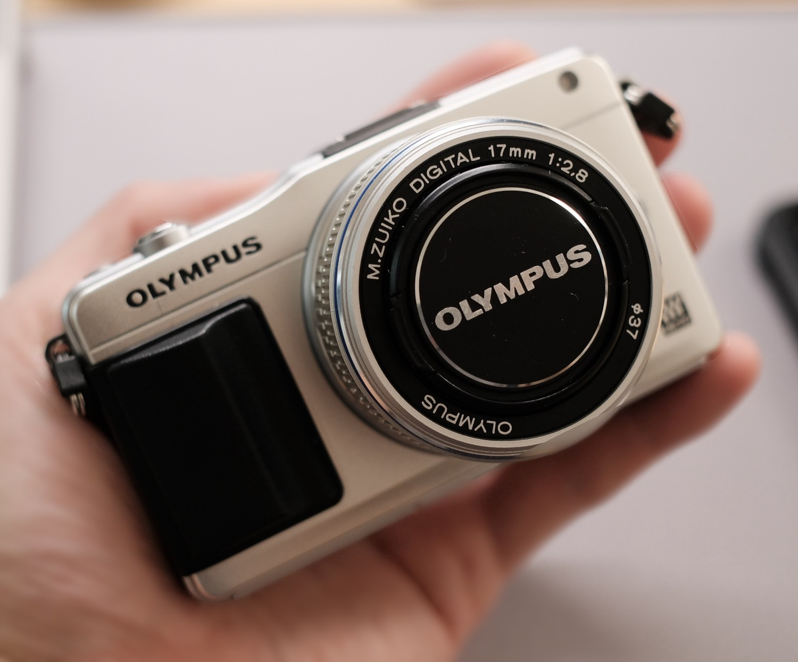
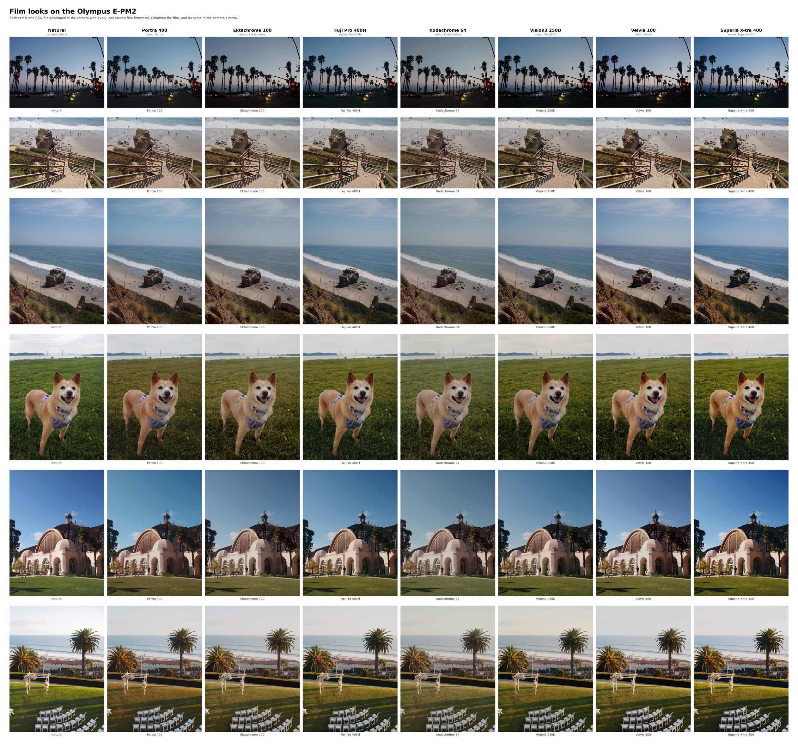

# EPM2Mod



Repository containing the current work for creating a custom firmware mod for the Olympus PEN **E-PM2**. The goal is to unlock or add new features to this camera. Currently, we've implemented replacing the default art filters with film simulations like Portra, Ektachrome, etc., and enabled interval shooting (up to 99 shots), a feature of the E-PL6.

| Feature | What you get | Status |
|---|---|---|
| **Film looks** | Seven film emulations as art filters, for stills and live view | Tested on the camera |
| **Interval shooting** | The Time Lapse Settings menu of the E-PL6: 1 to 99 frames, start delay, interval, optional time-lapse movie | Interval shooting tested on the camera. The time-lapse movie and long intervals are not yet reported |
| Video quality and recording limit | Research and patch specs | Not built. See `experiments/2026-11-12-hardware/` |

See below for an example of the film looks:



Each row shows one RAW file. The camera developed the file with each look. The first column shows the standard Natural mode.
Full-resolution sheet: [docs/film-sim-comparison.pdf](docs/film-sim-comparison.pdf).

## Film looks

Seven of the twelve art-filter menu entries are replaced by film looks. They work for stills and
live view, straight out of the camera as JPEG.

| Menu name | Film | Replaces |
|---|---|---|
| Portra | Kodak Portra 400 (on Portra Endura paper) | Pop Art |
| Ektachrome | Kodak Ektachrome 100 (slide) | Soft Focus |
| Pro 400H | Fuji Pro 400H (on Crystal Archive paper) | Pale&Light Color |
| Kodachrome | Kodak Kodachrome 64 (slide) | Light Tone |
| Vis 250D | Kodak Vision3 250D (on 2383 print film) | Pin Hole |
| Velvia | Fuji Velvia 100 (slide) | Diorama |
| Superia 400 | Fuji Superia X-tra 400 (on Crystal Archive paper) | Cross Process |

Grainy Film, Gentle Sepia, Dramatic Tone, Key Line and Watercolor are unchanged. Colour and tone only:
no grain, no halation. The looks are fitted to [spektrafilm](https://github.com/andreavolpato/spektrafilm)
simulations of each film and measured on the camera with a synthetic test RAW; average colour error is
about 1.1 to 1.5 ΔE2000 on natural colours (stock Natural against the same targets: 4 to 6).
How it works, how it was measured and what the limits are: **[docs/film-emulation.md](docs/film-emulation.md)**.

## Interval shooting

The E-PM2 firmware contains the interval-shooting code of its sister model, the E-PL6, but no menu
entry for it. The mod adds the entry: **Shooting Menu 2 → Time Lapse Settings**. Set the number of
frames, the start waiting time, the interval time (1 second or more), and if the camera makes a
time-lapse movie when the sequence is complete. The camera stays awake during a sequence.

The frame count goes from 1 to 99 in steps of 1, then from 100 to 240 in steps of 5. The stock
E-PL6 stops at 99. The steps are there because the menu's value list holds 128 entries at most; the
firmware keeps the count in one byte. Each frame uses the mechanical shutter.

What was in the firmware, how the patch works, how it was checked and what is not yet tested:
[experiments/2026-11-13-intervalometer/README.md](experiments/2026-11-13-intervalometer/README.md).

## Build and flash the latest build

The latest known-good build is **`seven-films-6-interval-240`**: the seven film looks and interval
shooting with up to 240 frames. It was flashed and tested on a real E-PM2 on 2026-11-13 ([camera log](docs/camera-log.md)). No firmware is distributed here. You build the image from
Olympus's own v1.6 firmware file and the patch specs in this repository.

**You need:** Python 3 (no extra packages), an SD card, a charged battery, and an E-PM2 with body
firmware 1.6.

1. Get the repository.

   ```bash
   git clone https://github.com/cfu288/EPM2Mod.git
   cd EPM2Mod
   ```

2. Put the stock E-PM2 v1.6 firmware file here: `firmware/stock/E-PM2/OLY_E_101_1600_0000_0000.BIN`.
   Where to get it: [firmware/README.md](firmware/README.md). Check the file:

   ```bash
   sha256sum firmware/stock/E-PM2/OLY_E_101_1600_0000_0000.BIN      # macOS: shasum -a 256 ...
   # 34d339ac3986ba8c10f494dbe2e4ae8f143ebf5bbfaa356e3ff9b7f40fc3e300
   ```

3. Build.

   ```bash
   python3 tools/build.py \
       patches/remap7b-code.json patches/seven-fixes-1.json patches/seven-movie-1.json \
       patches/seven-structure-extra.json patches/seven-films-5.json \
       patches/xp-adaptive-hue-off.json patches/seven-labels.json \
       experiments/2026-11-13-intervalometer/patches/interval-timelapse-v2.json \
       experiments/2026-11-13-intervalometer/patches/interval-frames-240.json \
       -o build/seven-films-6-interval-240.BIN
   ```

   The order of the specs matters. The build tool refuses a wrong base file and checks every byte it
   replaces.

4. Check the result. The build is reproducible, so the hash must be the same as this one:

   ```bash
   sha256sum build/seven-films-6-interval-240.BIN
   # 01837f962f8a8ca0d189d9cd65ad9b5b35402ca3f3ed54a3872af044e050de11
   ```

5. Copy the file to the SD card as `DCOLYMP/E1019999.BIN`. It must be the only file in `DCOLYMP`.

   ```bash
   mkdir -p /Volumes/SDCARD/DCOLYMP            # macOS; on Linux use the card's mount point
   rm -f /Volumes/SDCARD/DCOLYMP/*
   cp build/seven-films-6-interval-240.BIN /Volumes/SDCARD/DCOLYMP/E1019999.BIN
   shasum -a 256 /Volumes/SDCARD/DCOLYMP/E1019999.BIN     # must be the hash of step 4
   diskutil eject /Volumes/SDCARD
   ```

6. Flash. Put the card in the camera. With the camera off, hold **OK** and switch the camera on.
   The lamp is solid orange for about one minute: do not touch the camera. When the lamp blinks, the
   update is complete. Switch the camera off, then on.

7. Check. The art filter list shows Portra, Ektachrome, Pro 400H, Kodachrome, Vis 250D, Velvia and
   Superia 400. Shooting Menu 2 shows Time Lapse Settings.

For the film looks only, leave out the two `interval-…` lines. That build is
`seven-films-6`, sha256 `5badb0796731b40a27ef015e57da134d7d793486d4c6262a3f483c1aae60fd05`.
With `interval-timelapse-v2.json` but without `interval-frames-240.json`, the frame count stops at
99 as on the E-PL6 (`seven-films-6-interval`, sha256
`f52ea6976ac2e9c567b2c07d7556b96b6431c8fcd2d90de195abdb76059e0104`).

Before you build a different combination of specs, run
`python3 tools/freespace.py check SPEC…` with the same list. It fails if two specs use the same
bytes or if a spec writes where the camera does not load the firmware.

**To go back to the original firmware,** do steps 5 and 6 with the stock file of step 2.
More detail on flashing: [docs/flashing.md](docs/flashing.md).

Limits of this build:

- Movies get only part of each look.
- The second type (II) of Portra, Pro 400H and Superia is the same as type I.
- Grain and halation are not simulated.
- Interval shooting: at most 99 frames. The time-lapse movie, cancelling a sequence and intervals
  longer than 90 seconds are not yet reported as tested.

**At your own risk.** This is unofficial, for the E-PM2 with body firmware 1.6 only, and not affiliated with
Olympus or OM Digital Solutions. A wrong or interrupted flash can leave a camera unusable. Never put a
firmware file for another model on the card.

To run the project's own tests (they need the stock firmware file of step 2):
`python3 -m unittest discover -s tests`.

## Layout

| Path | What |
|---|---|
| `tools/oetool.py` | OE container: `info`, `unpack`, `pack`, `patch` (recomputes checksums) |
| `tools/build.py` | applies JSON patch specs to a stock BIN → `build/` |
| `tools/disasm.py`, `tools/fwmap.py` | MN103 disassembly (GNU objdump, `scripts/build-binutils-mn10300.sh`) and the block-0 function database with `fn`/`str`/`range`/`xref`/`tasks` queries |
| `patches/` | one spec per mod, with a status and expected hash once camera-tested; `patches/history/` holds superseded and failed specs (record only) |
| `firmware/` | stock and reference BINs (git-ignored), `SHA256SUMS`, provenance |
| `docs/` | [firmware map](docs/firmware-map.md) (what the firmware contains and where), [flashing](docs/flashing.md), [camera log](docs/camera-log.md), [format](docs/firmware-format.md), [verification](docs/verification.md), [conventions](docs/conventions.md) |
| `experiments/` | dated ad-hoc work; promote results into tools/patches/docs |
| `tests/` | unittest suite |

## Patches

The current film build is described under *Build and flash the latest build* above. Every other film spec in the table below is in `patches/history/`; the table is the development history.

| Spec | Status |
|---|---|
| `pixel-hacking` | camera-tested, works (PoC: renames a menu label) |
| `curve-probe-2` | built, **not camera-tested** (Cross Process I := Natural + Saturation +2; verifies the per-channel base-gamma tables, NOTES §14.3) |
| `film-portra-xp` (+ `label-portra`) | **camera-tested 2026-11-11, works** as `build/film-portra-xp-labelled.BIN` (Portra 400 in the Cross Process I slot; NOTES §14.4, §15) |
| `film-portra-xp2` (+ `label-portra`) | built, **not camera-tested** (as above plus a fitted luma look curve; NOTES §16.3) |
| `film-portra-xp` + `label-portra` | camera-tested 2026-11-11, works (first Portra build) |
| + `sixaxis-probe-1` / `sixaxis-portra-1` (xp3) | camera-tested 2026-11-11, work (see docs/camera-log.md) |
| `sixaxis-portra-2` (xp4), `sixaxis-portra-3` (xp5) | built, not camera-tested |
| `xp-adaptive-hue-off`, `film-portra-xp7` (xp6 / xp7 builds) | xp7 flashed OK 2026-11-12; first patches that change code bytes (NOTES §22–23) |
| `film-portra-xp8` | flashed OK 2026-11-12; measured with the synthetic test RAW (NOTES §23–25) |
| `film-portra-xp9` | flashed OK 2026-11-12; mock natural colours ΔE 1.31 vs target, as predicted (NOTES §25) |
| `film-ektachrome-pa2` | built, **not camera-tested**; Ektachrome 100 in the Pop Art II slot, data only (NOTES §26) |
| `film-ektachrome-lt`, `label-ektachrome-lt` | flashed OK 2026-11-12; Ektachrome 100 in the Light Tone slot, ΔE 1.55 on mock natural colours (NOTES §26.5–26.6; slot map in `docs/art-filter-slots.md`) |
| `film-ektachrome-lt2` | flashed OK 2026-11-12; ΔE 1.39 on mock natural colours, as predicted (NOTES §26.6) |
| `film-portra-xp10`, `film-ektachrome-lt3` | flashed OK 2026-11-12 (current build); refits against the measured fit objective; scene-independence confirmed with the blue-scene test RAW (NOTES §27–28) |
| `slot3-code`, `film-pro400h-pa1`, `label-pro400h-pa` (+ `…-s3` copies of the two film patches) | flashed OK 2026-11-12 (`three-films-1`): **first new code, works**; third film (Fuji Pro 400H) in the Pop Art entry, look distorted by Pop Art's chroma curves (NOTES §29–30) |
| `slot3-chroma-linear` | flashed OK 2026-11-12 (`three-films-2`, current build): Pro 400H natural colours ΔE 1.20 (NOTES §30.4) |
| `film-pro400h-pa2` | built, **not camera-tested** (`three-films-3`): correction refit of Pro 400H (NOTES §30.4) |
| `slots7-code`, `slots7-neutral` | built, **not camera-tested** (`seven-slots-neutral`): Pale&Light, Soft Focus, Pin Hole and Diorama as film slots with a neutral test look; emulator-checked (docs/art-slots-evaluation.md, NOTES §32) |
| `slots12-code`, `slots12-neutral`, `film-pro400h-pa2-s12` | built, **do not flash** (uses effect numbers 106 / 108; NOTES §35) (`twelve-slots-neutral`): all twelve visible filters as film slots; the five effect filters use the numbers of hidden second types; emulator-checked (docs/art-slots-evaluation.md §4, NOTES §33) |
| `slots7-kind` | flashed 2026-11-12 with slots7-code (`seven-slots-neutral-b`): **live view freezes** in Soft Focus, Pin Hole, Diorama (NOTES §34–35) |
| `remap7-code`, `remap7-neutral` | flashed 2026-11-12 (`seven-slots-remap-neutral`): **live view freezes** in Soft Focus, Pin Hole, Diorama (NOTES §35–36) |
| `four-code`, `four-neutral` | built, **not camera-tested** (`four-slots-neutral`): the three films + Pale&Light as a fourth slot; no effect filter touched (NOTES §36) |
| `remap7b-code` | flashed OK 2026-11-12 (`seven-slots-remap2-neutral`, current build): **live view no longer freezes** in the three remapped entries (NOTES §37) |
| `seven-structure-extra`, `seven-films-1`, `seven-labels` | **camera-tested** (`seven-films-1`, 2026-11-12; `seven-films-2`, corrected fits for the four new films, camera-tested the same day; open: rare restart when RAW Data Edit saves, see camera log): seven films in menu order: Portra 400, Ektachrome 100, Pro 400H, Kodachrome 64, Vision3 250D, Velvia 100, Superia X-tra 400 (NOTES §39) |
| `curve-probe-1`, `film-portra` | superseded drafts, not camera-tested (NOTES §12.5, §13) |

## Licence

Code, documentation and notes: [MIT](LICENSE). Some material keeps other terms: the film look data is
derived from [spektrafilm](https://github.com/andreavolpato/spektrafilm) by Andrea Volpato (CC BY-SA 4.0),
and excerpts of the Olympus firmware remain Olympus's. No firmware and no third-party tool is included.
Details and credits: [NOTICE.md](NOTICE.md).

## Background

Landscape research: `../reports/Olympus firmware modding landscape.md` and `../research_notes/Olympus firmware modding landscape/`.

Commits follow Conventional Commits. Run `git config core.hooksPath .githooks` once: it enables the commit-message check and a check that refuses machine-specific paths and host names (use `/path/to/...`, `USER@HOST`). See [docs/conventions.md](docs/conventions.md).
