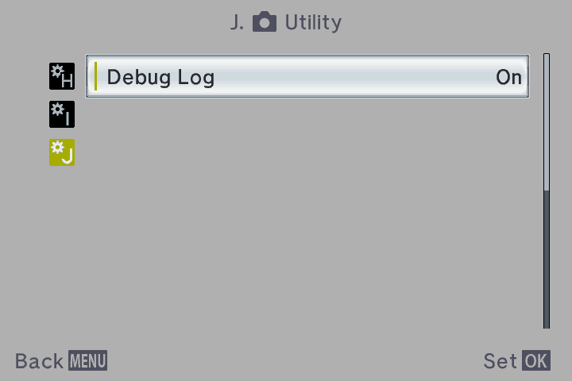
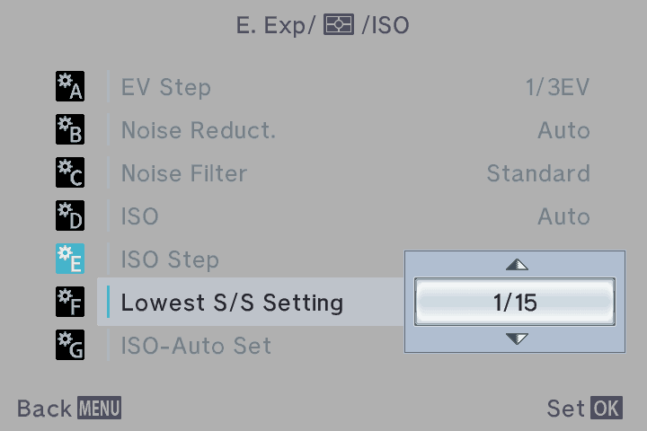

<h1></h1>

Repository containing the current work for creating a custom firmware mod for the Olympus PEN **E-PM2**. We've implemented the ability to swap the default art filters with film simulations like Portra, Ektachrome, etc. You can choose which ones to load with the installer. See them compared on [our site](https://cfu288.github.io/EPM2Mod/films). We also enabled interval shooting (up to 240 shots), added a level gauge, focus peaking, and a lowest shutter speed setting for ISO Auto.

## Added Features

| Feature | |
|---|---|
| [Film simulations](docs/guide/film-looks.md) |  |
| [Looks from the SD card](docs/guide/card-looks.md) |  |
| [Interval shooting](docs/guide/interval-shooting.md) |  |
| [Level gauge](docs/guide/level-gauge.md) |  |
| [Focus peaking](docs/guide/focus-peaking.md) |  |
| [Debug log](docs/guide/debug-log.md) |  |
| [Lowest shutter speed for ISO Auto](docs/guide/lowest-shutter-speed.md) |  |

[](https://cfu288.github.io/EPM2Mod/films)

## Dependencies

- [uv](https://docs.astral.sh/uv/getting-started/installation/)
- [git](https://git-scm.com/downloads)

## Install

This firmware is only for an E-PM2. The firmware is unofficial, use it at your own risk. Ensure your battery is full prior to flashing. You can either use the installer or the CLI/command line. CLI is preferred.

### Using the installer

Download the zip from [Releases](https://github.com/cfu288/EPM2Mod/releases), unzip it, and double-click **Start (Mac).command** or **Start (Windows).bat** (Linux: `./start.sh`). Follow the page that opens. On a Mac, the first start is blocked: allow it in System Settings → Privacy & Security → **Open Anyway**.

### Using the command line

Get the code:

```sh
git clone https://github.com/cfu288/EPM2Mod.git
cd EPM2Mod
```

1. Format the card in the camera. This makes the `DCIM` folder. Put the card in the computer. `uv run epm2mod cards` shows the folder of the card (for example `/Volumes/NO NAME` on a Mac or `E:\` on Windows).
2. Write EPM2Mod to the card:

   ```sh
   uv run epm2mod install --card /path/to/card
   ```

   This downloads the Olympus firmware, applies the patches, and writes `DCOLYMP/E1019999.BIN` to the card. To add film simulations, put a film simulation in each ART slot with `--film`: `install` then also writes `EPM2LOOK.BIN`. ART1 is the first entry of the camera's ART menu (Pop Art), ART12 the last (Watercolor). A slot you leave out keeps its Olympus art filter. The names are in the [film table](docs/guide/film-looks.md#available-film-simulations), or run `uv run epm2mod films`:

   ```sh
   uv run epm2mod install --card /path/to/card --film ART1=portra-400 --film ART2=ektachrome --film ART3=pro-400h --film ART4=kodachrome --film ART5=double-x --film ART6=vision3-250d --film ART7=velvia --film ART8=superia-400 --film ART9=provia --film ART10=portra-160 --film ART11=gold-200 --film ART12=vision3-500t
   ```
3. Do the steps that `install` shows:

<!-- BEGIN GENERATED: camera-steps -->
1. Eject the card (Mac: ⏏ in Finder. Windows: right-click → Eject) and take it out.
2. Put a charged battery and the card in the camera (cover on the bottom).
3. Hold OK (middle of the arrow pad) and ON/OFF together until the orange lamp on the front stays lit, then let go.
4. Leave the camera alone until the lamp blinks (1 to 2 minutes).
5. Turn the camera off and on.
6. To check: MENU → SETUP → wrench tab → Firmware reads Body : 1.6  EPM2Mod 2026.11.19.
7. MENU → SETUP → gears tab → J → Load Looks → Load → OK. No gears tab? Wrench tab → Menu Display → Custom Menu → On.
8. Check: MENU → ART shows Portra 400 in ART 1.
<!-- END GENERATED: camera-steps -->

While the lamp is steady, the camera writes the firmware. Do not switch the camera off. All commands and options are in the [command-line reference](docs/cli.md).

To go back to the original firmware, see [docs/install.md](docs/install.md).

## Troubleshooting

- **The camera starts normally instead of writing:** it found no firmware file it accepts. `DCOLYMP/E1019999.BIN` must be in the top folder of the card and be the only file in `DCOLYMP`.
- **Load Looks shows No file:** `EPM2LOOK.BIN` is not in the top folder of the card.
- **Load Looks shows Bad file:** the file is damaged or incomplete. Make it again with the installer or `uv run epm2mod films set`.

> This project was created with heavy use of AI assistance.
