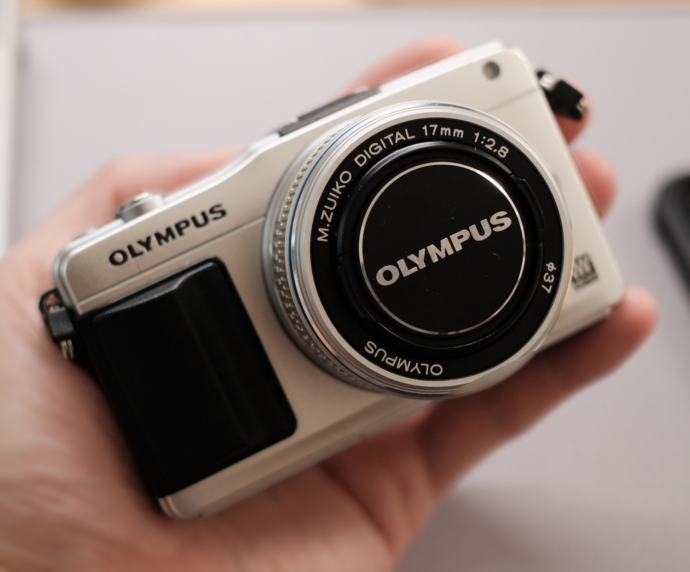

# EPM2Mod



Repository containing the current work for creating a custom firmware mod for the Olympus PEN **E-PM2**. We've implemented the ability to swap the default art filters with film simulations like Portra, Ektachrome, etc. You can choose which ones you want to load via our [ film looks page](https://cfu288.github.io/EPM2Mod/) to download the looks you want. We also enabled interval shooting (up to 240 shots), added a level gauge, and added focus peaking.

## Added Features

| Feature | 
|---|
| [Film simulations](docs/guide/film-looks.md) |
| [Looks from the SD card](docs/guide/card-looks.md) |
| [Interval shooting](docs/guide/interval-shooting.md) | 
| [Level gauge](docs/guide/level-gauge.md) | 
| [Focus peaking](docs/guide/focus-peaking.md) | 

## Install

This firmware is only for an E-PM2. The firmware is unofficial, use it at your own risk. Ensure your battery is full prior to flashing.

There are two ways to install. Both make the same firmware.

### Installer

Download the zip from [Releases](https://github.com/cfu288/EPM2Mod/releases), unzip it, and double-click **Start (Mac).command** or **Start (Windows).bat** (Linux: `./start.sh`). Follow the page that opens.

On a Mac, the first start is blocked: allow it in System Settings → Privacy & Security → **Open Anyway**.

### Command line

1. With [uv](https://docs.astral.sh/uv/getting-started/installation/) installed, put EPM2Mod on the SD card, with its 12 default films, as the installer does (`uv run epm2mod cards` shows the card's folder):

   ```sh
   uv run epm2mod make --card /path/to/card
   ```

   Without the card in this computer, `uv run epm2mod make` writes `build/card/DCOLYMP`. Copy that folder to the top of the card, beside `DCIM`.
2. To choose the films, change any of the 12 in this command and run it too (`uv run epm2mod looks list` shows all 19 films):

   ```sh
   uv run epm2mod looks pack ART1=portra-400 ART2=ektachrome ART3=pro-400h ART4=kodachrome ART5=double-x ART6=vision3-250d ART7=velvia ART8=superia-400 ART9=provia ART10=portra-160 ART11=gold-200 ART12=vision3-500t --card /path/to/card
   ```
3. Put the card in the camera. With the camera off, hold **OK** and the **ON/OFF** button together. When the orange lamp on the front of the camera (the AF illuminator) lights steadily, let go of both.
   - While the lamp is steady, the camera is writing the firmware. This takes 1 to 2 minutes. Do not switch the camera off.
   - When the lamp blinks, the update is done. Switch the camera off and on again.
4. If you chose films: MENU → Custom Menu → J → **Load Looks** → **Load** → OK ([more](docs/guide/card-looks.md)).

To go back to the original firmware, choose **Olympus original** in the installer, or see [docs/install.md](docs/install.md).


