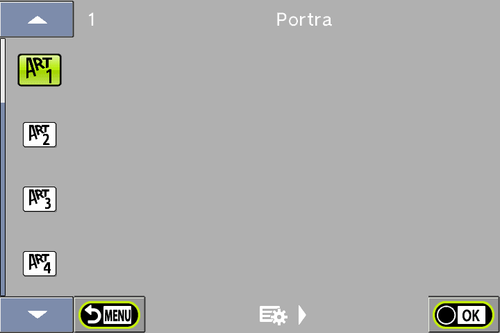

# EPM2Mod


Repository containing the current work for creating a custom firmware mod for the Olympus PEN **E-PM2**. The goal is to unlock or add new features to this camera. Currently, we've implemented replacing the default art filters with film simulations like Portra, Ektachrome, etc., enabled interval shooting (up to 240 shots), and added a level gauge.

| Feature | What you get | Status |
|---|---|---|
| **Film looks** | Seven film emulations as art filters, for stills and live view | Tested on the camera |
| **Interval shooting** | 1 to 240 frames, start delay, interval, optional time-lapse movie | Tested on the camera |
| **Level gauge** | Two tilt bars in live view | Tested on the camera |
| Focus peaking | Edge lines in live view while you focus by hand | In work |
| Video bitrate and recording limit | | Research only |

See below for an example of the film looks:


Each row shows one RAW file. The camera developed the file with each look. The first column shows the standard Natural mode.
Full-resolution sheet: [docs/film-sim-comparison.pdf](docs/film-sim-comparison.pdf).

## Film looks

Select **ART** on the camera. Seven of the art filters are now film looks. They work for photos and
live view.



<!-- BEGIN GENERATED: films -->
| Menu name | Film | Replaces |
|---|---|---|
| Portra | Kodak Portra 400 (negative, on Kodak Portra Endura paper) | Pop Art |
| Ektachrome | Kodak Ektachrome 100 (slide) | Soft Focus |
| Pro 400H | Fuji Pro 400H (negative, on Fuji Crystal Archive paper) | Pale&amp;Light Color |
| Kodachrome | Kodak Kodachrome 64 (slide) | Light Tone |
| Vis 250D | Kodak Vision3 250D (cinema negative, on Kodak 2383 print film) | Pin Hole |
| Velvia | Fuji Velvia 100 (slide) | Diorama |
| Superia 400 | Fuji Superia X-tra 400 (negative, on Fuji Crystal Archive paper) | Cross Process |
<!-- END GENERATED: films -->

The other five art filters do not change. A look changes colour and tone only: no grain, no
halation. Details: [docs/film-emulation.md](docs/film-emulation.md).

## Interval shooting

**MENU → Shooting Menu 2 → Time Lapse Settings.** Set the number of frames (1 to 240), the start
delay, the interval, and whether the camera makes a time-lapse movie at the end.

## Level gauge

1. **MENU → Custom Menu (gears) → D → Info Settings → LV-Info → Level Gauge → OK.**
   If the gears tab is not there: Setup Menu (wrench) → Menu Display → switch the Custom Menu on.
2. In live view, press **INFO** until the two bars show.

 

## Install

<!-- BEGIN GENERATED: pinned-build -->
The pinned build is **`seven-films-6-interval-240-level`**: seven film looks as art filters, interval shooting with up to 240 frames, and the level gauge. We tested this build on a real E-PM2 on 2026-11-14 ([camera log](docs/camera-log.md)).

| | sha256 |
|---|---|
| Stock firmware, `OLY_E_101_1600_0000_0000.BIN` | `34d339ac3986ba8c10f494dbe2e4ae8f143ebf5bbfaa356e3ff9b7f40fc3e300` |
| Pinned build, `seven-films-6-interval-240-level` | `3e7f793ea74b21dab19c61eac33fe1f818d9c627e4fa522a2551ea62fc32c7f6` |
<!-- END GENERATED: pinned-build -->

You need [uv](https://docs.astral.sh/uv/getting-started/installation/), an SD card, a full battery,
and an E-PM2 on firmware 1.6 (Setup Menu → Firmware).

1. Get this repository (**Code → Download ZIP**, or `git clone`) and open a terminal in its folder.
2. Put the SD card in the computer and run this command with the location of the card:

   ```bash
   uv run tools/make_firmware.py --card /Volumes/NAME
   ```

   The script downloads the maker's firmware, applies the patches, checks the result and writes it
   to the card. It stops with a message if a step fails. This repository contains no firmware.
3. Put the card in the camera. With the camera off, hold **OK** and switch the camera on.
4. Wait about one minute while the lamp is orange. Do not touch the camera. When the lamp blinks,
   switch the camera off and on.

To go back to the original firmware: `uv run tools/fetch_stock.py`, copy the file it names to the
card as `DCOLYMP/E1019999.BIN`, then do steps 3 and 4. More: [docs/flashing.md](docs/flashing.md).

**Use this firmware at your own risk.** It is unofficial and only for the E-PM2 with firmware 1.6.
An interrupted update can make a camera unusable. Never put a firmware file for another camera on
the card.

## Limits

- A movie gets only a part of each film look.
- Type II of Portra, Pro 400H and Superia is the same as type I.
- The level gauge has no calibration menu yet.
- Each interval frame uses the mechanical shutter.

## For developers

Start with [docs/conventions.md](docs/conventions.md) (layout, builds, tests),
[docs/feasibility.md](docs/feasibility.md) (what is possible, the emulator) and
[docs/todo.md](docs/todo.md). Rules for AI agents: [AGENTS.md](AGENTS.md). Every camera update is in
[docs/camera-log.md](docs/camera-log.md).

<details>
<summary>Tested builds</summary>

<!-- BEGIN GENERATED: builds -->
| Build | What | Patch specs | Camera-tested | sha256 |
|---|---|---|---|---|
| `seven-films-6-interval-240-level` (pinned) | Seven film looks as art filters, interval shooting with up to 240 frames, and the level gauge | 10 | 2026-11-14 | `3e7f793ea74b21dab19c61eac33fe1f818d9c627e4fa522a2551ea62fc32c7f6` |
| `seven-films-6` | Seven film looks as art filters | 7 | 2026-11-13 | `5badb0796731b40a27ef015e57da134d7d793486d4c6262a3f483c1aae60fd05` |
| `seven-films-6-interval` | Seven film looks as art filters, and interval shooting with up to 99 frames | 8 | 2026-11-13 | `f52ea6976ac2e9c567b2c07d7556b96b6431c8fcd2d90de195abdb76059e0104` |
| `seven-films-6-interval-240` | Seven film looks as art filters, and interval shooting with up to 240 frames | 9 | 2026-11-13 | `01837f962f8a8ca0d189d9cd65ad9b5b35402ca3f3ed54a3872af044e050de11` |
<!-- END GENERATED: builds -->

Make one with `uv run tools/make_firmware.py builds/NAME.json`.

</details>

## Licence

[MIT](LICENSE). The film look data is derived from
[spektrafilm](https://github.com/andreavolpato/spektrafilm) (CC BY-SA 4.0). The firmware and the
camera screens shown here belong to Olympus. Details: [NOTICE.md](NOTICE.md).
