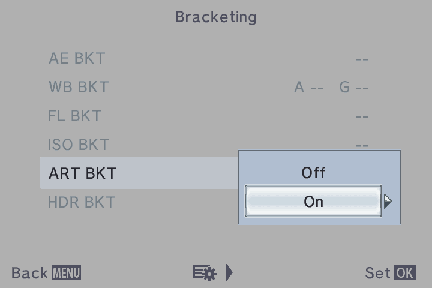
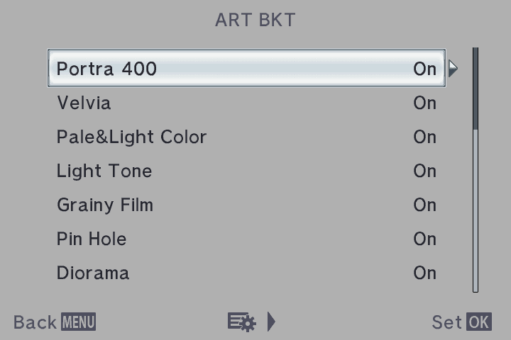
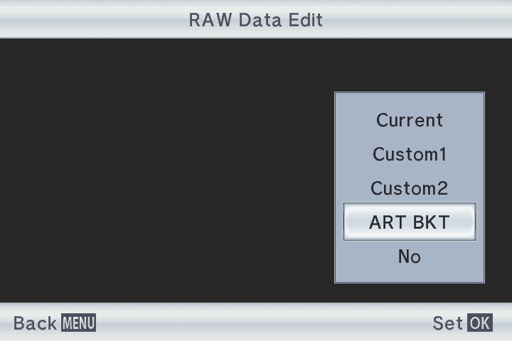

# ART BKT in RAW Data Edit

ART BKT in RAW Data Edit develops one RAW photo in each film simulation you choose, in the camera, so you can compare
them side by side without a computer.

## Setup

Choose the film simulations once. Go to **MENU → SETUP → Shooting Menu 2 → Bracketing → ART BKT**, press **RIGHT**,
highlight **On** without pressing **OK**, and press **RIGHT** again.

The **ART BKT** screen lists the 12 ART entries under the names of your film simulations, then the Picture Modes. For
each row you want, press **RIGHT**, choose **On** or **Off**, and press **OK**. Press **MENU** to leave.

## Usage

1. Set the Picture Mode you want as the reference, for example Natural.
2. Press the playback button, show a RAW photo, and press **OK**. Select **RAW Data Edit**, press **OK**, select
   **ART BKT**, and press **OK**.

   
3. Select **Yes** and press **OK**. Wait until the camera asks **Reset** or **No**.
4. Select **No** and press **OK** to go back to playback.

You get one JPEG in the current Picture Mode, then one for each row that is On, in the order of the ART BKT screen.
Each JPEG records the name of its film simulation in its Image Description, so a photo viewer shows which is which.

## Limits

- A row set to the Olympus art filter Dramatic Tone, Key Line or Watercolor gives a JPEG with Natural's brightness and
  colors.

For implementation details, see the [notes](../../experiments/2026-11-24-artbkt-production/NOTES.md).
