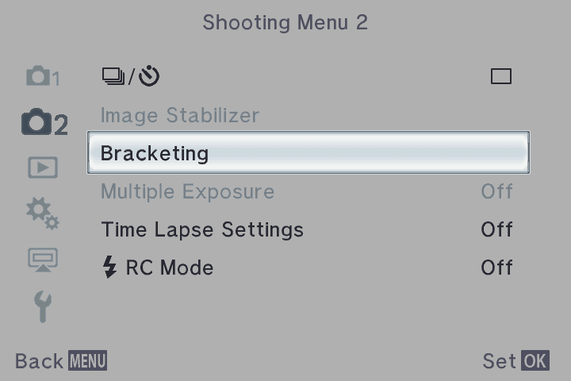

# Broken Image Stabilizer

Some E-PM2 cameras have a broken image stabilizer: the IS icon blinks when you turn the camera on. EPM2Mod has a
version for these cameras that does not use the stabilizer, so the camera starts without the blinking icon and
about a second sooner.

## Setup

In the installer, on **Choose what to install**, select **EPM2Mod**, open **Other options**, and select
**My camera's image stabilizer is broken**. Then go on as for a normal install.

From the command line: `epm2mod install --card /path/to/card --no-stabilizer`.

## Usage

There is nothing to switch on. **MENU → SETUP → Shooting Menu 2 → Image Stabilizer** is grayed out, and so is the
stabilizer item of the live control.

## Limits

- The camera has no image stabilization, for photos or for movies.
- The camera still makes a short noise when you turn it on.
- On a camera whose stabilizer works, this version turns stabilization off. To turn it back on, install EPM2Mod
  again without the option.

For implementation details, see the [notes](../../experiments/2026-11-27-no-ibis/NOTES.md).
