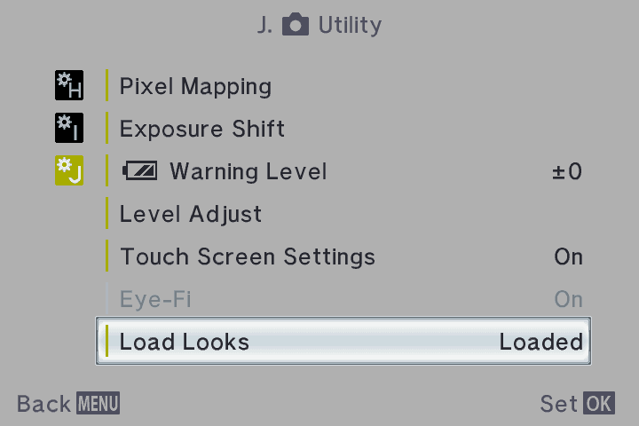

# Looks from the SD Card

Load your own film looks into any of the twelve film entries from a file on the SD card. The camera keeps them,
with their names, after power-off and without the card.

## Make a file

List one look per entry (`entry` is the stock name in [Film Simulations](film-looks.md), column "Replaces"):

```json
{"looks": [
  {"entry": "Pale&Light Color", "name": "Portra 800", "fit": "looks/fits/portra800.npz"}
]}
```

Then run `uv run epm2mod looks pack MYLOOKS.json -o EPM2LOOK.BIN`. A name has up to 16 letters. Entries the file does
not list keep their built-in look.

## Load

1. Copy the file to the top folder of the card as **EPM2LOOK.BIN**.
2. MENU → Custom Menu → J → **Load Looks** → **Load** → OK. The row reads Loading, then **Loaded** at the next key.




The entry shows the look's name everywhere the camera shows a film name.


You can delete the file. **Built-in** in the same row brings back the built-in looks. **No file** or **Bad file**
means nothing changed. No Custom Menu tab (gears icon): enable it in **Setup Menu → Menu Display**.

## Limits

- The row's texts are English in every menu language.
- No look has grain. Double-X has had none since this build.

File format, for a program that writes looks: [look-file-format.md](../look-file-format.md). Design and tests:
[card-looks design](../../experiments/2026-11-17-card-looks/design.md).
