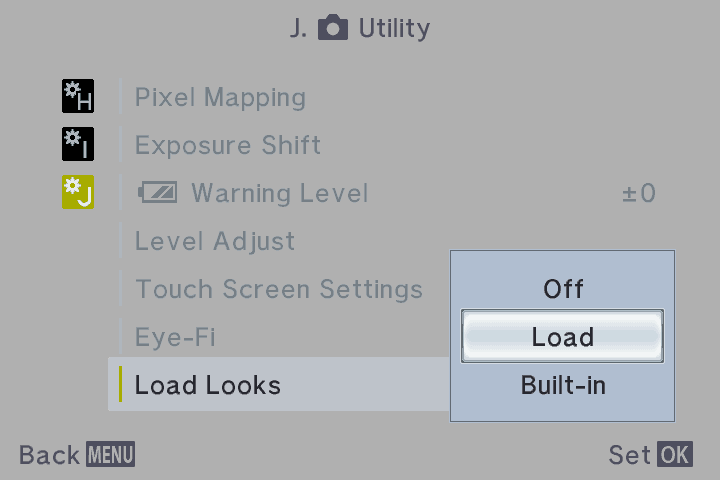

# Looks from the SD Card

Load your own film looks into any of the twelve film entries from a file on the SD card. The camera keeps them,
with their names, after power-off and without the card.

## Make a file

`uv run epm2mod looks list` shows the 19 films you can choose. Pick a film for any ART number the camera shows, with
the card in the computer:

```sh
uv run epm2mod looks pack ART2=velvia ART6=double-x "ART12=vision3-500t:Cinestill 800T" --card /path/to/card
```

The text after `:` is the name the camera shows (up to 16 letters). ART numbers you do not list keep their built-in
look. Without `--card` the file goes to `build/EPM2LOOK.BIN`. Copy it to the top folder of the card.

## Load

MENU → Custom Menu → J → **Load Looks** → **Load** → OK. The row reads Loading, then **Loaded** at the next key.




The entry shows the look's name everywhere the camera shows a film name.


You can delete the file. **Built-in** in the same row brings back the built-in looks. **No file** or **Bad file**
means nothing changed. No Custom Menu tab (gears icon): enable it in **Setup Menu → Menu Display**.

## Limits

- The row's texts are English in every menu language.
- No look has grain. Double-X has had none since this build.

File format, for a program that writes looks: [look-file-format.md](../look-file-format.md). Design and tests:
[card-looks design](../../experiments/2026-11-17-card-looks/design.md).
