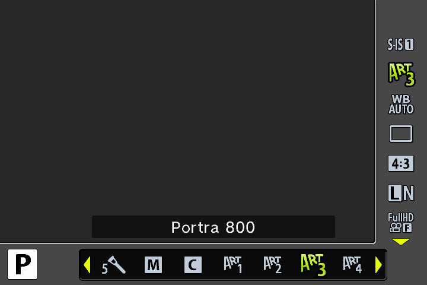

# Looks from the SD Card

The camera comes with the Olympus art filters. A file on the SD card puts a film in each ART entry it lists. The
camera keeps them, with their names, after power-off and without the card.

## Make a file

The installer always writes the file, with the 12 default film simulations or your choice. On the command line, put a film simulation in each ART slot with `--film`. ART1 is the first entry of the camera's ART menu (Pop Art), ART12 the last (Watercolor). A slot you leave out keeps its Olympus art filter. Change any film simulation in this command (the names are in the [film table](film-looks.md#available-film-simulations) and in `uv run epm2mod films`, and
`uv run epm2mod cards` shows the card's folder):

```sh
uv run epm2mod films set --card /path/to/card --film ART1=portra-400 --film ART2=ektachrome --film ART3=pro-400h --film ART4=kodachrome --film ART5=double-x --film ART6=vision3-250d --film ART7=velvia --film ART8=superia-400 --film ART9=provia --film ART10=portra-160 --film ART11=gold-200 --film ART12=vision3-500t
```

It writes `EPM2LOOK.BIN` to the top folder of the card. Without the card, use `-o FILE` and copy the file there. The other options are in the [command-line reference](../cli.md).

## Load

MENU → SETUP → Custom Menu → J → **Load Looks** → **Load** → OK. The row reads Loading, then **Loaded** at the next key.


The entry shows the look's name everywhere the camera shows a film name.



Each Load replaces the last one: an entry the file leaves out goes back to its Olympus art filter. You can delete
the file. **No file**: `EPM2LOOK.BIN` is not in the top folder of the card. **Bad file**: the file is damaged or incomplete. Make it again. No Custom Menu tab (gears icon): enable it in **MENU → SETUP → Setup Menu (wrench tab) → Menu Display**.

## Limits

- The row's texts are English in every menu language.
- No look has grain.

File format, for a program that writes looks: [look-file-format.md](../look-file-format.md). Design and tests:
[card-looks design](../../experiments/2026-11-17-card-looks/design.md).
