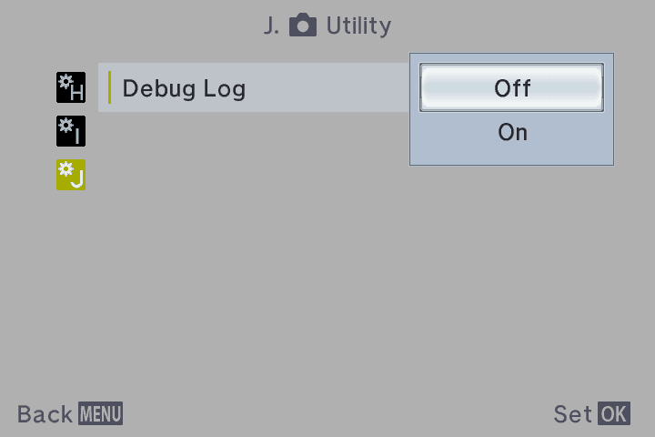
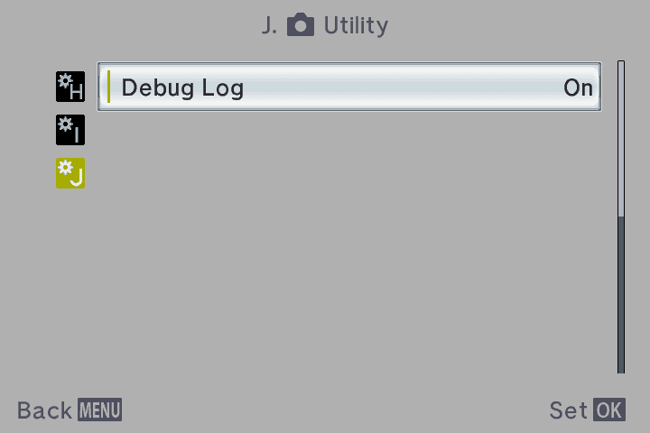

# Debug Log

The camera writes what it does to a file on the card.

## Setup

Go to **MENU → SETUP → Custom Menu → J**, press **DOWN** past Load Looks to **Debug Log**, select **On**, and press **OK**.

If the menu has no Custom Menu tab (gears icon), enable it in **MENU → SETUP → Setup Menu (wrench tab) → Menu Display**.

## Usage

With **On**, the camera adds to `EPM2LOG.BIN` in the top folder of the card each time you open a menu or playback, and
at power-off. With the command-line install, `uv run epm2mod log EPM2LOG.BIN --summary` reads the file
([the log format](../logging.md)).

## Limits

- **Off** is the default. With Off the camera writes no file and keeps no record after start-up.
- The file stops growing at 4 MiB. Delete it to go on.
- The row's texts are English in every menu language.
