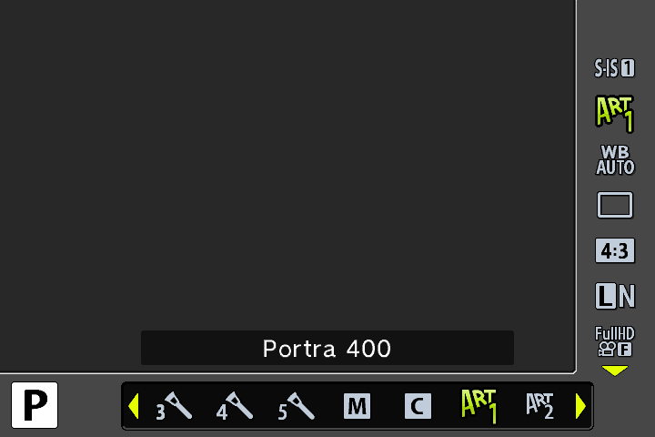

# Film Simulations

The camera comes with the Olympus art filters. Load Looks puts the film simulations in their place. They work for
photos and live view.

## Usage

Install with the installer, which puts the films on the SD card. Then MENU → Custom Menu → J → **Load Looks** →
**Load** → OK ([more](card-looks.md)).

In P, A, S or M mode, press **OK**, select **Picture Mode**, and scroll right past Custom. The film simulations are also in the **ART** mode list.

## Available Films

<!-- BEGIN GENERATED: films -->
| Menu name | Film | Replaces |
|---|---|---|
| Portra 400 | Kodak Portra 400 (negative, on Kodak Portra Endura paper) | Pop Art |
| Ektachrome | Kodak Ektachrome 100 (slide) | Soft Focus |
| Pro 400H | Fuji Pro 400H (negative, on Fuji Crystal Archive paper) | Pale&amp;Light Color |
| Kodachrome | Kodak Kodachrome 64 (slide) | Light Tone |
| Double-X | Kodak Double-X 5222 (black-and-white negative, on Kodak 2302 print film) | Grainy Film |
| Vis 250D | Kodak Vision3 250D (cinema negative, on Kodak 2383 print film) | Pin Hole |
| Velvia | Fuji Velvia 100 (slide) | Diorama |
| Superia 400 | Fuji Superia X-tra 400 (negative, on Fuji Crystal Archive paper) | Cross Process |
| Provia | Fujifilm Provia 100F (slide) | Gentle Sepia |
| Portra 160 | Kodak Portra 160 (negative, on Kodak Portra Endura paper) | Dramatic Tone |
| Gold 200 | Kodak Gold 200 (negative, on Fuji Crystal Archive paper) | Key Line |
| Vis 500T | Kodak Vision3 500T (cinema negative, on Kodak 2383 print film) | Watercolor |
<!-- END GENERATED: films -->

## Limits

- The simulations change colour and tone only. There is no halation and no grain.
- The E-PM2 has no colour wheel. Newer Olympus cameras have a table for 12 colours in the image processor. Mods for those cameras let you change each of the 12 colours. The E-PM2 has a table for 6 colours only ([more](../feasibility.md#colour-wheel-and-twelve-colour-editors)).
- You can choose another film for any of them: [Looks from the SD card](card-looks.md).
- Movies only get part of each simulation.
- Filter Type and Add Effects do nothing in Double-X, Provia, Portra 160, Gold 200 and Vis 500T.
- The original art filters are not available in this build.

For how the simulations were made and measured, see [film emulation](../film-emulation.md).
