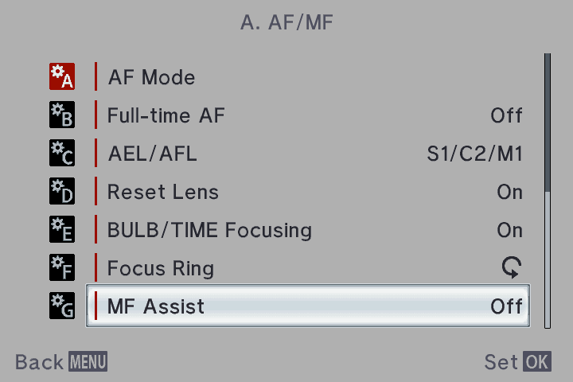

# Focus peaking

When you turn the focus ring, the view zooms in and shows thin light lines on the sharp edges.

**To switch it on:** MENU → Custom Menu (gears) → **A** → **MF Assist** → **On**. Then set the
focus mode to **MF**.

**To use it:** turn the focus ring. The lines show in the zoomed view. They go away when the zoom
ends. The photo has no lines.

**Limits**

- The lines are thin.
- The lines show only in the zoomed view of MF Assist.

How it works: [../../experiments/2026-11-14-focus-peaking/NOTES.md](../../experiments/2026-11-14-focus-peaking/NOTES.md).
