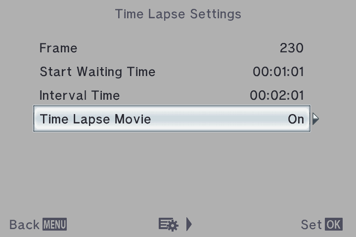

# Interval shooting

Set the mode to P, A, S or M and set the clock. Then: **MENU → Shooting Menu 2 → Time Lapse Settings → On.**

| Setting | Values |
|---|---|
| Frame | 1 to 99, then 100 to 240 in steps of 5 |
| Start Waiting Time | the delay before the first frame |
| Interval Time | the pause after one frame is saved, 1 second or more. The time between two frames is longer: about 3 seconds with a 1 second setting |
| Time Lapse Movie | On: the camera also makes a movie from the frames |

Press the shutter button to start the sequence. The camera stays on until the sequence ends.

**Limits**

- Each frame uses the mechanical shutter.
- The row is not available in iAUTO, ART and movie mode. For a film look, use **Picture Mode**.
- Not yet tested: 240 frames in one sequence, stopping a sequence, intervals over 90 seconds.

How it works: [../../experiments/2026-11-13-intervalometer/README.md](../../experiments/2026-11-13-intervalometer/README.md).
