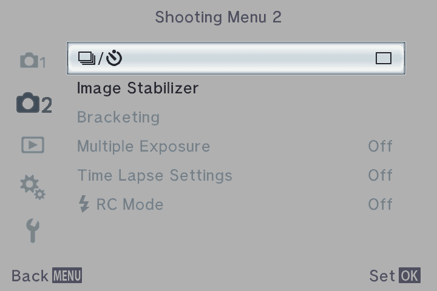

# Interval shooting

**MENU → Shooting Menu 2 → Time Lapse Settings → On.**

| Setting | Values |
|---|---|
| Frame | 1 to 99, then 100 to 240 in steps of 5 |
| Start Waiting Time | the delay before the first frame |
| Interval Time | 1 second or more |
| Time Lapse Movie | On: the camera also makes a movie from the frames |

Press the shutter button to start the sequence. The camera stays on until the sequence ends.

**Limits**

- Each frame uses the mechanical shutter.
- Not yet tested: 240 frames in one sequence, stopping a sequence, intervals over 90 seconds.

How it works: [../../experiments/2026-11-13-intervalometer/README.md](../../experiments/2026-11-13-intervalometer/README.md).
