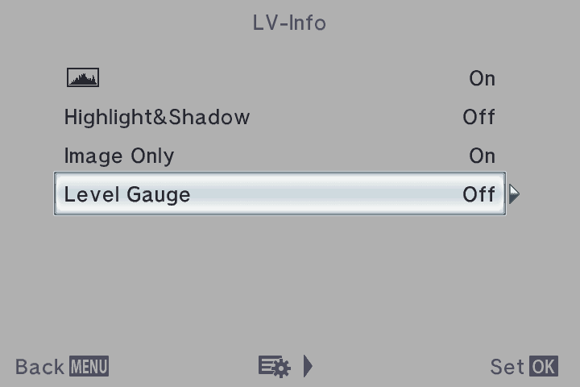
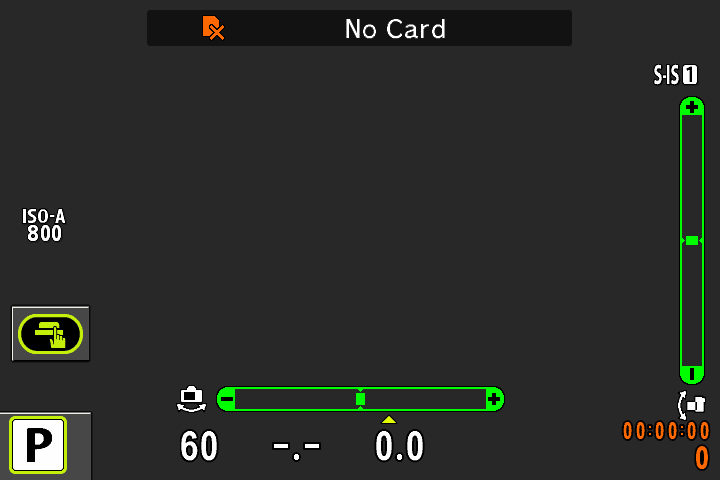
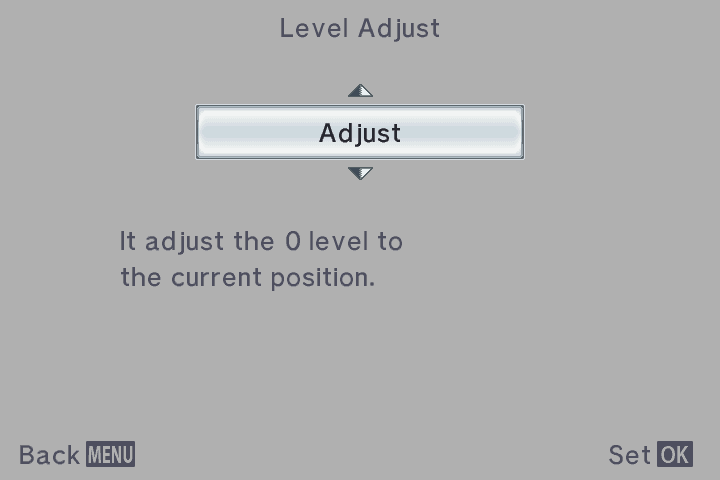

# Level Gauge

## Setup

Go to **MENU → SETUP → Custom Menu → D → Info Settings → LV-Info → Level Gauge** and press **OK**.

If the menu has no Custom Menu tab (gears icon), enable it in **MENU → SETUP → Setup Menu (wrench tab) → Menu Display**.

## Usage

In live view, press **INFO** until the two bars appear. A bar turns green when that axis is level. The shooting information stays on the screen, so you can check the exposure and ISO while you level the camera.

## Calibration

Put the camera on a flat surface. Go to **MENU → SETUP → Custom Menu → J → Level Adjust**, select **Adjust**, and press **OK**. Keep the camera still for 3 seconds. Select **Reset** to restore the factory values.

For implementation details, see the [level gauge notes](../../experiments/2026-11-14-level-gauge/NOTES.md).
