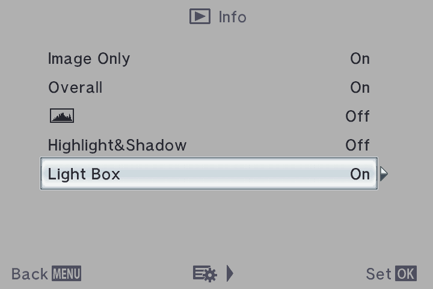
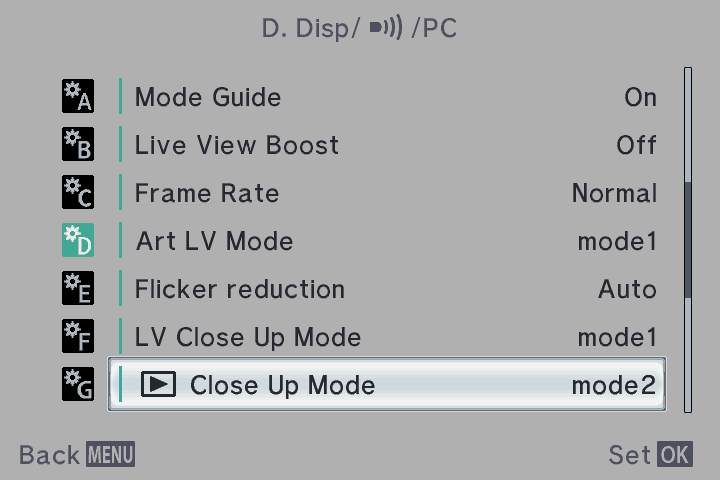

# Light Box

Light Box shows two pictures side by side in playback, so you can compare two similar shots for focus or expression.

## Setup

1. Go to **MENU → SETUP → Custom Menu → D → Info Settings → ▶ Info → Light Box**, press **RIGHT**, choose **On**,
   and press **OK** twice.
2. **▶ Close Up Mode** must be set to **mode2** to show Light Box: go to **MENU → SETUP → Custom Menu → D →
   ▶ Close Up Mode**, press **RIGHT**, choose **mode2**, and press **OK**.

If the menu has no Custom Menu tab (gears icon), enable it in **MENU → SETUP → Setup Menu (wrench tab) → Menu Display**.

## Usage

1. Press the playback button, then press **INFO** until two pictures show side by side.
2. Press **RIGHT** or **LEFT** to change the picture on the right, in the green frame.
3. Press **OK** to move that picture to the left side. Then step through the others on the right.
4. Turn the control dial to zoom in on both pictures, and scroll both with the arrow pad.

## Limits

- An **Fn** button set to **Magnify** does not zoom in playback. Zoom with the control dial.

For implementation details, see the [notes](../../experiments/2026-11-19-light-box/NOTES.md).
