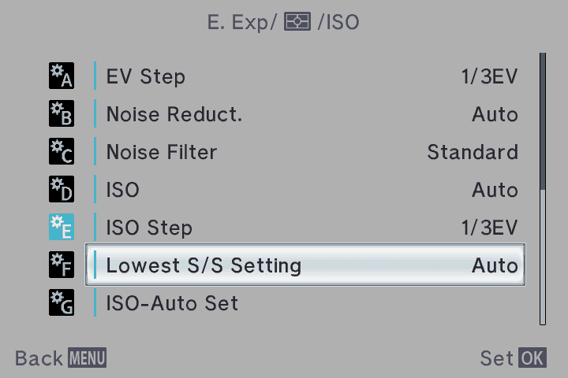
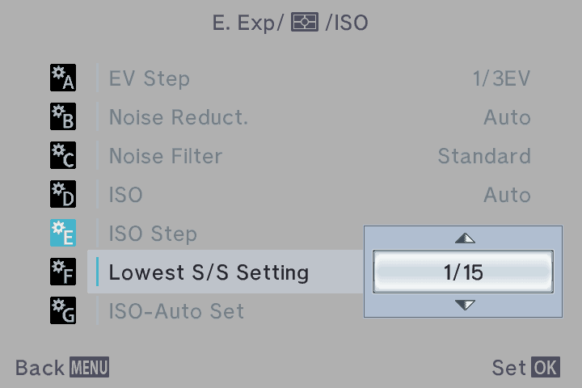

# Lowest S/S Setting

In P and A with ISO Auto, choose the shutter speed at which the camera starts to raise ISO.

## Setup

Go to **MENU → Custom Menu → E. Exp/▣/ISO → Lowest S/S Setting**, press **RIGHT**, choose a speed with **UP/DOWN**,
and press **OK**.

If the menu has no Custom Menu tab (gears icon), enable it in **Setup Menu → Menu Display**.

## Usage

- **Auto** (default): the camera works as before.
- **Faster, for moving subjects** (for example 1/250 for children, pets or indoor sports): the camera holds that speed
  and raises ISO, up to the High Limit of **ISO-Auto Set**. Then the shutter gets slower.
- **Slower, for still subjects** (for example 1/8 for interiors or dusk, hand-held with the stabiliser or on a
  tripod): the camera first slows the shutter down to that speed, then raises ISO. There is less noise, but moving things blur.

## Limits

- Only in **P** and **A**, with **ISO Auto** and **no flash**. Otherwise the setting has no effect.
- Values: Auto, 60" to 1/4000 in 1/3 EV steps.
- The row's texts are English in every menu language.

For implementation details, see the [notes](../../experiments/2026-11-17-auto-iso-min-shutter/NOTES.md) (sections 11 and 12).
