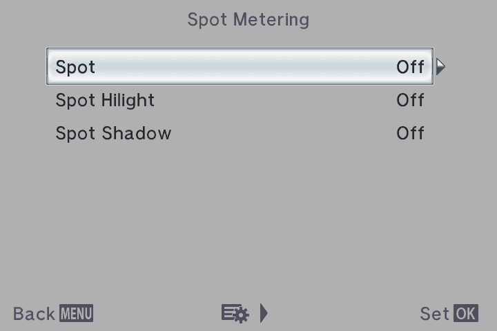

# Spot Metering

Spot metering measures the light at your AF point, not at the centre, so an off-centre subject gets the right
exposure without recomposing.

## Setup

Go to **MENU → SETUP → Custom Menu → E. Exp/▣/ISO → Spot Metering**, press **RIGHT**, select **Spot**,
**Spot Hilight** or **Spot Shadow** with **UP/DOWN**, press **RIGHT**, choose **On**, and press **OK**.

If the menu has no Custom Menu tab (gears icon), enable it in **MENU → SETUP → Setup Menu (wrench tab) → Menu Display**.

## Usage

1. Set the metering mode: press **OK**, then in the right column choose the metering item and select **Spot**,
   **Spot Hilight** or **Spot Shadow**. Its row on the Spot Metering page must be **On**.
2. Choose where to meter:
   - **Tap the subject** on the screen: the spot moves to the point you tap.
   - Or press **LEFT** and move a single AF target with the arrow keys: the spot moves with the target.

Rows set to **Off** (the default) meter at the centre, as before.

## Limits

- At the centre, as before: in **All Targets** with no point tapped, in **C-AF+TR**, in movies and in the magnified
  view.
- Faces are ignored: with **Face Priority** on, the camera meters at the AF point, not at the face.
- The row is greyed out in **iAUTO**.
- The **Spot Metering** row's name is English in every menu language.

For implementation details, see the [notes](../../experiments/2026-11-24-af-spot-metering/NOTES.md).
