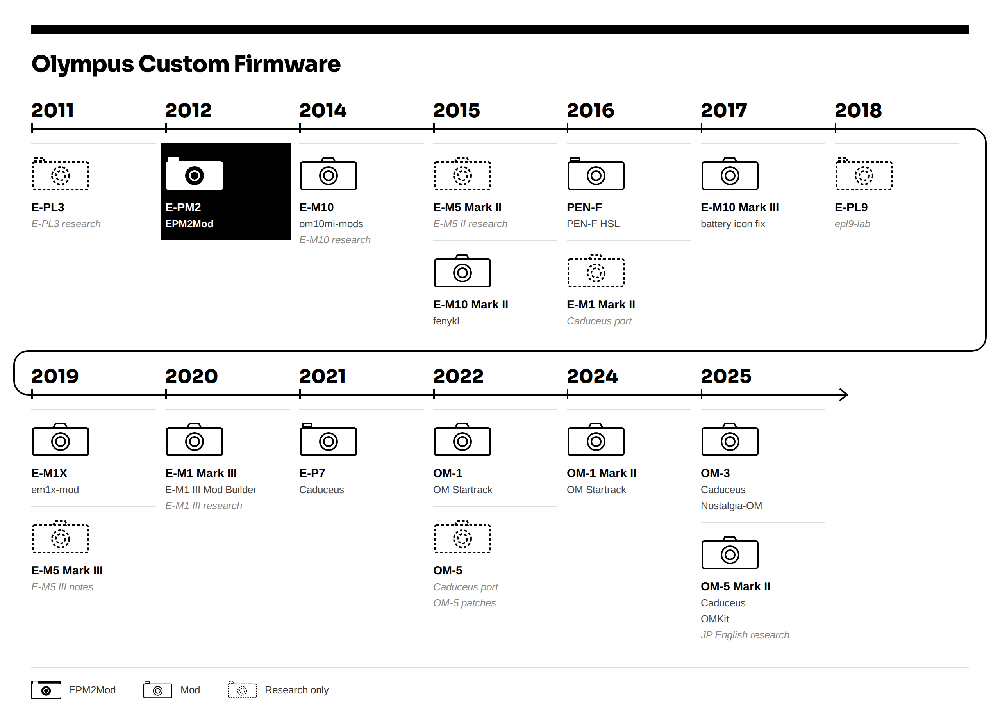

# Olympus Custom Firmware

The list holds the Olympus custom firmware projects we know of on 2026-11-26: those on GitHub, in the [OM Firmware Atlas](https://xulfr.github.io/om-firmware-atlas/), in Caduceus's [list of ports](https://github.com/cakelesscoder/caduceus-ep7/blob/main/docs/BODIES.md) and in the 43rumors roundups of [2026-11-21](https://www.43rumors.com/new-mft-hacking-roundup-e-pm2-gains-focus-peaking-e-p7-gets-150mbps-4k-and-more-om-3-upgrades/) and [2026-11-26](https://www.43rumors.com/micro-four-thirds-hacking-update-new-film-controls-focus-stacking-and-more/).

[db firmware](https://db-firmware-support.vercel.app/en) ([releases](https://github.com/azqeurio/om-c-firmware/releases)) is one desktop tool that patches 24 bodies, from the E-PL5 to the OM-5 Mark II. The E-PM2 is not one of them. It is not repeated in each row below.

| Announced | Camera | TruePic | Projects |
|---|---|---|---|
| 2011 | E-PL3 | VI | [E-PL3 research](https://github.com/sympho-ru/olympus-e-pl3-research) (research only) |
| 2012 | E-PM2 | VI | **EPM2Mod** |
| 2014 | E-M10 | VII | [om10mi-mods](https://meghnus.github.io/om10mi-mods/lut/), [E-M10 research](https://github.com/matozoid/em10_1) (research only) |
| 2015 | E-M5 Mark II | VII | [E-M5 II research](https://github.com/harshmandan/em5ii-fw) (research only) |
| 2015 | E-M10 Mark II | VII | [fenykl](https://github.com/atx/fenykl) |
| 2016 | PEN-F | VII | [PEN-F HSL](https://github.com/fishcu/oly_fw_analysis/releases) |
| 2016 | E-M1 Mark II | VIII | [Caduceus port](https://github.com/emudojo/caduceus) (research only) |
| 2017 | E-M10 Mark III | VIII | [battery icon fix](https://github.com/adrian3/olympus-e-m10-mark-iii-battery-icon-fix) |
| 2018 | E-PL9 | VIII | [epl9-lab](https://github.com/RemeraLl1/epl9-lab) (research only) |
| 2019 | E-M1X | VIII | [em1x-mod](https://github.com/bk2gf59w5d-ui/em1x-mod/releases) |
| 2019 | E-M5 Mark III | VIII | [E-M5 III notes](https://github.com/nsud-dev/olympus-firmware-notes) (research only) |
| 2020 | E-M1 Mark III | IX | [E-M1 III Mod Builder](https://github.com/dfeldt91-blip/E-M1-Miii/releases), [E-M1 III research](https://github.com/nivag8899/olympus-em1m3-research) (research only) |
| 2021 | E-P7 | VIII | [Caduceus](https://cakelesscoder.github.io/caduceus-ep7/) |
| 2022 | OM-1 | X | [OM Startrack](https://github.com/kingoflolz/om-startrack/releases) |
| 2022 | OM-5 | IX | [Caduceus port](https://github.com/tadejs/caduceus-om5) (research only), [OM-5 patches](https://github.com/przestaw/OM-5-firmware-patches) (research only) |
| 2024 | OM-1 Mark II | X | [OM Startrack](https://github.com/kingoflolz/om-startrack/releases) |
| 2025 | OM-3 | X | [Caduceus](https://androidfanman.github.io/caduceus-om3/), [Nostalgia-OM](https://github.com/SengokuCola/Nostalgia-OM/releases) |
| 2025 | OM-5 Mark II | IX | [Caduceus](https://xulfr.github.io/caduceus-om5/), [OMKit](https://github.com/necrostaz/omkit/releases), [JP English research](https://github.com/aabramovsky/om5-ii-jp-english-research) (research only) |

Sources for the years: [E-PL3](https://petapixel.com/2011/06/30/olympus-announces-three-new-pens-the-e-p3-e-pl3-and-e-pm1/), [E-PM2](https://www.bgr.com/general/olympus-pen-e-pl5-and-e-pm2-release-date-october/), [PEN-F](https://old.imaging-resource.com/news/2016/01/27/brains-meets-beauty-new-olympus-pen-f-offers-premium-design-with-a-healthy), [E-M5 Mark II](https://www.engadget.com/2015/02/05/olympus-om-d-e-m5-mark-ii/), [E-M10 Mark II](https://photorumors.com/2015/08/25/olympus-om-d-e-m10-mark-ii-camera-officially-announced/), [E-M1X](https://www.sansmirror.com/newsviews-2/newsviews/2019-mirrorless-camera/jan-mar-2019-mirrorless/olympus-introduces-pro-e.html), [E-M5 Mark III](https://newsshooter.com/2019/10/17/olympus-releases-om-d-e-m5-mark-iii), [E-P7](https://old.imaging-resource.com/news/2021/06/09/olympus-announces-pen-e-p7-camera-for-international-markets), [OM-1](https://petapixel.com/2022/02/14/om-digital-unveils-om-1-camera-with-a-new-sensor-and-quad-pixel-af), [OM-5](https://www.photographyblog.com/news/om_system_om_5), [OM-1 Mark II](https://www.capturemag.com.au/news/om-system-announces-om-1-mark-ii), [OM-3](https://petapixel.com/2025/02/05/om-system-om-3-is-a-stylish-more-fun-om-1-ii-with-nearly-all-the-performance), [OM-5 Mark II](https://petapixel.com/2025/06/16/the-om-system-om-5-mark-ii-is-a-refined-compact-travel-camera).

## Hardware Generations

A body's image processor generation (TruePic VI to X) decides what carries over between bodies. Within one generation
a port is possible but still work: Caduceus finds 36 % of its E-P7 edits in the E-M5 III (below). Across
generations a mod is rewritten. Every generation runs its
main code on the same CPU family, Panasonic MN103 ([model matrix](model-matrix.md), which has the details and what
each kind of mod needs per generation):

| TruePic | Years | Firmware | Processors | Mods in the table |
|---|---|---|---|---|
| VI | 2011–13 | 13.5–15 MiB, not compressed; the load address differs per body | Two MN103 cores, no network processor | EPM2Mod, E-PL3 research |
| VII | 2013–16 | 17–20 MiB; the E-M5 II, E-M10 II and PEN-F use the load address of today's bodies | MN103 | om10mi-mods, fenykl, PEN-F HSL, E-M5 II research |
| VIII | 2016–21 | 22–26 MiB | MN103, and a Cortex-A9 for networking | Caduceus E-P7 and its ports, em1x-mod, the E-PL9 and E-M5 III work, battery icon fix |
| IX | 2020–25 | 19.5–26 MiB; the E-M1 III and OM-5 store compressed code | MN103, and a Cortex-A9 | E-M1 III Mod Builder, Caduceus and OMKit on the OM-5 II, the OM-5 ports |
| X | 2022–25 | 32 MiB, compressed resources, a new hardware register map | MN103, and a Cortex-A53 running Linux | Caduceus OM-3, Nostalgia-OM, OM Startrack |

The E-PM2 shares TruePic VI only with the E-PL3, E-PL5, E-PL6, E-P5, STYLUS 1 and TG-2. The E-PL3 is not in the
firmware survey that the model matrix is made from; its generation comes from its announcement year (I).

## Why EPM2Mod Is Not a Fork

The other projects change newer bodies. Their edits do not carry over to the E-PM2
([Caduceus review](../../experiments/2026-11-11-caduceus-review/01-methods-safety.md#2-what-applies-to-the-e-pm2)):

- **Different code.** The E-PM2's code is about 14 MB and runs at 0x7E421020. The E-P7's code is about 26 MB and
  runs at 0x60020020. An edit is made at an address in one firmware, so no edit is at the same place in the other
  ([model matrix](model-matrix.md)).
- **Edits do not carry over even to close bodies.** Caduceus's own byte-pattern check finds 36 % of its E-P7 edits
  in the E-M5 Mark III, which has the same processor generation (TruePic VIII). The E-PM2 is two generations older
  (TruePic VI).
- **No Colour Profiles.** Caduceus's looks and its colour editor change the COLOR 1–4 Colour Profiles. The E-PM2
  has no Colour Profiles, so EPM2Mod puts each film simulation in an ART entry
  ([colour pipeline](../dev/colour-pipeline.md#2-from-a-menu-entry-to-the-stages)).
- **No colour wheel in live view or movies.** The E-PM2's 12-colour stage works on photos only
  ([feasibility](../dev/feasibility.md#colour-wheel-and-twelve-colour-editors)).
