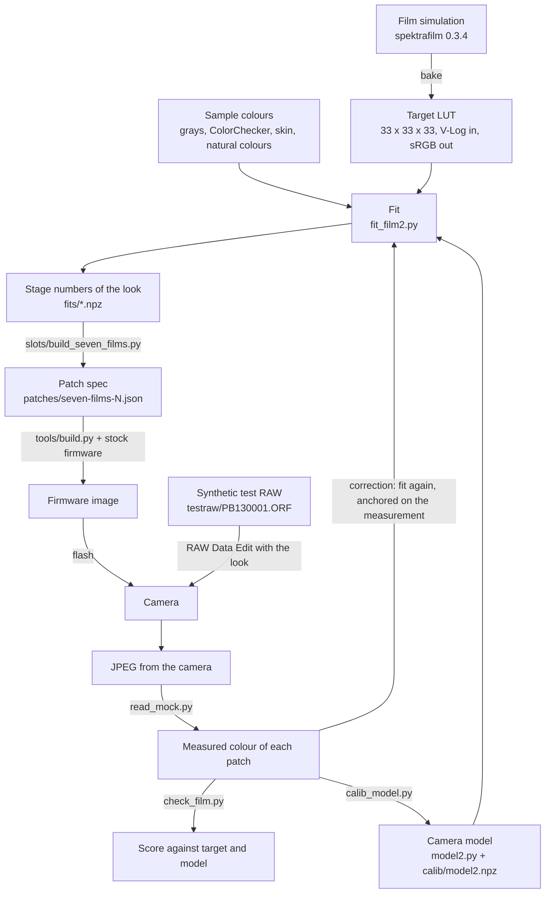
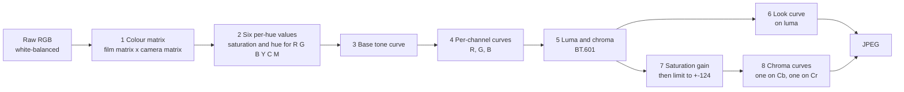
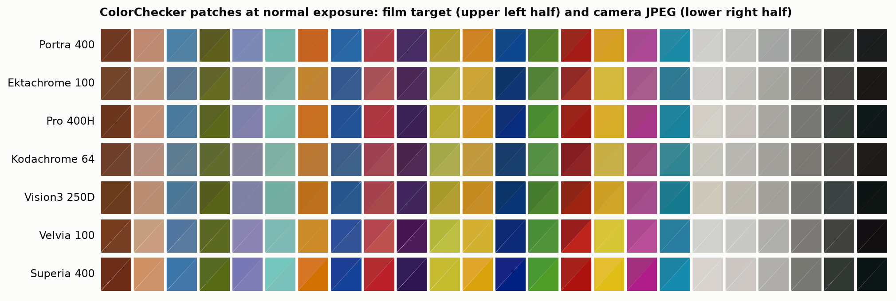
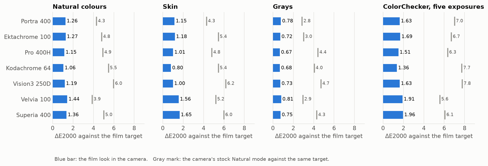
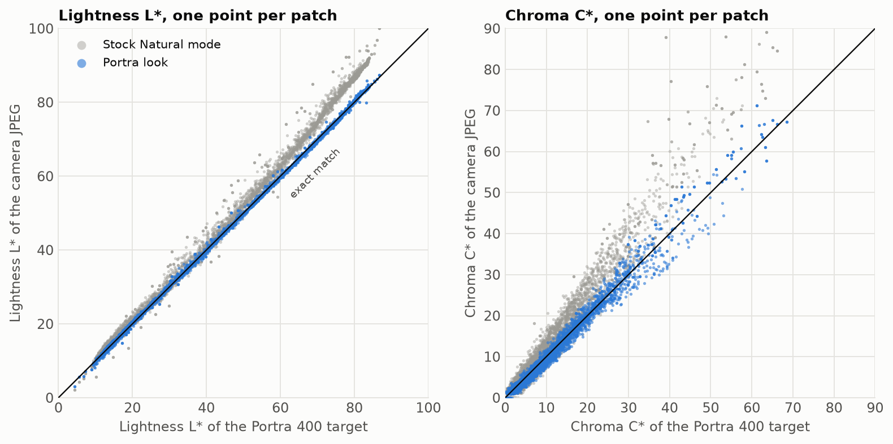
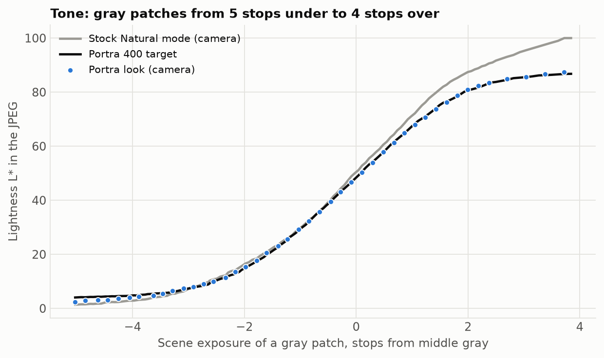
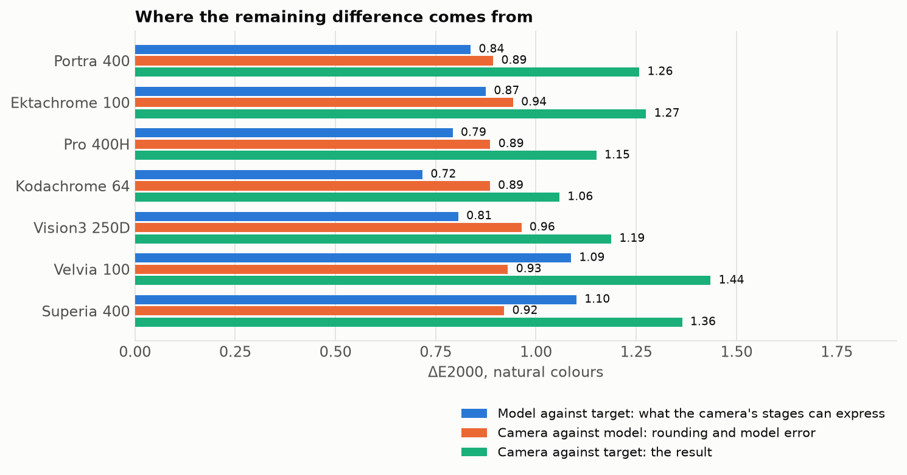
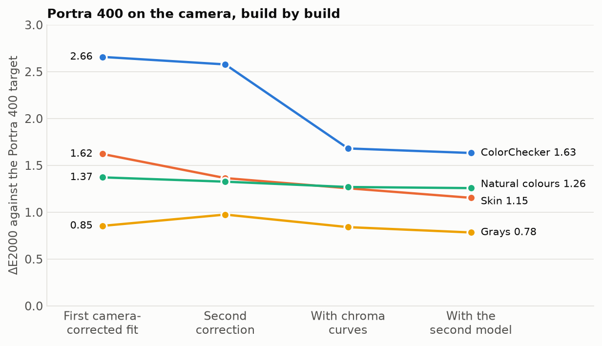

# Film looks in the E-PM2's art-filter slots

This folder holds the work behind the seven film looks: the method, the camera model, the fits, the
measurements and the scripts. For a shorter, less technical account, read
[`docs/film-emulation.md`](../../docs/film-emulation.md). The dated lab notes, with every dead end,
are in [`NOTES.md`](NOTES.md).

## What we did

The camera has no film mode and no general colour lookup table. A picture mode or art filter is a
set of numbers for a fixed chain of processing stages: a colour matrix, tone curves, per-hue
saturation and hue values, a saturation gain and two chroma curves.

We did four things:

1. **Found the stages and their tables in the firmware.** For each art filter we found where its
   numbers are stored and which code selects them.
2. **Built a model of the camera's processing.** The model predicts the JPEG from the raw values and
   a set of stage numbers.
3. **Fitted the stage numbers** so that the camera's output is as near as possible to a film
   simulation. The simulation is the target.
4. **Wrote the numbers into seven art-filter slots**, flashed the camera, and measured the result
   with a synthetic test image. Then we corrected the fit against the measurement.

The result: seven film looks that the camera applies itself, to stills and to live view.

## How we did it



The loop on the right is the important part. A fit made with the model alone lands near the target.
One correction against the camera's own output then removes most of the model's error, because the
second fit starts from what the camera did and uses the model only for the change.

### The synthetic test image

A photographed colour chart has too few colours, and its true colours are not known exactly. So we
write our own RAW file. `orfcodec.py` is an encoder for Olympus's compressed raw format.
`make_mock2.py` uses it to write a 16-megapixel raw with 6,912 flat patches whose raw values we
chose. The camera develops this file like its own (Playback → Edit → RAW Data Edit), with any
picture mode or art filter.

| Patches | Number | Purpose |
|---|---|---|
| Natural colours | 3,535 | the main body of the fit; random colours with a bias to low saturation |
| Hold-out colours | 1,000 | never used in a fit; they show if a fit only memorised its samples |
| ColorChecker at −2, −1, 0, +1, +2 stops | 336 | the 24 chart colours at five exposures |
| Skin series | 45 | steps between the two skin patches, at nine exposures |
| Grays | 132 | 5 stops under to 4 stops over middle gray |
| Dense gray ramp, near-neutrals | 512, 576 | tone and colour casts |
| Out-of-range colours | 300 | colours so saturated that a channel goes negative after the colour matrix |
| RGB cube, markers | 343, 133 | coverage, and the marks that locate the grid in the JPEG |

A second file, `PB130002.ORF`, repeats 2,200 of the patches inside a frame that is mostly sky blue.
It checks that the camera's result does not depend on the rest of the picture. It does not: the
shared patches came out the same, within one level.

## Data in, data out

**In**

| Data | Form | From |
|---|---|---|
| Stock firmware, E-PM2 v1.6 | `OLY_E_101_1600_0000_0000.BIN` (not in git) | Olympus |
| Film targets | one `.cube` LUT per film, 33³, V-Log in, sRGB out, exposure 0 EV (not in git) | spektrafilm 0.3.4: `spektrafilm-lut` for negatives with a print paper, `bake_slide.py` for slide films |
| Sample set and weights | grays 150, ColorChecker 20, skin patches 60, natural colours 1 | GRKit's choices, in `fit_look.py` |
| Camera developments of the test RAW | JPEG, one per look or picture mode (not in git) | the camera |
| Two tone tables, the matrix rounding rule, the table addresses | read from the firmware | `CODE_DIG.md`, `docs/art-filter-slots.md` |

**Out**

| Data | Form | Where |
|---|---|---|
| Synthetic test RAWs and their patch layouts | `.ORF`, `.npz` | `testraw/` |
| Camera model constants | 12 direction vectors, exposure scale, saturation scale, chroma limit | `calib/model2.npz` |
| The seven looks | per film: 3 curves × 1,024 points, gain, 6 + 6 per-hue values, 3 × 3 matrix, 2 chroma curves | `fits/*.npz` |
| The seven looks as firmware bytes | patch spec: address, expected bytes, new bytes | `patches/seven-films-5.json` |
| Patch readings | per JPEG: RGB of each patch | `out/mock/read_*.npz` (not in git) |
| Scores | ΔE2000 per group | the tables and figures below |

## The camera model

`model2.py` predicts the JPEG the camera writes from the white-balanced raw values and the numbers
of a look.



| # | Stage | Where its numbers come from |
|---|---|---|
| 1 | Colour matrix, rounded by the camera's own rule | rule read from the firmware code; the result is in each JPEG's EXIF |
| 2 | Six per-hue values, modelled as 12 direction vectors in linear RGB | vectors fitted on developments of the test image |
| 3 | Base tone curve, one table for all channels | read from the firmware |
| 4 | Per-channel curves | the look |
| 5, 6 | Luma, and the look curve (the stock "identity" table has a highlight shoulder) | read from the firmware |
| 7 | Saturation: chroma × gain × 0.003839 | scale fitted on the test image |
| 8 | Chroma curves, 16 knots each | format decoded from the firmware, checked on the camera |

In pseudocode:

```text
function camera(raw, look):
    v  = look.matrix_as_loaded * raw                       # linear RGB
    v  = v + sum over the six hue sectors of
             weight(v, sector) * (look.S[sector] * dir_sat[sector] + look.H[sector] * dir_hue[sector])
    g  = base_curve(K * v)                                  # a negative value keeps its sign: curve(-x) = -curve(x)
    b  = per_channel_curve[c](g[c])  for c in R, G, B       # the same rule for negative values
    y  = 0.299 b.R + 0.587 b.G + 0.114 b.B
    Y  = look_curve(max(y, 0))
    Cb = clamp(0.564 * sat * (b.B - y), -124, +124) + 128   # sat = look.gain * 0.003839
    Cr = clamp(0.713 * sat * (b.R - y), -124, +124) + 128
    Cb = chroma_curve_cb(Cb);  Cr = chroma_curve_cr(Cr)
    return clip(RGB(Y, Cb, Cr), 0, 255)
```

The fitted constants are in `calib/model2.npz`. `calib_model.py` fits them on 25 developments of the
test image with known settings (21 film builds and the four stock picture modes) and tests them on 7
more. No photographed chart is used.

**How well the model predicts the camera** (ΔE2000, mean; the seven developments of the final build,
which the calibration did not see):

| Group | Camera vs model |
|---|---|
| Natural colours | 0.92 |
| ColorChecker at five exposures | 0.87 |
| Skin series | 0.73 |
| Grays | 0.71 |
| Out-of-range colours | 1.15 |

The camera's rounding (8-bit JPEG, rounding at several stages) gives a floor of about 0.8 on natural
colours. The model is close to that floor.

## The fit

`fit_film2.py` finds the numbers of a look. All stages are fitted together.

```text
function fit(target_lut, samples, weights, measurement = none, previous_look = none):
    parameters = 3 curves (16 knots each), gain, 6 saturation values, 5 hue values (red hue fixed at 0),
                 6 off-diagonal matrix terms, 2 chroma curves (8 free heights each)

    function predicted(parameters):
        if there is a measurement of previous_look:
            # start from what the camera did; use the model only for the change
            before_curves = undo_chroma_curves(measurement, previous_look)
            pre = before_curves + model_before_curves(parameters) - model_before_curves(previous_look)
        else:
            pre = model_before_curves(parameters)
        return clip(apply_chroma_curves(pre, parameters))

    minimise  sum over samples of  weight * deltaE2000(predicted(parameters), target_lut(scene colour))
              + small terms that keep the curves smooth and the per-hue values moderate
    with a soft-L1 loss (scale 3), so that a few very large errors do not dominate

    round to what the camera stores: integers, the camera's matrix rounding, 8-bit curve knots
    fit the curves and the gain once more with the rounded values fixed
    return the look
```

Weights: grays 150, ColorChecker 20 (its two skin patches 60), natural colours 1 (GRKit's choices),
plus the skin series at 20, near-neutrals at 4, the dense gray ramp at 20 and the out-of-range
colours at 0.25.

## Results

Target: the spektrafilm simulation of each film. Scored on the patches of `PB130001.ORF`, developed
in the camera with build `seven-films-5` / `-6`. All numbers are ΔE2000, mean over the patches of a
group. A difference of about 1 is the smallest that an eye can see side by side.

### The colours, side by side

Each square is one ColorChecker patch at normal exposure. The upper left half is the film target.
The lower right half is what the camera wrote. Where you cannot see the diagonal, the match is good.



### Accuracy by group



| Group (patches) | Portra 400 | Ektachrome 100 | Pro 400H | Kodachrome 64 | Vision3 250D | Velvia 100 | Superia 400 |
|---|---|---|---|---|---|---|---|
| Natural colours (3,526) | 1.26 | 1.27 | 1.15 | 1.06 | 1.19 | 1.44 | 1.36 |
| Natural colours, 95th percentile | 2.55 | 2.91 | 2.44 | 2.29 | 2.55 | 3.25 | 2.82 |
| Hold-out colours, not in the fit (1,000) | 1.26 | 1.30 | 1.19 | 1.08 | 1.20 | 1.47 | 1.39 |
| Skin series (45) | 1.15 | 1.18 | 1.01 | 0.80 | 1.00 | 1.56 | 1.65 |
| Grays (132) | 0.78 | 0.72 | 0.67 | 0.68 | 0.73 | 0.81 | 0.75 |
| Near-neutrals (576) | 1.00 | 0.91 | 0.91 | 0.85 | 0.93 | 0.99 | 0.98 |
| ColorChecker at five exposures (335) | 1.63 | 1.69 | 1.51 | 1.36 | 1.63 | 1.91 | 1.96 |
| Out-of-range colours (299) | 14.1 | 13.9 | 15.0 | 15.8 | 12.7 | 16.8 | 12.0 |

The hold-out colours score the same as the fitted ones, so the fits did not memorise their samples.

### Is the fit a proper one? Patch by patch

One point per patch, for Portra 400. A point on the black line is an exact match. The gray points
are the camera's stock Natural mode against the same target: they show what the look had to change.



The tone of the gray patches, from 5 stops under to 4 stops over middle gray. The film target rolls
off the highlights and lifts the shadows a little. The look follows it.



### Where the remaining difference comes from

For natural colours, the result (camera against target) has two parts: what the camera's stages can
express (model against target), and rounding plus model error (camera against model).



| | Portra | Ektachrome | Pro 400H | Kodachrome | Vision3 | Velvia | Superia |
|---|---|---|---|---|---|---|---|
| Model vs target | 0.84 | 0.87 | 0.79 | 0.72 | 0.81 | 1.09 | 1.10 |
| Camera vs model | 0.89 | 0.94 | 0.89 | 0.89 | 0.96 | 0.93 | 0.92 |
| Camera vs target | 1.26 | 1.27 | 1.15 | 1.06 | 1.19 | 1.44 | 1.36 |

The two parts are about equal. A better model cannot remove much more: the second part is mostly
the camera's rounding.

### How the method improved

Portra 400 on the camera, at four steps of the method.



The large step is the chroma curves. Before them, no stage could reduce strong colour and leave
weak colour alone.

### Limits of these numbers

- The target is a simulation made from film datasheets. Nobody compared these looks with scans of
  real film.
- The scores are for the daylight (5300 K) matrix. Auto white balance uses the same matrix. With the
  Shade and Incandescent presets the model predicts changes of 0.05 or less on natural colours.
- Out-of-range colours cannot be matched. The camera limits chroma, and the stock Natural mode is
  no better against the same targets (14 to 22).
- The test image tests the camera's processing. It does not test the lens or the sensor's response
  to real light.
- Grain, halation and other spatial effects are not simulated.

## Files

| File | What |
|---|---|
| `NOTES.md` | dated lab notes, §1–47, in the order things happened |
| `CODE_DIG.md` | firmware addresses and what was read from the disassembly |
| `make_mock2.py`, `orfcodec.py`, `read_mock.py`, `mocklib.py` | the synthetic test RAW (with our own ORF encoder), and the reading of its patches from a camera JPEG |
| `model2.py`, `chroma.py`, `calib_model.py`, `eval_model.py` | the camera model, its chroma-curve stage, its calibration and its score against the camera |
| `fit_film2.py` | fits a film target with the model; `--anchor` for a correction round against a measurement |
| `check_film.py`, `make_figures.py`, `make_comparison.py` | score of one camera JPEG; the figures above; the photo comparison sheet |
| `bake_slide.py` | target LUT for slide films (spektrafilm with the print step off) |
| `slots/build_seven_films.py`, `slots/build_fixes.py`, `slots/build_movie_map.py` | write the patch specs of the current build |
| `slots/`, `slot3/` (other files) | assembly for the new code, and the generators of earlier builds |
| `fits/`, `calib/`, `testraw/`, `figures/` | the seven looks, the model constants, the test RAWs, the figures |
| `fit_film.py`, `fit_xp9.py`, other `analyze_*`, `fit_*`, `check_*`, `extract.py`, `make_chart.py`, `make_mock.py` | earlier stages (photographed chart, first test image, first model); kept because NOTES refers to them |

Run the scripts from this folder. They need Python with numpy, scipy, numba, Pillow, rawpy and
matplotlib, and `exiftool`. Most also need the stock firmware block and the camera readings, which
are not in git: `shots/` (camera files) and `out/` (working fits, target LUTs, readings). The test
RAW generators and the patch generator work from the repository alone.

To add or change a film: see section 8 of [`docs/film-emulation.md`](../../docs/film-emulation.md).

The film look data in `fits/` and in the patch specs is derived from
[spektrafilm](https://github.com/andreavolpato/spektrafilm) by Andrea Volpato (CC BY-SA 4.0). See
[`NOTICE.md`](../../NOTICE.md).
