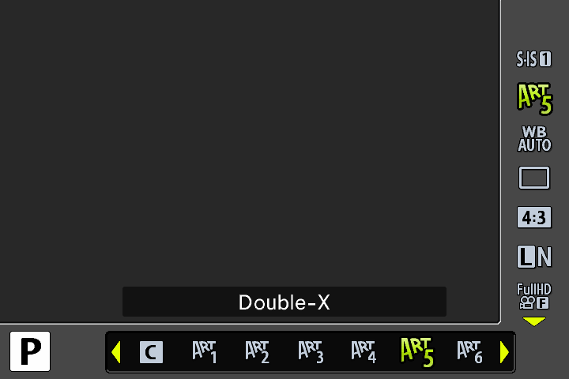

# Double-X: the first black-and-white film look (2026-11-16)

Owner: "lets try it". Kodak Double-X 5222 printed on Kodak 2302, fitted from the spektrafilm `dev` branch, in
the Grainy Film entry with that entry's grain program.

Candidate build `builds/films-12-bw.json`. **Not camera-tested. Nothing was flashed.**

Labels: **V** = ran in the emulator, read in the firmware bytes, or measured on camera files that the film
experiment already has. **I** = inferred. **U** = unknown.



## 1. How the camera makes Grainy Film

| Question | Answer | Evidence |
|---|---|---|
| What makes the entry monochrome | The stored Picture Mode value 104, not the art code. It sets the monochrome flag of the job (job+192) and the toning type P+88; the block builder 0x7E56224C then switches on a toning block of the hardware (block+548, type word 0x01110003) | V: code read (0x7E56224C, 0x7E56B64E, 0x7E56D039; value tests at 0x7E70C674, 0x7E70E5B9, 0x7E7160BF) |
| Where in the pipeline the colour goes away | **At the end.** The grey value is the luma of the tone-coded picture, 0.299 R' + 0.587 G' + 0.114 B'. So everything before it sets how a colour turns into grey: matrix, six-axis, tone curves | V, camera: Monotone against Natural on the chart of 2026-11-09, 182 patches: 1.5 codes (two Natural shots differ by 1.35). "Tone curve of the linear luma" misses by 15.9. `results/model-check.txt` |
| Does the art matrix act in this path | Yes. The colour-matrix function 0x7E56C603 takes the art-matrix chain in every job of op class 0 or 1; the monochrome flag only adds the B&W filter matrix before it | V, emulator: the whole function run for art code 74 with the flag set writes the camera matrix on the stock image and the fitted matrix on the candidate, equal to the model's prediction (`results/stage-check-films-12-bw.txt`, step 4) |
| B&W filter (Yellow, Orange, Red, Green) | Four matrices 0x7E768EFE … (P+84 = 1 to 4), multiplied in the same function before the art matrix when job+192 is 1 or 2. If the entry has a filter set, both act | V code. U: whether this camera's menu offers the filter for Grainy Film |
| Picture tone (Sepia, Blue, …) | Types 5 to 8 of the same toning block. Not changed | V code |
| The six stages for codes 74 (still, live view) and 83 (movie tables) | Tone: the default record. Look: handler 0x7E56E917 = the stock straight tables 0x7E75B8F0 / 0x7E75B6F0, or **0x7E7620F0** (an S curve) for the variants 3, 5, 7 and 4 of P+99. Saturation, six-axis, chroma: default. Matrix: none | V, emulator (`stage_check.py`, `stage_check_bw.py`). I: the variants with the S curve are live view and movie (they have no grain program; the curve stands in for its contrast) |
| The grain program | `art_filter_06_rough_monochrome` 0x7E7229A3, effect hash 0x7E85C45C, the same for 74 and 104. Ten passes (table 0x7E8586B0); they send the developed picture through the image library again as jobs of op class 21 (class 2) | V code |
| Its contrast | In jobs of class 2 the look stage takes a table by art code (hash 0x7E78CBA8): **0x7E75EEF0 for 74 and 83**, 0x7E7600F0 for 104 and 105. 512 bytes each, loaded at one place only. The table of 74 is a hard S curve (slope up to 3.3) | V: code and the emulator run of that branch |
| Its grain | Noise is added before that table: the spread inside a patch is 1 code in black and white and 52 in mid grey, the shape of the table's slope. With a noise spread of 19.5 before the table the model gives 37 / 51 / 46 where the camera has 45 / 52 / 41 | V measured (test RAW developed with stock Grainy Film, reading `A_grainy_film`). I: the order. **U: where the amount and the size of the noise are set** (no constant found in the ten passes; they build jobs, the numbers are in the image library) |
| What is between the developed picture and the table | A smooth rising curve g (25 → 58, 121 → 154, 205 → 224). Not read in the code; measured: with g, the stock picture is the table of g(luma) to 1.8 codes on 3,526 natural colours and 1.1 on the grays, with no rest that depends on the colour | V measured. U outside luma 25 to 208 (the chart's range under the hard curve) |

**What a look can control in this entry:** the grey mix (the art matrix, by the chain compare), and the tone,
through the grain program's table for still pictures and through table 0x7E7620F0 for live view and movies.
The slope of the grain table is also the strength of the grain.

**What it cannot use:** tone curves per channel. The tone-curve hash is open-addressed; the key of code 74 is 4,
entries 4 to 7 are taken and entry 8 is the empty entry that code 70 (Portra 400) matches. No place that the
firmware would find is free (V: table read). The look table of still pictures is shared with other codes.

## 2. Target and fit

- spektrafilm `dev`, commit `6cd00c8d4f30b5b550f50f4bbd3753c9f2a48507` (2026-06-10), run from a checkout outside
  the repository with the installed dependencies of spektrafilm 0.3.4; none of its code is here.
  `spektrafilm-lut build --film kodak_doublex --print kodak_2302 --input vlog --output srgb --resolution 33`,
  the command of the colour fits. Cube sha256 `0316665d…8b03eb3`. Licence file of the branch: CC BY-SA 4.0, as `main`.
- The `dev` builder scales its input (`input_exposure.gain` 0.25 in `bundle.json`: V-Log 1.0 is put 6 stops
  above mid grey). The cubes of 0.3.4 have no gain. The fit divides the input by the gain, so scene 18 % grey is
  the film's mid grey, as in the colour fits. Then 18 % grey gives picture value 117.7.
- Conversion: the cube's output is the scanned print in sRGB code values (density → display is spektrafilm's
  own scan step). R = G = B within 0.3 code, so there is no print tint to remove; the target is the mean of the
  three, an exactly neutral grey. Black is 9.1 (the print's maximum density), white ends near 216.
- The target's grey mix is far from the camera's: at equal luminance, blue renders 1.6 stops lighter than grey,
  green 0.8 stop darker, red the same.
- Model: the camera model of the colour fits (`model2.py`) with the saturation at zero, then g and the grain
  table (`scripts/monolib.py`). Checks against the camera: `results/model-check.txt`.
- Fit (`scripts/fit_mono.py`): the six free values of the matrix and one rising tone curve D (25 knots), on the
  sample set and weights of the colour fits. D is then stored twice: as the grain table, T(x) = D(g⁻¹(x)), and
  as the live-view table. Fit file `looks/fits/doublex.npz`.

Mean |ΔL*| / mean ΔE2000 against the Double-X target (model only, `results/fit-doublex.txt`):

| Rendering | natural | skin | ColorChecker × 5 EV | grey ramp |
|---|---|---|---|---|
| Double-X fit | 0.10 / 0.08 | 0.12 / 0.09 | 0.15 / 0.12 | 0.07 / 0.05 |
| stock Monotone | 3.01 / 2.27 | 3.75 / 2.88 | 5.54 / 4.39 | 2.85 / 1.95 |
| stock Grainy Film I | 19.3 / 13.6 | 19.8 / 14.2 | 18.3 / 13.1 | 14.4 / 9.8 |

- Matrix that the camera loads (5300 K, × 256): 64 64 128 / 60 96 100 / 52 32 172 (stock 418 −140 −22 /
  −56 360 −48 / 14 −132 374). Weights of scene R, G, B in the grey: 0.19, 0.43, 0.38 (stock 0.30, 0.59, 0.11).
- Tone D at luma 0, 32 … 224, 255: 8, 33, 69, 98, 125, 152, 178, 200, 220.
- Grain: the fitted table has a mean slope of 1.0 between picture values 40 and 215 (stock 2.6), so the
  predicted spread in mid grey is about 20 codes (stock: 52). **The grain is the stock program's noise at about
  40 % of the stock strength. It follows from the tone; it was not chosen.** Stock strength with the Double-X
  tone needs the tone before the grain program: a look handler of its own for the still variants of code 74
  (about 40 bytes of code and two tables). Not built; say if it is wanted.
- Expect more error on the camera than these figures: the colour looks measured 0.3 to 0.45 ΔE higher than
  their model figures, and 28 % of the samples (deep shadows, highlights) lie outside the measured range of g.

## 3. What the build changes

`builds/films-12-bw.json` = `builds/films-12.json` with:

| Spec | Change |
|---|---|
| `films12-entry-grainy-film` | **left out**: the entry stores 104 and gives art codes 74 / 83 again |
| `films12-entry-gentle-sepia` | **replaced by** `films12bw-entry-gentle-sepia`: the entry stores 111, so it shows Provia 100F (art code 94, the tables that films-12 made for it); the colour-tone name of value 111 becomes that entry's. 14 bytes |
| `films12-names` | **replaced by** `films12bw-names`: Double-X in the Grainy Film texts, Provia in the Gentle Sepia texts, 34 languages |
| `films12bw-doublex` | **new**, after `films12-looks`: the last jump of the films-12 matrix chain goes to 26 new bytes (compare 74, compare 83, load) with the matrix behind them, at 0x7EBF2F40; grain table 0x7E75EEF0; live-view table 0x7E7620F0. 1,073 bytes, 5 of them in bytes of `films12-structure` |

Every other films12 spec is unchanged and stays in the build. Generator: `src/epm2mod/looks/mono.py`, data
`looks/films-12-bw.json` (`epm2mod looks --write`); names: `scripts/names_bw.py`.

- **Ektar 100 leaves the list.** Provia needs another entry, and of the five new colour films the closest pair of
  looks is Ektar 100 and Portra 400 (1.24 ΔE2000; then Portra 160 and Portra 400 1.25, Vision3 500T and 250D
  1.27; `films-max/results/distances.tsv`). The newer one of the pair goes. Another choice is one word in
  `looks/films-12-bw.json` (`moved_to`). Ektar's tables stay in the image, unused.
- **Place in the lists: where the entry is, ART 5**, between Kodachrome and Vis 250D. Last place was not built.
  Reason: the order is fixed by 22 tables, 8 sets of number pictures and 8 texts per language
  (`films-contiguous` notes). To move the entry to place 12 turns places 5 to 12 in all of them, and the
  films12 entry specs and names are written by place, so they would all be made again: not a delta on films-12.
  No table forbids it (I). It is the method of `films-contiguous` with an eight-entry turn.
- Grainy Film II (ART mode → ▶ on the entry → Filter Type II; codes 104 / 105) is the stock filter under the
  name Double-X (V: stage check). Art effects of the entry work as in stock (the stored value has its key).
- The log dictionary has no name for the entry's codes; `epm2mod log` shows art code 74.

## 4. Checks

| Check | Result |
|---|---|
| `epm2mod make builds/films-12-bw.json`: free-space check, boot test, update-path test | PASS, PASS, PASS |
| `epm2mod make builds/debug-log-films-12-bw.json` | **not made by `make` yet**: the free-space check fails on `patches/log-core.json` against `patches/log-peaking-guard.json`, a spec of other work in progress; `debug-log-films-12` fails the same way. The same specs applied in memory (`scripts/apply_only.py`) give the sha256 below; that image passes the boot test and the update-path test. Run `make` again when that spec is settled |
| `tools/emu/opcheck.py`, both builds | 0 FAIL |
| `tools/emu/hookcheck.py patches/films12bw-doublex.json` | 3 transfers, 0 FAIL (one changed jump inside segment 2, two jumps back to the stock matrix code) |
| `black`, `mypy --strict`, `python -m unittest discover -s tests` | clean; 193 tests OK (8 new in `tests/test_looks_mono.py`) |
| `scripts/stage_check_bw.py` (`results/stage-check-films-12-bw.txt`) | **PASS.** Value 104 gives 74 / 104 (types I / II) and 74 / 83 (still / movie) in all tables, as stock; classes, effect lists and the grain program's entries as stock. Codes 74 and 83: tone, saturation, six-axis, chroma as stock; matrix = the fit; live-view table = the fit's L; grain table = the fit's T; still look tables as stock. Codes 104 / 105 as stock. The other eleven entries: all tables are their films and equal to films-12 (value 111 = Provia now at the Gentle Sepia place); the twelve ART presets store the list's values |
| `films-max/scripts/scen_films.py`, 12 stored values and 119 (`results/scen-films-12-bw.txt`) | 13 of 13: a picture in every frame, no anomaly, lines with the MF Assist request. Value 104 gives code byte 74 |
| Peaking S1 to S5, S6, S7 against pinned and films-12 (`results/scen-s*.txt`) | as films-12 in all seven: S1 the same writes with the request clear; S2 a picture through the line job in every frame; S3 no anomaly in 13 filter changes; S4 R = 0; S5 the same state; S6 0 FAULT, it lists the five art codes of films-12 as different from pinned, as intended; S7 PASS |
| Screens, English (`films-max/scripts/screens.sh`): quick menu in P and movie mode, Picture Mode list, Picture Mode Settings, ART list, ART BKT | Double-X at place 5 (ART 5), Provia at place 9; the others as films-12 (`results/lists-menu.png`, `results/lists-art.png`) |
| English, German, Japanese, French, Korean, Chinese (simplified): Picture Mode and ART lists | all name strips equal to English. All 34 languages: static, the names script checks each name and that every other id reads as before |
| Each entry chosen in the quick menu and on the ART mode screen, state saved | both: 100, 101, 102, 103, **104**, 105, 106, 107, **111**, 114, 115, 118 |
| A selection made on the pinned build, state loaded by the candidate | the seven films and Grainy Film: the same entry (Grainy Film reads Double-X). Stored 108, 109, 119, 120: the screen shows the last entry, as in films-12 |
| Shallow menu crawl, P / ART / movie | against films-12: 12 of 372, 0 of 211, 12 of 222 screens differ, all Shooting Menu 1 → Picture Mode (the two names). Against pinned: the same counts as films-12 had. Custom Menu screens and firmware error entries equal |

| Build | sha256 |
|---|---|
| `films-12-bw` | `938ac84678785bf37491d78d05feab12494a766e570f8e588ae3da10eac0f044` |
| `debug-log-films-12-bw` (applied in memory, see above) | `e39091f6d6ea838cbc2f03f78d92548f57761738a4db9aae10ad76f8bfbe698d` |
| pinned `peaking-fast` (made last, in `build/card`) | `0e8a25b9578b8119b14b4895be7d2a0b70d7315e5e817758699777f0f31d917e` |

Not checkable off the camera: the picture (tone, grey mix, grain strength); that the grain program reads table
0x7E75EEF0 the way section 1 infers; live view and movie in the entry; whether the first frame after a mode
change shows the stock contrast; the B&W filter menu.

## 5. On the camera

```sh
.venv/bin/epm2mod make builds/debug-log-films-12-bw.json --card /path/to/card   # or builds/films-12-bw.json
sha256sum /path/to/card/DCOLYMP/*.BIN && sync && umount /path/to/card
```

Before the flash: MENU → Shooting Menu 1 → Picture Mode → Natural, mode P. Image quality RAW+JPEG.

1. Press OK, go to Picture Mode with ▲▼, press ▶ to the fifth film. **Expected:** the name bar reads
   **Double-X**, ART 5; live view is black-and-white. The ninth reads **Provia** and is in colour.
2. A colourful scene (blue sky or a blue object, green leaves, something red): one photo in **Double-X**, one in
   the Picture Mode **Monotone**, one in **Portra 400**. Do not move the camera between them.
3. A face: the same three photos.
   **Expected in Double-X:** grain over the whole picture, weaker than Grainy Film had; blue lighter and green
   darker than in Monotone; skin a little lighter. Black-and-white with pure black and white patches and no
   mid tones = the grain program does not use the new table as inferred: send the photo.
4. With Double-X selected: PLAY → show the RAW of step 2 → OK → RAW Data Edit. **Expected:** the same picture as
   the Double-X JPEG of step 2.
5. Live view in Double-X for ten seconds, half-press, then movie mode: record 3 seconds in Double-X.
   **Expected:** black-and-white, no grain in live view (as stock), tone like the photo; no freeze.
6. Provia (ninth film): one photo. **Expected:** colour slide look, no grain.
7. MENU (flushes the log), power off.

Send back: the 7 JPEGs, the RAWs of steps 2 and 3, the RAW Data Edit JPEG, the movie, `EPM2LOG.BIN`.
Measurement afterwards: develop the test RAW `PB130001.ORF` with Double-X (RAW Data Edit), then
`read_mock.py` and `scripts/check_model.py` give ΔL* per patch set and the grain spread.

Back: `.venv/bin/epm2mod make --card /path/to/card` (the pinned build `peaking-fast`).

## 6. Scripts

```sh
.venv/bin/python -I experiments/2026-11-16-doublex/scripts/check_model.py      # model against camera data
.venv/bin/python -I experiments/2026-11-16-doublex/scripts/fit_mono.py --name doublex    # then copy out/fit_mono-doublex.npz to looks/fits/doublex.npz
.venv/bin/epm2mod looks --write
.venv/bin/python experiments/2026-11-16-doublex/scripts/names_bw.py --base build/peaking-fast.BIN
.venv/bin/epm2mod make builds/films-12-bw.json && .venv/bin/epm2mod make builds/debug-log-films-12-bw.json
.venv/bin/python experiments/2026-11-16-doublex/scripts/stage_check_bw.py build/films-12-bw.BIN
experiments/2026-11-16-films-max/scripts/screens.sh builds/films-12-bw.json
.venv/bin/epm2mod make                                                         # the pinned build again
```

`scripts/monolib.py` is the model; `results/grain-transfer.json` holds the measured g; `scripts/apply_only.py`
applies a build's specs to a scratch file for emulator runs (no checks; not for a camera).
