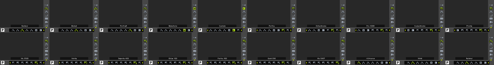

# How many film looks fit, and a build with twelve (2026-11-16)

Owner: "Let's see if we can max out/replace the existing built in ones with our custom sims and see if we run
into issues like storage". Then: "Pick a few more sims that are simple to implement but match the complexity of
existing sims and impl them, that ideally have good data to impl them".

Candidate build `builds/films-12.json`: all twelve art entries are film looks. **Not camera-tested. Nothing was
flashed.** A build with more than twelve looks (`films-max`) was **not** made; section 3 says what stops it.

Labels: **V** = ran in the emulator or read in the firmware bytes. **I** = inferred. **U** = unknown.

## 1. Result

| Place | Menu entry (stock) | Film | Fit: natural / skin / ColorChecker (ΔE2000, model) | Stored value | Art code |
|---|---|---|---|---|---|
| 1 to 4 | Pop Art, Soft Focus, Pale&Light, Light Tone | **Portra 400** (was named Portra), Ektachrome, Pro 400H, Kodachrome | as pinned | 100 to 103 | as pinned |
| 5 | Grainy Film | **Provia 100F** (slide) | 0.71 / 0.87 / 1.63 | 111 (was 104) | 94 |
| 6 to 8 | Pin Hole, Diorama, Cross Process | Vis 250D, Velvia, Superia 400 | as pinned | 105 to 107 | as pinned |
| 9 | Gentle Sepia | **Ektar 100** (Endura paper) | 0.85 / 1.21 / 1.75 | 112 (was 108) | 98 |
| 10 | Dramatic Tone | **Portra 160** (Endura paper) | 0.84 / 1.12 / 1.48 | 114 (was 109) | 144 |
| 11 | Key Line | **Gold 200** (Crystal Archive paper) | 0.85 / 1.18 / 1.47 | 115 (was 119) | 156 |
| 12 | Watercolor | **Vision3 500T** (2383 print film) | 0.64 / 0.85 / 1.47 | 118 (was 120) | 159 |



Why these five (target distance = mean ΔE2000 to the nearest installed look, hold-out natural colours):

- Provia 100F: the second neutral slide; 2.04 from Ektachrome; the best slide fit.
- Gold 200 on Crystal Archive: warm consumer negative; 1.89 from Pro 400H (on Endura paper it is 1.31 from Portra).
- Ektar 100: saturated negative; 1.24 from Portra 400.
- Portra 160: softer than Portra 400; 1.25 from it, 1.77 from Ektar.
- Vision3 500T: tungsten cinema negative; 1.27 from Vision3 250D, 3.6 from every non-cinema look; the best fit of all.

Dropped: **Portra 800** (ColorChecker 2.58, skin 1.96: clearly worse than the installed seven, whose worst
model-only figures are 1.90 and 1.74). Fitted and kept as files, not in a build: C200, UltraMax 400, Verita 200D,
Vision3 50D, Vision3 200T (each within 1.5 of a look that is in the build). All figures: `results/fits.tsv`,
`results/distances.tsv`. The installed seven score 0.73 to 1.12 / 0.87 to 1.74 / 1.20 to 1.90 by the same
model-only measure; on the camera they measured about 0.3 to 0.45 higher on natural colours (film notes §46).
Expect the same for the five.

## 2. How the five entries became film slots

The first seven slots keep the stored Picture Mode value of their entry and send it to a colour-only art code.
That does not work for Grainy Film, Gentle Sepia, Dramatic Tone, Key Line and Watercolor:

- The firmware tests their **stored values** (104, 108, 109, 119, 120) in code, not only their art codes. V:
  0x7E70C674, 0x7E70E5B9, 0x7E7160BF (104 and 108 switch the monochrome path, 109 with type II too),
  0x7E6ECD33 and 0x7E6DC85E (live view: 104, 109), 0x7E6CD005 (109), 0x7E70BE48 and 0x7E70CF43 (119, 120), and
  about 40 more compare sites. A remap of the art code alone leaves all of them active.
- Focus peaking forces Picture Mode 119 and art code 163 in live view (peaking notes §11). 119 must stay Key Line.

So an extra slot gives its **menu entry another stored value**, one of the hidden values 110 to 118, and a
**new art code**. The stock value, its art code and all its tables stay as they are (peaking keeps working by
construction; the stock filter comes back when one spec is left out).

| Item | What | Evidence |
|---|---|---|
| Hidden stored values | 111, 112, 114, 115, 118. `art_GetFilterType`, both live-view functions (still and movie tables), the class table, the EXIF table and "is art filter" 0x7EBBAA10 have an entry for 100 to 120 | V: tables read; `stage_check.py` runs them |
| Not used: 116, 117, 110, 113 | 116: 13 code sites set a parameter for it (0x7E70D394 …). 117: tested at 0x7E6CD009. 110: white-balance case and EXIF case of its own. 113: no finding, free | V |
| New art codes | 94, 98, 144, 156, 159: in no art table of the firmware, in no compare of the image library, the white-balance module or the record / movie-art code, and not a shooting-mode code (list of setting 24) | V: `artcode_inventory.json` plus the scan in section 3 |
| One code for stills and movie | A new code has no meaning to the firmware either way, so the movie tables give the same code. A movie in these five entries gets the film's tone tables and chroma curves (the first seven use straight chroma curves in movies) | V tables; I that nothing depends on two codes |
| Tone tables | 15 stock tables of 512 bytes that no record points at since `remap7b-code` (0x7E74F3BC …, in segment 1) | V: pointer scan of the pinned image |
| Saturation, six-axis, chroma | The stock handlers and tables of art codes that no menu entry reaches: Pin Hole I (73), Diorama (86), Pin Hole II (106), Pin Hole III (108), code 153. Jump-table entries only, no new code | V: handlers decoded; test `test_the_stock_firmware_has_what_the_slots_name` |
| New code and data | 887 bytes in the segment-2 area 0x7EBF1090–0x7EBF3BAD: tone stubs, record triples and records at 0x7EBF38BC (595 B), the second part of the matrix compare chain and 15 stubs at 0x7EBF2E80 (202 B), five matrices at 0x7EBF3B52 (90 B) | V: `tools/freespace.py check` PASS |
| Tables keyed by the stored value | Hash tables 0x7EC4A864 (colour-tone name), 0x7E810200 (movie file tag), 0x7E851A94 (record class): keys 111 … 118 added | V |
| The menu entry | One byte in each value list (settings 111, 509, 510), in each "is an art filter" list (0x7E818EFA, 0x7E82405E, 0x7E82417E), in six constants of the ART bracket routines (0x7EA7633A, 0x7EA9528D, 0x7E5A75AE), and in the **preset of the entry's ART filter** | V |
| ART shooting mode | The mode controller applies a preset when the shooting mode changes: table 0x7E834794 (57 rows of mode code, kind, list, count), each list holds (setting, value) pairs. The preset of an ART filter (kind 1) sets setting 111 to the entry's stored value (0x7E706EAA applies it). Five values changed: 0x7E82B810, C1C0, C4F8, C830, CB68 | V: found with a read of the stored byte in the emulator; `screens.sh` step 3 and `stage_check.py` step 6 |

Not connected for the five entries: **Filter Type and Add Effects**. The shooting application looks them up by
stored value (hash 0x7EBBACE4); the hidden values have no key there, so the type is 0 and no effect is added,
as for Light Tone without effects. The two screens still open and change nothing (I).

## 3. Capacity

### 3.1 Per entry and per code

| Entry or code | Six stages (stock) | Extra processing | Film slot? | Cost |
|---|---|---|---|---|
| Grainy Film (value 104; codes 74, 104) | look table only; default gamma, saturation, six-axis | monochrome by stored value, grain program, 14 code sites | yes, by a hidden value | section 2 |
| Gentle Sepia (108; 91) | look, chroma | toning by stored value | yes, same | same |
| Dramatic Tone (109; 96, 165) | own handlers of another shape | local contrast, 27 compare groups | yes, same | same |
| Key Line (119; 163, 169) | default | line job; **needed by peaking** | yes, same; 119 / 163 untouched | same |
| Watercolor (120; 181, 182) | look, saturation, six-axis | effect program | yes, same | same |
| Hidden values 111, 112, 114, 115, 118 | their stock codes 75, 84, 117, 118, 153 are not used | none found for the value | used by films-12 | – |
| Hidden value 113 | – | none found | free: one more entry | list growth, 3.3 |
| Hidden values 110, 116, 117 | – | 110: WB and EXIF case; 116: 13 code sites; 117: 1 code site | only with those sites patched (U how each behaves) | code immediates |
| Art codes 75/125, 84/124, 117/121, 119/123 | colour class in the record tables | own compares in the image library (hashes 0x7E74A568, 0x7E78B29C) | not clean | – |
| Art codes 118/122, 151/152, 153/154 | – | effect lists of `art_chk_type` | no | their saturation / six-axis / chroma tables are reusable (153 is used) |

A look costs 1,536 B of tone tables, 143 B of other tables (saturation 4, six-axis 24, matrix 18, chroma 97) and
about 175 B of code and records (stub 11, triple 12, records 96, chain 14, matrix load 8, three value stubs 24),
plus 7 jump-table entries, 1 tone-hash entry (32 entries, 23 used now) and 3 hash keys.

### 3.2 Budget

| Resource | Have | films-12 uses | Left |
|---|---|---|---|
| **Art codes that nothing in the firmware knows**, inside the table ranges 71–168 | 5 verified (94, 98, 144, 156, 159) | 5 | **0 verified.** 92: 8 compare sites not read (U). 95 and 161 are tested beside shooting-mode codes (0x7E6E328B, 0x7E5875E4). 99, 100, 110–112, 115, 157 are shooting-mode codes |
| Hidden stored values without code special cases | 6 | 5 | 1 (113) |
| Tone tables free in segment 1 | 15 | 15 | 0. Reclaimable after films-12: about 16 look tables of codes that no entry reaches (0x7E75E4F0, ECF0, F0F0, F4F0, F6F0, FCF0, FEF0, 0x7E7604F0, 06F0 …) = 5 looks; 7.2 KB of dead code in segment 3 (`USABLE-DATA`, never read yet) = 4 looks; Kodachrome and Superia keep 24 tables each, 42 of them only for movies = 14 looks |
| Saturation / six-axis / chroma sets of unreachable codes | 7 | 5 | 2 (codes 118, 119) |
| Proven code space, segment 2 area (and compatible with the debug log) | about 2.1 KB | 887 B | about 1.2 KB in runs of 65 to 254 B, and 281 B at 0x7ECB0EE7 = 6 to 8 looks |
| Kernel area 0x7E4C90CA–0x7E4C9800 | pinned uses 1,098 B, the log 666 B | 0 | 748 B without the log, 82 B with it |
| Menu rows | 128 per list | 19 | not a limit |

Table data in segments 2 and 3 is read by the image library when a picture or a live-view frame is developed.
The first seven films keep tables and stubs there since 2026-11-12 (camera-tested, also three shots straight
after power-on, film notes §44). The update path loads neither segment and develops no picture (I).

**Limiting factor: art codes, then stored values.** Twelve looks is what fits with codes and stored values that
need no further change of stock code. Storage is not the limit at twelve and would allow about 20.

### 3.3 What more than twelve needs

1. **Art codes.** Either read the 8 sites of code 92 (one more look), or use codes outside 69–184. Those miss
   every table, so each of the five table stages needs a hook with a table of its own (gamma range test
   0x7E56B7A6, look 0x7E56E84D, saturation 0x7E56DC78, six-axis 0x7E56D2AB, chroma 0x7E5662E2): about 150 B of
   new code in segment 1 or the kernel area. U: how the record and movie-art range tests (69–183) treat such a
   code; probe = one hidden-value entry with code 200 and the debug log.
2. **Stored values.** 113 is free. 110, 116, 117 need their code sites neutralised. Values above 120 fail every
   range test (`cmp 120` in `art_GetFilterType`, both live-view functions, the class and EXIF tables and about
   20 more sites): each table must move and each test must change. This is the **hard size**.
3. **List entries beyond 19** (not built):
   - value lists of settings 111, 509, 510: 64 B per entry plus 4 B; the record holds pointer and size, so a
     longer copy can go to free space (method of `interval-frames-240`). No hard size.
   - Shooting Menu 1 → Picture Mode, Picture Mode Settings, ART BKT: row tables (20 B per row) and the row →
     value / page tables. The interval work moved a row table (48 edits for one row). No hard size, much work.
   - ART list: records 0x7EFE8B14 (13 × 44 B) and eight tables by place. No sister firmware has a longer list.
   - Number pictures "ART 13" and up do not exist (block 1 picture table); texts ids for 34 languages need room
     in each text pool (Chinese and Korean are full already, section 5).
   - Show flags and ART BKT flags are one setting id per entry (345–361, 414–424, 443, 469, 470): a new entry
     needs a setting id. **Hard: the settings store has no spare ids known** (U; an always-on id can stand in).
   - The stored value is one byte: no storage change.

## 4. The specs and the builds

| Spec | Made by | Content |
|---|---|---|
| `patches/films12-structure.json` | `epm2mod looks --write` (`src/epm2mod/looks/extra.py`) | code, records, table and hash entries. Nothing of it runs while no entry stores a hidden value |
| `patches/films12-looks.json` | same | the five looks (40 ops, 8.4 KB) |
| `patches/films12-entry-NAME.json` × 5 | same | 13 single bytes: the entry stores the hidden value, also in ART shooting mode |
| `patches/films12-names.json` | `scripts/names_spec.py` | the five names and "Portra 400" for the first entry, in 34 languages. It also holds what `film-names-all-languages` does and takes its place |

| Build | sha256 | Content |
|---|---|---|
| `builds/films-12.json` | section 6 | the pinned specs without `film-names-all-languages`, then structure, looks, names, five entry specs |
| `builds/debug-log-films-12.json` | section 6 | the same plus `log-core`, `log-probes`, `log-peaking-time` (as `debug-log-peaking-fast`) |

`films-contiguous` is not used: with twelve films the order is only a matter of which film is in which entry.

**Why the names spec replaces one pinned spec.** `epm2mod make` lets no later spec change a byte that an
earlier spec covers and keeps. The Japanese names of Grainy Film need ten such bytes of
`film-names-all-languages`. So `films12-names` is the difference to the build without that spec. The pinned
spec file is not changed.

**Escape.** Leave out `patches/films12-entry-grainy-film.json` (or `-gentle-sepia`, `-dramatic-tone`,
`-key-line`, `-watercolor`) and that entry is the stock filter again, under the film's name. For the stock
names too, put `film-names-all-languages` back in place of `films12-names`.

## 5. Checks

| Check | Result |
|---|---|
| `epm2mod make` for both builds: free-space check, boot test, update-path test | PASS, PASS, PASS |
| `emulator/opcheck.py` both builds | 0 FAIL |
| `emulator/hookcheck.py patches/films12-structure.json` | 18 transfers, 0 FAIL (no new hook; one changed jump inside segment 2) |
| `black`, `mypy --strict`, `python -m unittest discover -s tests` | clean; 185 tests OK (11 new in `tests/test_looks_extra.py`) |
| **`scripts/stage_check.py`** (new): for every stored value of the lists, `art_GetFilterType` (types 1 to 3) and the four live-view tables run in the emulator; for every code they give, all six stages' dispatch; the tables each stage ends with compared byte for byte with what the generator makes from the fit | pinned PASS (12 values, 28 codes). films-12 **PASS** (12 values, 19 codes): every entry gives one code in all still paths and one in both movie tables, class 1, no code in an effect list; all 12 looks are their films; the seven old entries give the same codes, tables and contents as pinned; the 12 ART presets store the list's values (`results/stage-check-films-12.txt`) |
| Peaking S6 (six-axis dispatch for codes 9–184), S7 (`scen_direct4.py`) | 0 FAULT. S6 prints FAIL for films-12 because it lists codes whose result differs from pinned: 94, 98, 144, 156, 159, the five new codes, as intended. S7 PASS (`results/scen-s6-s7-films-12.txt`) |
| Peaking S1 to S5 (`scen_peaking.py`), films-12 against pinned | as pinned in all five (section 6) |
| `scripts/scen_films.py` (new): live-view rig, each of the 12 stored values and 119, three frames without and three with the MF Assist request | 13 of 13: picture in every frame, no anomaly, lines with the request (section 6) |
| Emulator screens, English (`scripts/screens.sh`): quick menu in P and movie mode, Picture Mode list, Picture Mode Settings, ART list, ART BKT | twelve films in order, ART 1 to 12 (pictures above and in `results/`) |
| English, German, Japanese, French: Picture Mode and ART lists (`lang-all.sh`) | plus Korean and Chinese (simplified): all name strips equal to English. All 34 languages: static, `names_spec.py` checks each name and that every other id reads as before. Korean and Chinese pools are full: there some ids that show the same text now share one string, which gives the room for the full names |
| Each entry chosen in the quick menu, and on the ART mode screen, state saved | both: stored values 100, 101, 102, 103, **111**, 105, 106, 107, **112, 114, 115, 118** |
| A selection made on the pinned build, state loaded by films-12 | the seven films: same name and number. Stored 104, 108, 109, 119, 120 (a stock filter that is gone from the list): the screen shows the last entry, Vis 500T / ART 12, **and the camera still renders the old stock filter** until a Picture Mode is chosen once (I for the rendering: the pipeline of those values is untouched) |
| Shallow menu crawl, films-12 against pinned | mode P: 372 screens by name, 12 differ, all Shooting Menu 1 → Picture Mode; 80 Custom Menu screens equal. Movie: the same 12. ART: 0 of 211 |

**ART shooting mode (found by the emulator, closed).** The first candidate stored 104, 108, 109, 119, 120
when one of the five entries was chosen on the ART mode screen: the value comes from the preset of the ART
filter (section 2), not from the lists. With the preset values in the entry specs, each of the twelve ART
entries stores the value of its film (V: `screens.sh` step 3: 100, 101, 102, 103, 111, 105, 106, 107, 112, 114,
115, 118) and gives its art code (V: `stage_check.py` step 6). The ART mode code of the entry (setting 281 /
24: 74, 91, 96, 163, 181) stays; what the camera does with that code in ART mode is for the camera test, as
it is for Soft Focus, Pin Hole and Diorama in the pinned build (I).

**A stock filter selected before the flash (defined, not fixed).** A camera that has Picture Mode 104, 108,
109, 119 or 120 stored (in P, A, S, M or movie mode, or in a Myset) shows the last entry, Vis 500T / ART 12,
and renders the old stock filter until a Picture Mode is chosen once; the stored value is then a list value.
Why not fixed: the stored value itself is the trouble (the firmware tests it in code), and a list cannot map
two stored values to one entry (19 entries, the 19th is the fallback). A fix is new code that rewrites the
stored byte when the settings load, in the settings path at start-up; not built. In ART mode the case does
not arise: the preset sets the value each time the mode is entered. Camera step: choose Natural before the
flash, and choose the Picture Mode again in each Myset that used one of the five filters.

Not checkable off the camera: the picture; live view and movie with the five new entries; an ART bracket;
whether a stored value 111–118 meets a test in code that the scans did not see (section 5a); EXIF (the five
entries write Pop Art's tags).

## 5a. Was everything found that reacts to the old filters? (inventory of readers)

No tool here can prove it: there is no source, a scan of constants misses computed uses, and the emulators run
only part of the firmware. This is the evidence, and its limits.

**(a) Static, `scripts/readers.py`** (re-run: `.venv/bin/python …/readers.py`; lists in `results/readers.tsv`,
summary in `results/readers-static.txt`). It scans the linear disassembly for reads with a constant id and
classes the 40 instructions after each read by the constants they compare with.

| Kind | Count | What the new values meet |
|---|---|---|
| A. Call sites of a settings getter with the id of Picture Mode, settings 509 / 510, the ART mode code, Filter Type or Add Effects | 108 | 97 no compare (value stored, passed on or a table index); 6 a range test 100..120; 2 compare stock values only (0x7E5A75B7: the ART bracket composer, patched; 0x7E6DC840: 104 / 109 for the B&W settings, the hidden values take "neither"); 3 marked "hidden" are the range test 3..115 of setting 24 next to the read, not of the Picture Mode (read by hand) |
| B. Reads of the art code byte (+79) in the image library | 56 | 19 no compare (table index: the six stages and three more hashes); 37 compare codes of stock filters only (Dramatic Tone 96/97/165/166, Key Line, Sepia 91/93, Grainy 74/83/104/105, codes 75/125, 117/121, 151/152 …): a new code takes "none of these" in all 37 |
| C. Reads of the mov layer's mode and code bytes and of the record context's Picture Mode and art codes | 87 | 74 no compare; 3 range tests; 9 compare stock values only (104/109 at 0x7E6ECD2D, 104/107 at 0x7E716C59, 116 at three sites, codes 73/82 at three sites, 104/108 at 0x7E70E581); 1 "hidden" is scene code 115 on the code byte (0x7E6C6914), not a stored value |
| D. Table entries: 9 jump tables by (value − 100), 6 hashes by stored value, 6 jump tables and 11 hashes by art code; one row per hidden value / new code | 140 | 72 set by films-12; 8 the stock entry of Pop Art (art packet mode 0x7E7FF400); **60 default** = 12 tables × 5 |

The 12 default branches, read one by one: settings loader 0x7EBBAAE4 (no key: the same branch as an art
filter, fields cleared); B&W settings 0x7EBBABE4 (no key: nothing loaded, as for Pop Art); Filter Type / Add
Effects 0x7EBBACE4 (no key: type 0, no effect, the gap named in section 2); record class by code 0x7E8520E0
and 0x7E852354 (0, as the camera-tested codes 102 and 167); image-library hashes 0x7E74A568, 0x7E78B29C,
0x7E78CBA8 (not monochrome, no line or watercolor path, no own curve: the plain colour path); movie-art
hashes 0x7E7FF668, 0x7E7FF568 (no type II / III code); ART show flag 0x7E818CC8 (not reached: it takes the
ART mode code); effect program 0x7E85C45C (none).

**(b) Dynamic, `scripts/readers_dynamic.py` with `watch_reads.mjs`** (`results/readers-dynamic.txt`).

| Run | Seen | Against the static list |
|---|---|---|
| Full boot, 7 sessions (quick menu over all 19 values in P and movie mode with OK on a new entry, Picture Mode list, Picture Mode Settings, INFO, PLAY, ART list with OK on a new entry, ART BKT list): read watchpoints on the stored Picture Mode byte and its copy | 4 distinct readers. Three are loops over all settings (0x7E67FFFB, 0x7E680290, 0x7E6803C5: the mode controller's snapshot and restore) | 2 of 108 static call sites executed; 106 never. 3 dynamic readers have no static site (the loops: no constant id). **The GUI does not read the stored byte per use**: it reads the mode controller's own copy, which the watchpoints do not cover |
| Live-view rig, 13 stored values × (3 frames + 3 frames with the peaking request): read watchpoints on the mov layer's mode and code bytes | 22 distinct reading instructions | 10 of the 30 static reads (absolute address) executed, 20 never; **12 dynamic reads are not in the static list** (they read through a pointer to the struct, 0x7E6C367F … 0x7E6ECFA9): a gap of the static method. None of the 12 lies in new code; with the new values every frame gave a picture and no anomaly (`scen_films.py`) |
| Colour stages (`stage_check.py`) | all six dispatches for every code, from the instruction after the read of +79 | the 56 reads of kind B themselves are not executed by the pieces; the 37 with compares were read statically only |

**(c) Covered by neither method** (the camera test must touch each once with a new entry): a real capture
(the capture layer 0x7E58–0x7E5B reads the Picture Mode at five sites, never executed here) and its JPEG and
EXIF; RAW Data Edit; movie record and the movie file's tag; an ART bracket (the composer 0x7E5A75AE);
playback info and the index view of a picture taken with a new entry; print order / PictBridge and the
share / slideshow menus (colour-tone name in rec view: hash 0x7EC4A864); Mysets (save and recall); the super
control panel; the Photo Story and e-Portrait paths; sleep and wake with a new entry selected; HDMI output.

## 6. Hashes and the last results

| Build | sha256 |
|---|---|
| `films-12` | `837786534ec6fdada46d052480672930419ca838e760dd790794b9e6b3ef8913` |
| `debug-log-films-12` | `5d0a7683e4d8da90226163eeeaaf44dfa31250704b7c5e512bd59a5c3a34d02f` |
| pinned `peaking-fast` (made last, in `build/card`) | `0e8a25b9578b8119b14b4895be7d2a0b70d7315e5e817758699777f0f31d917e`, as recorded |

- Peaking S1 to S5, films-12 against pinned (`results/scen-s1-s5-films-12.txt`): S1 the same writes and code
  with the request clear; S2 a picture through the line job and the overlay pass in every frame (art type 1
  and 0); S3 no anomaly in 13 filter changes; S4 R = 0 at the end; S5 the same state, heap mode and still gain.
- `scen_films.py` (`results/scen-films-12.txt`): all 12 film values and 119: a picture in 3 of 3 frames
  without and with the request, no anomaly, L = 1 and white lines (pass 9 gain 0x0200, pass 7 ucExpose 3) with
  it. The code byte 0xA07507CC reads 0 for the five new entries, as it does for the camera-tested Soft Focus
  entry (art code 102).
- Shallow crawl: mode P 12 of 372 screens differ, movie 12 of 222, ART 0 of 211; every difference is a screen
  of Shooting Menu 1 → Picture Mode. Custom Menu screens equal. Firmware error entries equal.

## 6a. When films-12 becomes the pinned build: the documents

The guide's film table (`docs/guide/film-looks.md`, made by `epm2mod readme` from `looks/films.json`) names the
first entry "Portra". `looks/films.json` was not changed, because its label makes `patches/seven-labels.json`
and the pinned build must keep its bytes. With films-12 pinned: let the readme generator take the menu name of
the first entry from the names spec's rename ("Portra 400") and add the five rows of `looks/more-films.json`;
replace the screenshot `docs/images/ui/quick-menu-portra.png`; say in the guide that Filter Type and Add
Effects do nothing in the five new entries; list the build without `film-names-all-languages`.

Names: twelve entries read Portra 400, Ektachrome, Pro 400H, Kodachrome, Provia, Vis 250D, Velvia, Superia 400,
Ektar 100, Portra 160, Gold 200, Vis 500T, the same text in all 34 languages. A number is there where the
stock has one in its usual name or where two of a family are in the list (Portra, Vision3); Ektachrome,
Kodachrome, Velvia and Provia are each the only one of their family. No other name is ambiguous.

## 7. On the camera

Use the debug build first (it reports which handler and table every art code used), then the plain build.

```sh
.venv/bin/epm2mod make builds/debug-log-films-12.json --card /path/to/card   # or builds/films-12.json
```

Before the flash: choose Natural (MENU → Shooting Menu 1 → Picture Mode → Natural), mode P.

1. After the flash, mode P. Press OK, go to Picture Mode with ▲▼, press ▶ step by step.
   **Expected:** Portra, Ektachrome, Pro 400H, Kodachrome, Provia, Vis 250D, Velvia, Superia 400, Ektar 100,
   Portra 160, Gold 200, Vis 500T, with ART 1 to ART 12. Live view shows a normal colour picture in each:
   no freeze, no black-and-white, no outline, no grain. A freeze or an effect in one entry = write down which.
2. In each of the twelve entries take one photo of the same scene. Then PLAY → OK → RAW Data Edit on
   `PB130001.ORF` (the test RAW, `experiments/2026-11-09-film-portra/testraw/`) once per entry.
3. Movie mode: select Provia, Ektar 100 and Vis 500T in turn. **Expected:** no freeze. Record 3 seconds in one.
4. Focus peaking: with Peaking on (White), turn the focus ring in Portra and in Gold 200.
   **Expected:** white lines in the magnified view, as before.
5. ART mode (MENU → ART): choose 5 Provia, then 11 Gold 200. **Expected:** the same film picture as in mode P
   (no black-and-white, no outline); one photo each.
6. One pass with **Ektar 100** selected in mode P over the paths that no emulator check runs (section 5a c):
   one RAW+JPEG photo; PLAY → INFO until the detailed view shows; a 3-second movie; MENU → ART → 13 ART BKT → ▶, only
   Ektar 100 and Portra 400 On, OK, one photo (**expected:** two JPEGs with the two film looks), then back to P;
   MENU → Shooting Menu 1 → Reset/Myset → Myset1 (store), change to Natural, Reset/Myset → Myset1 (recall;
   **expected:** Ektar 100 again; the two Myset sub-screens were not opened in the emulator); let the
   camera go to sleep and wake it. A freeze, an error message or a wrong look in one step = write down which.
7. MENU (opens the log flush), then power off.

Send back: the 12 photos, the 12 RAW Data Edit JPEGs and `EPM2LOG.BIN` from the card.

Back: `.venv/bin/epm2mod make --card /path/to/card` (the pinned build `peaking-fast`).

Evaluation: `uv run epm2mod log EPM2LOG.BIN --summary` (events `art_sixaxis`, `film_stage`, `film_matrix`,
`film_curve`: the five new entries must show art codes 94, 98, 144, 156, 159 with handlers 0x7E56D593,
0x7E56D5A2, 0x7E56D715, 0x7E56D724, 0x7E56D751 and matrix tables 0x7EBF3B52 + 18 n). ΔE per look: copy the
JPEGs to `experiments/2026-11-09-film-portra/shots/measured/` as `F12_NAME.JPG`, then in that folder
`../../.venv/bin/python -I read_mock.py` and `check_film.py` with the film's fit, as in film notes §46.

## 8. Scripts

```sh
.venv/bin/epm2mod looks --write                                              # structure, looks, entry specs
.venv/bin/python experiments/2026-11-16-films-max/scripts/names_spec.py --base build/peaking-fast.BIN
.venv/bin/epm2mod make builds/films-12.json && .venv/bin/epm2mod make builds/debug-log-films-12.json
.venv/bin/python experiments/2026-11-16-films-max/scripts/stage_check.py build/films-12.BIN --base build/peaking-fast.BIN
experiments/2026-11-16-films-max/scripts/screens.sh builds/films-12.json     # about 40 minutes
.venv/bin/python experiments/2026-11-16-films-max/scripts/scen_films.py BLOCK0
.venv/bin/epm2mod make                                                       # the pinned build again
```

Fits: `fit_more.sh`, `fit_more_starts.sh`, `fit_starts.py`, `fit_table.py`, `export_fit.py` (spektrafilm 0.3.4
targets, `fit_film2.py` of the film experiment without an anchor; a second pass starts from the three nearest
installed looks, because the standard starts end in a poor minimum for some films: `results/fits.tsv` has both).
