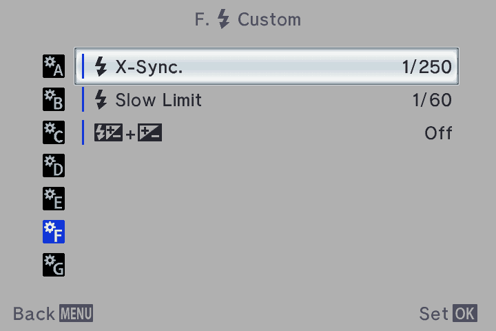
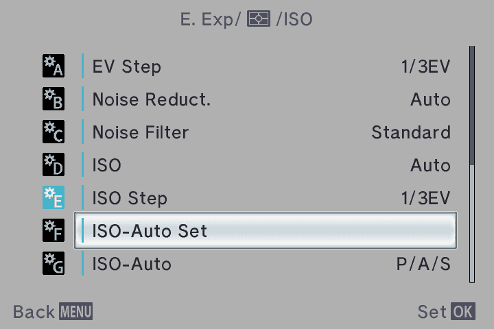

# Minimum shutter speed for Auto ISO, and exposure compensation in M

Date: 2026-11-17. Desk work, function harness and full-boot emulator. Nothing was flashed. No build was made.

Labels: **V** = read in the firmware bytes or run in the harness / emulator; **I** = inferred; **U** = unknown.
Values are Q8 APEX numbers: Tv 0x0600 = 1/64 s (shown as 1/60), 0x0800 = 1/250, Sv 0x0600 = ISO 200, 0x0900 = ISO 1600.

## 1. Answer

1. **The stock firmware already has the setting.** The threshold speed of Auto ISO is
   `tv_th = min(X-Sync, max(1/(2 × focal length), 1/30, Flash Slow Limit))`, with or without a flash (V in the
   harness, U on the camera). The menu row is MENU → Custom Menu → F → **# Slow Limit** (30 s to 1/250, default 1/60).
   With 1/250 there, P and A hold about 1/250 s and raise ISO up to the High Limit of ISO-Auto Set.
2. So the first step is a camera test of the pinned build (section 8). It needs no flash unit and no new firmware.
3. A row of its own ("ISO-Auto Min S/S", Auto to 1/4000, not tied to the flash) is a medium job: a 50-byte rewrite of
   one function in place (prototype V in the harness) and a menu row made as the Peaking row was. Plan in section 7.
4. Exposure compensation in M with Auto ISO: the exposure routine already uses a compensation value in M (V in the
   harness). One test in the caller sets it to 0 in M. The open part is the user interface (section 6).
5. The stabiliser setting has no part in the threshold (V: the function reads the focal length, X-Sync and Slow Limit
   only).

 

## 2. Where the exposure program is

All addresses are in **segment 1** (0x7E4FE000–0x7E881000, loaded by the boot task before Usr1) (V, load map).

| Part | Address | What it does | Label |
|---|---|---|---|
| Task | TAKE_EXPOSE, id 0x46, entry 0x7E5829E8 | Half-press, release and continuous handlers call 0x7E5865B3 → 0x7E5865F2 | V calls, I task |
| Caller | 0x7E5865F2 | Builds the blocks on its stack, calls `exp_cal_still`, copies the result (56 B) to RAM 0x60515DB0 | V |
| Settings → mode block | 0x7E58669D | Fills the 44-byte mode block and the 16-byte set block with the settings read 0x7E457C75 | V |
| `exp_cal_still` | 0x7E693D00 | The still exposure: threshold, corner values, program line, results | V, ran in the harness |
| Threshold | **0x7E694001** (61 B) | `tv_th`, stored at result +46 | V, ran |
| Mode → program code | 0x7E69433B, table 0x7E7DBC94 | 3 P, 4 A, 5 S, 6 M; art and scene modes map to their own codes | V |
| Program records | 0x7E6942CE, table **0x7E7DB508** | 45 records of 42 B: 10 Av corners, 4 Sv corners, 5 Tv corners, a flag, the key | V |
| Corner resolvers | 0x7E694412 (Av), 0x7E694474 (Sv), 0x7E6944D5 (Tv) | Replace the marks in a record by real values (table below) | V |
| Auto path / manual path | 0x7E6947C1 / 0x7E69464B | P, A, S and scenes / M (program code 6 or 58) | V |
| Debug capture | 0x7E69E86F, printers 0x7E69E9EA–0x7E69EEAE | Copies inputs and results when RAM byte 0x605A7374 is 1 (`exp still on` in the debug shell). The printers give the field names used here | V |

Marks in a program record (V):

| Mark | In Av corners | In Sv corners | In Tv corners |
|---|---|---|---|
| 0x9B00 | the user's aperture | – | the user's shutter speed |
| 0x6400 | smallest aperture | **High Limit** (mode +20) | X-Sync (mode +16) |
| 0x6300 | – | **Default** (mode +22) | **tv_th** (result +46) |
| 0x9C00 | open aperture | – | – |

The P record (key 3): Sv corners `High Limit, Default, 200, 200`; Tv corners `1/4000, X-Sync, tv_th, 60 s, tv_th`.
The A record has the same Sv and Tv corners. Sport (key 8) has a fixed 1/500 in place of the first `tv_th`; key 41 has
1/250. The whole table: `experiments/2026-11-08-feature-map/sections/12-exposure-af-files.md` §1.3.

Settings that enter (V: the tags in 0x7E58669D; the values after the first start in the emulator):

| Mode block | Tag | Setting id | Menu | Value after first start |
|---|---|---|---|---|
| +16 `stb_sync` | 0x94BA (and the flash state 0x7E5E2976, the lower of the two) | 114 | F → # X-Sync. | 0x0800 = 1/250 |
| +20 `iso_limiter` | 0x949A | 112 | E → ISO-Auto Set → High Limit | 0x0900 = 1600 |
| +22 `iso_standard` | 0x9A9A | 172 | E → ISO-Auto Set → Default | 0x0600 = 200 |
| +24 `shutter_stb_limit` | **0x9ABA**, read without any flash test | 174 | F → # Slow Limit | 0x0600 = 1/60 |
| +5 `ae` | 0x8E81 or 0x80A1 | – | metering mode (I); it chooses which metered BV is used (0x7E69403E) | – |
| +6 `stb_onoff`, +7 `strobe` | 0x7E5875D3, tag 0x8171 | 16 | flash state and flash mode | – |
| set +6 `cv` | 0x80BA through 0x7E5878A6 | 2 | exposure compensation (0 in M, section 6) | 0 |
| set +2 `sv` | 0x810A | 6 | ISO (0 = Auto) | 0 |

Focal length: `exp_cal_still` takes 0x7E53840B, which returns RAM 0x60503974, the driver's `focal_length_effect`
(V). The lens driver writes it as 2 × a lens table value (0x7E5387AF) (V). So it is the 35 mm-equivalent focal
length (I). The manual says the same: "1/(lens focal length × 2)" (page 86).

## 3. What sets the threshold today

Function 0x7E694001, in words (V, and run in the harness for 8 focal lengths × 4 Slow Limits):

```
t = 256 * log2(focal_length_effect)        # 0x7E507DFD: 1/t seconds = 1/(2 x lens focal length)
t = max(t, 0x0500)                         # never slower than 1/30
tv_th = min(X-Sync, max(t, Slow Limit))    # mode +16, mode +24
```

- No table by focal length, no constant per lens, no stabiliser input.
- 17 mm lens, defaults: max(1/34, 1/30, 1/60) = **1/60**. 45 mm lens: 1/90. Above 125 mm: 1/250 (the X-Sync cap).
- A web report agrees for another body: a user lowered the Auto ISO speed with Flash Slow Limit "to 1/30 but no
  lower" (photo.net topic 451867), and an E-M5 thread says the two are tied (fredmiranda.com topic 1163652).

What the program line does with it (harness, 17 mm f/2.5 lens, High Limit 1600; `results/expcal-stock.txt`):

| Scene BV | P, Slow Limit 1/60 | P, Slow Limit 1/250 | A at f/4, Slow Limit 1/250 |
|---|---|---|---|
| 8 | 1/400 f/6.4 ISO 200 | 1/800 f/4.5 ISO 200 | 1/1000 ISO 200 |
| 5 | 1/140 f/3.8 ISO 200 | 1/285 f/2.7 ISO 200 | 1/250 ISO 400 |
| 3 | 1/70 f/2.7 ISO 200 | 1/285 f/2.7 ISO 800 | 1/250 ISO 1600 |
| 2 | 1/70 f/2.7 ISO 400 | 1/285 f/2.7 ISO 1600 | 1/128 ISO 1600 |
| 0 | 1/70 f/2.7 ISO 1600 | 1/80 f/2.5 ISO 1600 | 1/32 ISO 1600 |
| −2 | 1/20 f/2.5 ISO 1600 | 1/20 f/2.5 ISO 1600 | 1/8 ISO 1600 |

- P: shutter and aperture fall together to about `tv_th` and open aperture + 0.15 EV. Then ISO rises from Default
  to High Limit with the shutter held. Then the shutter falls.
- A: the shutter falls to `tv_th`, ISO rises to High Limit, then the shutter falls.
- With High Limit 6400 the hold lasts 2 EV longer (table 4 in the results file).
- Flash on (`stb_onoff` = 1, `strobe` = 1): the shutter is the Slow Limit and ISO stays at 200 (table 6).

The # Slow Limit list (V, emulator): 40 values, 30 s to 1/250, in 1/3 EV steps; DOWN goes to faster speeds, and
the value after 1/250 is 30 s. The stored value is the Q8 Tv (1/4 s gave 0x0200). The mode controller's list is
0x7E849B2E (record 0x7E84B5F8); the GUI list has its own 40 items at 0x7F006EE4 (descriptor 0x7F00BF6C).

## 4. PEN-F and E-M1 II (guide only)

- Both have the menu text "Lowest S/S Setting" and the help text "Choose the slowest shutter …" (V, block 1).
- Their `exp_cal_still[mode]` dump has a new field **`shutter_iso_limit`** directly after `shutter_stb_limit`, and
  the result has `flash_point_tv` where the E-PM2 has `tv_th` (V, strings of E122 v3.1 and E125 v3.7).
- So Olympus added a second limit beside the flash one and split the flash threshold from the ISO threshold (I).
  The prototype in section 5 does the same thing in 50 bytes.

### 4.1 How the PEN-F 3.1 does it (traced 2026-11-18)

Firmware `OLY_E_122_3101_0000_0000.BIN` (sha256 77398610…69f2c, in `experiments/2026-11-08-feature-map/out/firmware/`).
Same instruction set as the E-PM2 (MN103), block-0 base 0x60021020. Function database:
`python3 tools/fwmap.py --fw PENF.BIN --base 0x60021020 --out /tmp/scratch/penf build`. English texts:
`experiments/2026-11-15-feature-survey/scripts/lang_enu.py` on block 1. All addresses below are PEN-F.

UI (V, data):

- Custom Menu E → ISO-Auto Set (text 155) opens a screen with two rows: "Upper Limit / Default" (text 2874) and
  "Lowest S/S Setting" (text 2875). Row record 0x60F963D6 (kind 4, text 2875). Manual page 181 agrees.
- Value list 0x60F943D0 (a second, identical one at 0x60F94694): 59 items of 12 B. **Auto, then 60 s to 1/8000 in
  1/3 EV steps.** Auto is text 71; the speeds are ASCII strings.
- Two settings: tag **0x5351** (Auto or not) and tag **0x536A** (the speed, Q8 Tv). Filled into the mode block at
  0x605DDA19: `shutter_iso_limit = (0x5351 == 0) ? 0x7FFF : 0x536A`.

Mode block (V, debug printer 0x6112C54D): `stb_sync` +16, `iso_limiter` +22, `iso_standard` +24,
`shutter_stb_limit` +26 (tag 0x9ABA, the same tag as the E-PM2's Slow Limit), **`shutter_iso_limit` +28**.

Logic (V read; not run):

| Function | What it does |
|---|---|
| `exp_cal_still` 0x605B906E | Same frame as the E-PM2's. `flash_point_tv` (result +54) = clamp(1/(2 f), low, high) via 0x605D7106 |
| Gate 0x605BB441 | Lowest S/S is **active** only if: flash off (+5 = 0), program code 3 (P), 4 (A), 36 or 37, ISO Auto (set +2 = 0), +28 ≠ 0x7FFF, and 0x605D68E1(+36, +44) = 0 (fields +36/+44 not named; U) |
| Rounding 0x605D344E | Rounds the limit up to the exposure step grid (set +12: 85 = 1/3 EV, 128 = 1/2, 256 = 1 EV; tables 0x6065D7B0, 0x6065D830, 0x6065D888) |
| Tv corner resolver 0x605B9CD4, mark **0x5F00** | Active: the corner **is** the rounded Lowest S/S. No focal-length term, no 1/30 floor, no Slow Limit. Not active: the stock rule 0x605B97B0 |
| Stock rule 0x605B97B0 (marks 0x5E00, 0x5F00) | `max(1/(2 f), Slow Limit)`, floor 1/30, cap X-Sync (+16) **only with the flash on**, else the cap is +18 (not named; I = the fastest speed). If active, then also `max(…, Lowest S/S)` |
| 0x605B984A | When +28 = 3328 (1/8000) it calls 0x605BB42C, the body's fastest speed (I: "1/8000" means "fastest") |

What this means for the E-PM2 row (section 7):

- Olympus's limit **replaces** the focal-length rule in P and A with ISO Auto and no flash. So it can be slower than
  1/30 and slower than 1/(2 f). Our prototype only takes a max, so it can only make the hold speed faster.
- Olympus's list is 1/3 EV from 60 s; the E-PM2's top speed is 1/4000, so the same list would be Auto + 56 items.
- The X-Sync cap only with the flash on is the same change as our prototype.
- Nothing can be copied: the E-PM2 has no mark 0x5F00 and no second field. The method fits in the in-place rewrite of
  0x7E694001 if the active case returns the limit instead of the max (I; size not checked).

## 5. The smallest change

| Step | Change | State |
|---|---|---|
| A. No change | Use # Slow Limit. Up to 1/250. It is also the flash shutter speed | V harness, U camera |
| B. Own row, Auto to 1/4000 | Rewrite the tail of 0x7E694001 in place + a menu row + a dormant setting | prototype V in the harness; menu not made |
| C. # Slow Limit up to 1/4000 | Longer lists for setting 174 + the rewrite | **rejected**: with the flash on, a Slow Limit above X-Sync gives 1/1000 s with flash in the harness (stock code path, bright scene) |

Prototype of B (`scripts/th.s`, `scripts/mkproto.py` → `specs/proto-threshold-inplace.json`; 46 B of code + 4 nop in
the 50 B from 0x7E69400C; no new code area, no hook, so no load-order question):

```
tv_th = max(t, Slow Limit, 1/30 x 2^k)     # k = the byte of setting 447, 0..7: Auto, 1/60, 1/125 ... 1/4000
if stb_onoff == 1: tv_th = min(tv_th, X-Sync)
```

Harness results (`results/expcal-proto.txt`):

- k = 0: every row of the stock tables is equal, but `tv_th` of lenses above 125 mm without flash is 1/(2 f), not
  1/250 (the X-Sync cap now needs the flash). The chosen exposure in those rows is the same (V).
- k = 2 … 7 hold 1/125 … 1/4000 in P and A while ISO has room (V). Flash on with k = 5: 1/250 or slower (V).
- The byte is read at its RAM address **0x60413275** (tag 0xD791; V in the emulator on stock; I that the address is
  the same on the camera: the bank layout comes from ROM lists). A second way, with the settings read, needs about
  15 B more: put it in the dead debug capture 0x7E69E86F (191 B, segment 1).

No candidate build was made: B is useful only with its menu row, and A needs no build.

## 6. Exposure compensation in M with Auto ISO

| Fact | Label |
|---|---|
| M path 0x7E69464B with ISO Auto: `Sv = Av + Tv − (BV − cv)`, held between Default and High Limit, rounded to 1/3 EV | V read, V harness (table 5: cv −1 EV gives 1 EV less ISO, +1 EV gives 1 EV more) |
| The bias 0x7E694540 takes `cv` from the set block for every mode | V |
| **The gate:** 0x7E5878A6 fills `cv`. It calls 0x7E5870FF (1 for mode 6, 58, 90) and returns 0 for those modes. Else it reads tag 0x80BA | V |
| Patch: the 2 bytes of `bne` at 0x7E5878AF → `nop nop`. M then gets the stored compensation for the shot | I (not run) |
| The live-view exposure block reads tag 0x80BA at 0x7E69D4ED with no mode test at the read | V; what its M path does with it: U |
| In M the F button changes shutter and aperture. The manual: "Exposure compensation is not available in M mode" (pages 26 and 32) | V manual |
| Does the value set in P stay in tag 0x80BA after a change to M? One tag, MODE bank | I; U until tried |

Feasible. What it takes: the 2-byte gate (small) and a way to set the value. Two ways: (a) the value set in P or A is
kept in M (no new screen; probe first that the tag keeps it), (b) a new row with its own dormant setting, −3 to +3
(as section 7, steps 3–5). The meter bar in M would still show the deviation from the uncompensated exposure (I).
Effort: (a) 1 to 2 hours with the emulator checks; (b) half a day.

## 7. Build plan for the row "ISO-Auto Min S/S" (after the camera test of section 8)

| # | Step | Effort |
|---|---|---|
| 1 | Camera test of # Slow Limit on the pinned build. If it holds 1/250, decide whether 1/500 and faster are wanted at all | 2 min, owner |
| 2 | Take `specs/proto-threshold-inplace.json` as the code spec. Check 0x60413275 on the pinned image (`scripts/tagplay.mjs … tag:d791`). Run `scripts/expcal.py --patch`, `tools/emu/hookcheck.py` | 30 min |
| 3 | Setting: dormant **447** (tag 0xD791, MODE bank, u8, default 0; EVF info, no reader found by the static scan; its list page is the dormant panel 608, descriptor 0x7F00BFCC). Mode-controller record 0x7E84C41C: list (0, 1) at 0x7E849EC2, length 2 → a stock byte list 0…7 (to find in segment 1), length 8. Check the reset lists as Peaking §15.2 did for 458 | 1 h |
| 4 | Menu row in group E after ISO-Auto (index 45 of the item table 0x7EBF2000): `{4, text 1498, 447, 0, order, help 1509, value list 608, 0}`. 81-row table → the dead 79-row tables of `level-adjust-row` at 0x7EBF3000–0x7EBF3780 (1,920 B, no reader since `peaking-menu`); child list grows in place at 0x7EBF2600 (+8 B, 120 B free behind it); 10 address loads, 11 page records, counts 79/80 → 80/81, row-state array 160 → 162 B, rows of group E 13 → 14 in the `.data` image. Generator: copy `experiments/2026-11-14-focus-peaking/scripts/mkspec_menu.py` | 3 h |
| 5 | List of panel 608: 8 items of 28 B. "Auto" = kind 2 with text 53. Speeds = kind 8 with numerator 1 and the denominator as a number (the stock items are `00 08 0100 fa00 …` for 1/250), so no new texts (I for 1/4000). Value → text list entry 608 (table 0x7F014614, now null). Both fit behind the new item table | 1 h |
| 6 | Texts, English first: 1498 "Built-in EVF Style" → "ISO-Auto Min S/S"; 1509 "Select the frame rate / in the built-in EVF." → "Slowest shutter speed / before ISO rises." (both free in the pinned build; 1499–1502, 1505, 1506 are taken) | 30 min |
| 7 | `builds/auto-iso-min-shutter.json` = the specs of `builds/films-12d.json` + the new spec; `.venv/bin/epm2mod make`; boot test, update-path test, screenshots of the row and list, value over three restarts, menu crawl comparison | 1 to 2 h |
| 8 | Camera test: section 8 with the new row | 5 min, owner |

Constraints (facts on 2026-11-17):

- The AE code, the mode-controller lists (0x7E849xxx) and the settings read are in segment 1. The rewrite is in
  place: no jump leaves the function.
- Kernel range 0x7E4C90CA–0x7E4C9800: 18 B free. Not needed.
- Segment-2 area 0x7EBF1090–0x7EBF3BAD: 1,104 B free in pieces of at most 177 B (`tools/freespace.py area
  0x7EBF1090`). The tables go into the dead tables instead. Debug builds: `log-probes` starts at 0x7EBF3780, so the
  new data must end before it (item table 1,298 B + items 224 B + text list 216 B = 1,738 B: fits).
- The GUI tables are read by segment-3 code after start-up only.

Risks:

- U: the row-state array grows 2 bytes again (RAM after 0x606A31B7): check as level-gauge NOTES §12.2.
- U: a reset list or Myset may write setting 447. The code masks the byte with 7, so a wrong value gives a valid speed.
- I: the direct RAM read. If the owner prefers the settings read, use the second way of section 5.
- A fast minimum (1/1000 and up) in dim light pins ISO at the High Limit; that is the setting working.

## 8. Camera test and probes

Test of the pinned build, two minutes, no flash unit on the camera. Lens at one focal length, mode P, ISO Auto.

1. MENU → Custom Menu → E → ISO-Auto Set → High Limit **6400** → OK. (Before: 1600. More room for the test.)

    
2. MENU → Custom Menu → F → # Slow Limit. The row shows **1/60**. Leave it. Take 3 photos of a dim indoor scene.
3. Same row → RIGHT → press DOWN until **1/250** (the next value would be 30) → OK. Take 3 photos of the same scene.
4. Optional: 1/125, 3 photos. Then set the value you want to keep.
5. `exiftool -ShutterSpeed -ISO -FNumber -FocalLength -Flash /path/to/card/DCIM/100OLYMP/*.JPG`

| Result | Meaning |
|---|---|
| 1/60 photos: 1/60 to 1/80 s. 1/250 photos: 1/250 to 1/320 s with about 4 × the ISO | As the harness. The feature is there; write the guide |
| 1/250 photos: ISO 6400 and slower than 1/250 | The scene is too dark for the test. Use more light |
| Both sets have the same shutter speed and ISO below 6400 | The camera does not fill the mode block as read. Flash the probe build below |
| 1/60 photos slower than 1/60 with ISO below 6400 | Same |

Probes for a debug build (describe only; `logs/events.json` and the generator were not touched):

| Event | Level | arg0 | arg1 |
|---|---|---|---|
| `ae_still_in` | debug | bits 0–15 `bv` (result +0), 16–31 `tv_th` (result +46), both s16 | bits 0–15 focal length (result +28), 16–23 mode (mode +3), 24–31 `stb_onoff` (mode +6) |
| `ae_still_out` | debug | bits 0–15 `tv` (+2), 16–31 `av` (+8) | bits 0–15 `sv` (+4), 16–31 `cv` (+10) |
| `ae_still_lim` | debug | bits 0–15 Slow Limit (mode +24), 16–31 X-Sync (mode +16) | bits 0–15 High Limit (mode +20), 16–31 Default (mode +22) |

- Site: the last call of `exp_cal_still`, **0x7E693E2E** `call 0x7E69E86F,[a2],8` (7 B). There a0 = a2 = the
  argument block: +0 → mode block, +20 → result. Cost at the site: 0 B, if the routine takes the place of the body
  of 0x7E69E86F (191 B, segment 1; it returns at once on a camera because byte 0x605A7374 is 0). It must end with
  `ret [a2],8`. The routine is about 80 B (I) and calls `log_chg` 0x7E4C9514 (kernel range: allowed from segment 1),
  so that a held half-press does not fill the ring.
- One set of three records per calculation that changed: per half-press, per shot, per frame of a sequence (I).

## 9. Scripts and results

| File | Use |
|---|---|
| `scripts/expcal.py` | Runs `exp_cal_still` in the function harness: the tables, one row (`--row`), a patched block (`--patch`), the prototype table (`--proto`). The stand-ins are listed at the top of the file |
| `scripts/th.s`, `scripts/mkproto.py` | The prototype code and the generator of `specs/proto-threshold-inplace.json` |
| `scripts/tagplay.mjs` | Full-boot emulator: keys, screenshots and `tag:HEX` (stored value and RAM address of a settings tag) |
| `scripts/mkimg.py` | An image folder for the emulator from stock + prototype specs |
| `scripts/texts.py` | The items of the stock lists and English strings by pattern |
| `specs/proto-slow-limit-list.json` | Variant C, first part (6 B). In the emulator the list wraps after 40 items: the GUI has its own item count |
| `results/expcal-stock.txt`, `results/expcal-proto.txt` | Harness tables |

## 10. Unknown, and the probe for each

| Unknown | Probe |
|---|---|
| Does the camera hold the Slow Limit speed without a flash, as the harness does? | Section 8 |
| Is the focal value 2 × the lens focal length? | Set Slow Limit to 30 s and X-Sync 1/250, 45 mm lens: the hold speed should be 1/90 |
| Which calculation gives the numbers on the screen before the half-press? | `ae_still_*` records against the screen |
| Kind-8 list item with denominator 4000; reset and Myset of setting 447; RAM after the row-state array | Emulator, steps 3 to 5 of the plan |
| Compensation in M: does tag 0x80BA keep the P value in M; does live view follow | Emulator with `tagplay.mjs`; then one camera test of the 2-byte gate |
