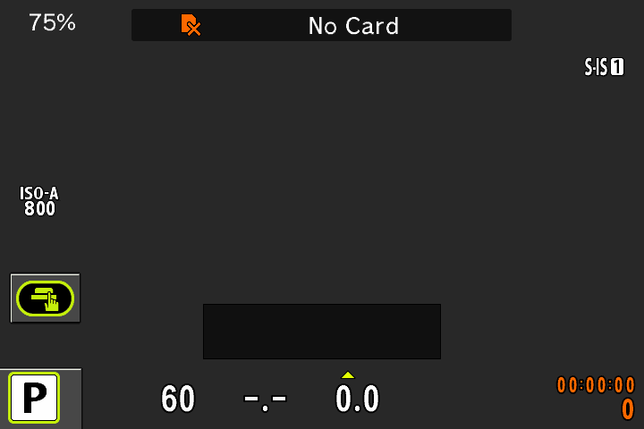
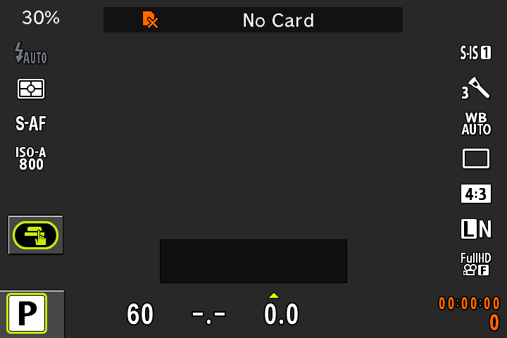
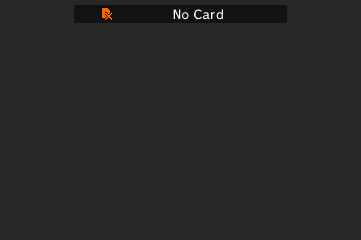

# Extra information on the shooting screen: battery %, focus distance, shutter count

Date: 2026-11-17. Desk work and emulator runs. Nothing was flashed.

Labels: **V** = read in the firmware bytes or run in the emulator. **I** = inferred. **U** = unknown; each has
a probe in section 8. Addresses are runtime addresses of E-PM2 firmware 1.6, block 0 (base 0x7E421020).
A "panel" is one screen layout object. A "widget" is one item on it. "fenykl" is the mod
[atx/fenykl](https://github.com/atx/fenykl) for the E-PL3, the same processor generation.

## 1. Short answer

1. **All three values are easy to read** (section 2). Battery: a 10-bit voltage reading, about 10 mV per
   count; the firmware itself keeps only four levels. Focus distance: one 32-bit word in the lens state, in
   mm (unit I). Shutter count: one stored setting.
2. **The live-view screen is one panel with 154 widgets** (section 3). Text is easy: the GUI has a text
   label class with `setText` and a `sprintf` for wide characters.
3. **A new widget costs one pointer and one 92-byte record** (section 4). The panel builder makes its widgets
   from a table of pointers. Index 0 of that table is an unused zero word.
4. **Step 1 is built and works in the emulator**: `75%` / `30%` at the top left of the live-view screen,
   from the battery voltage. Build `builds/osd-battery.json`, sha256
   `f99c1841f855bccb7975db94027543f33a172cfcc7b9dde299185f69ab7d7e48`, candidate, not flashed (section 6).
5. The percentage scale is inferred from the E-PL3. One camera look calibrates it (section 8).

| 75 % (A/D 800) | 30 % (A/D 728) | Image Only: hidden |
|---|---|---|
|  |  |  |

## 2. Where the values are

### 2.1 Battery

| Fact | Evidence | Label |
|---|---|---|
| The battery module is 0x7E538F6B–0x7E53A981, task BCHK_MAIN 0x7E53A1D0. It has the same structure as the E-PL3's | strings `vbat16`, `vbat8`, `Level`, `src`, `EBCHKAD`; fenykl `firmware.toml` | V |
| A/D read: `bchk_ad_read(channel)` 0x7E539481, wrapper 0x7E539E6A. Channel 4 = battery voltage, 13 = AC input, 11 = battery thermistor. It starts 5 samples into the u16 buffer 0x60503A2C, waits for an event with no time limit, and returns the mean of samples 1 to 4 | code; debug command `vbat` 0x7E539B8A prints the result as `vbat16` and result >> 2 as `vbat8` | V |
| **Resolution: 10 bits (0–1023).** Scale about 9.77 mV of pack voltage per count | 10 bits: V (`vbat8` = value >> 2; AC test `> 783`). Scale: I, from fenykl's one multimeter point on the E-PL3 (7.999 V = 820 counts); both bodies use the same AC threshold 783 | V / I |
| The buffer and the event are shared. Every stock caller holds semaphore 5 (id word 0x7E43EA96; wait 0x7E449409, signal 0x7E4494A1; wrapper 0x7E53A2E9) | code | V |
| The module checks once per second while its flag 0x60503A3E is 1 (queue wait with 1000 ms timeout). That check reads channel 4 and then channel 13, so the buffer does not keep the battery samples | code 0x7E53A1D0, 0x7E53A472, 0x7E539599; emulator: one read per second | V |
| **What the firmware keeps: a level with four values, 100 / 75 / 50 / 1** (u16 0x60503A3A; getter 0x7E53A340, API 0x7E68CC46). It comes from `vbat8` and threshold bytes chosen by temperature and lens (0x7E539408). It only goes down | code 0x7E53903C, 0x7E5390F8 | V |
| Power source: u16 0x60503A3C (0x100 = AC, 0x200 / 0x400 = battery) | 0x7E53963A; fenykl | V |
| The GUI gets a state 0–4: unknown (AC), high (> 75), middle (75), low (50), empty (≤ 1) | 0x7E9A040F, 0x7EBA274A, strings `BATTERY_STATUS_HIGH` … | V |
| The stock battery icon is drawn from that state | not traced to its widget | I |
| The BLS-5 has no gauge chip that the body reads: the module has voltage, thermistor and AC input only | no other battery read in the module | V for the code |

So a percentage must be made from the voltage. The firmware has no finer value.

### 2.2 Focus distance

| Fact | Evidence | Label |
|---|---|---|
| Lens state getter `lens_info_get(0)` 0x7E51FD09: returns 0x604F657C, or 0 with no lens that answers | code (214 callers) | V |
| State at +4: `state` u32, `zm_enc` u8 (+8), `fc_enc` u8 (+9), **`obj_dst` u32 at 0x604F6588**, `av_effect` u16 (0x604F658C) | debug dump 0x7E5268F4 (`obj_dst = %x`) | V |
| The value comes from the lens status packet (field `OBJ_DST`, 32 bits) | dump 0x7E525ABA | V |
| Unit: mm; 0xFFFFFFFF = infinity | fenykl reads the same field on the E-PL3 (same layout: state + 8) and shows it on the camera | I for this body |
| The EXIF maker-note field FocusDistance is written from this state | not traced | I |
| Real step size: depends on the lens (its own encoder table) | – | U |

### 2.3 Shutter count

| Fact | Evidence | Label |
|---|---|---|
| The service screen prints `R:%06d S:%06d C:%06d U:%06d V:%06d B:%06d L:%06d` | panel code 0x7ED40B46; debug command 0x7E99CAF9 ("Maintenance (PAGE 2)") | V |
| Source: `api_info_Get_System_LifeInformation` 0x7E680336. R = stored setting tag **0x8344** (setting id 4000, u32, EEROM bank). S = tag 0x8354 (id 4001). C, U, V, B = tags 0x38A4, 0x38B4, 0x3894, 0x3874 | code; `07-settings.tsv` | V |
| Read with `prm_get(tag, 0, 0)` 0x7E457C75, or `getSetting(4000)` in the GUI | code | V |
| R is the release count (the usual reading of this screen) | – | I |

## 3. How the shooting screen is drawn

| Piece | Address | What it does | Label |
|---|---|---|---|
| Live-view panel | class 0x600A (panel number 10); constructor 0x7ED6098C, vtable 0x7EF67B38 | 154 widgets on OSD layers 1 to 3. Object: child pointers at +792 (slot 0 unused, slots 1–154) | V |
| Builder | 0x7ED60A3E | for index 1..154: `Create(type, panel, record)` 0x7ED17DB8 with the record pointer from the RAM table 0x602B8A14 (initial values in the image at 0x7E8E8ED4), add as child, store at panel + 792 + 4·index | V |
| First refresh / data-update refresh | 0x7ED60A95 / 0x7ED60F27 (vtable words 0x7EF67CA4, 0x7EF67CC8) | call one small function per item; each reads the panel's copy of a data-model slot and sets its widgets | V |
| Data model | get 0x7ECEF64F, set 0x7ECEF667 | In live view the Rec viewer update 0x7ED99847 writes the slots 31 (40 B), 32 (74 B), 33, 34, 35, 37, 22, 24, 40, 98, 102 and 68 (level gauge) | V (emulator trace) |
| When it runs | – | On events, not on a timer. Emulator: at the start of the screen and after each key, then nothing. On the camera the exposure values change often | V emulator / U camera rate |
| Widget classes | 0x8003 image list (icons); **0x8013 image-font string**; **0x8010 text label** | see below | V |

**Numbers and text**

| Tool | Address | Notes | Label |
|---|---|---|---|
| Wide-character `sprintf(a0 = text, (4,sp) = format, (8,sp)… = values)` | 0x7ED37429 (332 calls) | `%d`, `%02d`, `%s`, `%c`, `%X` work. `%%` does not: it prints two signs | V |
| Text label `setText(a0 = label, a1 = text)` | 0x7ED2D510 | UI font, every character. Copies the text; no redraw when it is equal | V |
| Image-font string `setString(a0 = widget, a1 = text)`; font setter | 0x7ED28AB1; 0x7ED28CDD | the look of the stock numbers (shutter speed = font 10). 30 fonts, digits and a few signs: `results/image-fonts.txt`. No font has `%`. Fonts 7, 12–15, 18, 27 have `m`; fonts 2, 10, 19–21, 29 have `.` | V |
| `setVisible(a0 = widget, d0)` | 0x7EDC1851 | – | V |

**Widgets that exist and are free or hidden** (`results/lv-panel-children-stock.txt`)

| Widget | Finding | Label |
|---|---|---|
| Child slot 0 and table index 0 | never used: the builder starts at 1; the image word 0x7E8E8ED4 is 0 | V |
| Ids 155 / 156 (image-font, top right), 153 / 154, 199 / 200, 206–209 | hidden in normal shooting; stock code shows them in some states (0x7ED625D5 writes a value / 10 and its last digit into 155 / 156). Their purpose is not known | V hidden, U purpose |
| Text labels ids 193, 201 | hidden; stock code sets them by text id in some states | V |

Re-using a hidden stock widget saves 92 bytes of data. It risks a clash when the stock state appears. A new
widget has no such risk, so step 1 adds one.

## 4. The smallest way to add a number

**Add a widget by data** (V, emulator):

1. Write a 92-byte record for a text label (copy of the stock record 0x7EF674D0: type 0x8010, an id, a
   pointer to two rectangles `{x, y, w, h}` on the 720 × 480 screen, layer 2, text style 22, alignment).
   A record that is too short gives a filled box and no text: the class reads 92 bytes.
2. Point table index 0 (image word 0x7E8E8ED4) at the record.
3. Let the builder start at index 0: two bytes (`mov 1,d3` → `mov 0,d3`, `mov 4,d2` → `mov 0,d2`).

Cost: 92 + 16 bytes of data, 6 changed bytes. Only one free index exists. A second widget needs a longer
table (move 156 words, change three constants 155 and the object size), or one label that shows several
values in one text, which is the cheaper way.

**Fill it**: one routine at the end of both refresh functions, in place of their last call
(`call 0x7ECEDE74,[],8` at 0x7ED60F1D and 0x7ED61377). It runs the replaced call, formats the value and
calls `setText`. The label follows the visibility of the shutter-speed widget (child 71), so it hides in
Image Only without a rule of its own.

**INFO display modes**: the label is on the panel of every live-view information mode. No new mode is
needed. A new mode in the INFO cycle is not easy: the rule table has one rule per combination of five
settings (level-gauge notes, section 3.3), and the mode numbers are a fixed switch.

## 5. Code placement

| Item | Place | Size | Label |
|---|---|---|---|
| Routine T_INIT / T_UPD | 0x7EBF1F4F–0x7EBF1FCA | 123 B | V |
| Routine T_BATT | 0x7EBF2F6C–0x7EBF2FF1 | 133 B | V |
| Record, rectangles, format | 0x7EBF256C–0x7EBF25EA | 126 B | V |
| Free after this spec in the segment-2 area 0x7EBF1090–0x7EBF3BAD | 722 B in 16 runs; the longest are 120, 116, 112 and 108 B (`tools/freespace.py area 0x7EBF1F4F`) | – | V |
| RAM | 0x602BE8C8 (u32 time of the last read), 0x602BE8CC (u16 last count): slots 21 and 22 of the table 0x602BE874. No constant in the image names them and their initial values are 0 (the argument of focus-peaking notes 11.3 for slot 20) | 6 B | V static |

The two hooks are in segment 3 (GUI code) and jump to segment 2. Both segments are loaded by the same
task, so the kernel rule does not apply (`emulator/hookcheck.py patches/osd-battery.json`: 12 transfers,
0 FAIL). The routine calls kernel and segment-1 code (timer, semaphore, A/D read), which is loaded earlier.

## 6. Step 1: `patches/osd-battery.json`, build `builds/osd-battery.json`

Generator: `scripts/mkspec_osd_battery.py`. 8 operations, 382 new bytes, 15 changed bytes.

What the routine does at each refresh of the panel:

1. Nothing in the first 3 s after power-on (until the first read). The start-up then does the same work as
   before, and the boot report of the emulator stays equal to stock's.
2. At most once in 2 s: wait up to 20 ms for semaphore 5; if the module's check flag 0x60503A3E is 1, read
   channel 4; signal. This is fenykl's method on the E-PL3. Its read took 5 to 7 ms there.
3. Percentage = (count − 680) × 5 / 8, limited to 0–100. So 0 % = 6.64 V and 100 % = 8.21 V (I).
4. `sprintf("%d%c", value, '%')`, `setText`, `setVisible`.

| Check | Result |
|---|---|
| `epm2mod make builds/osd-battery.json` | sha256 `f99c1841f855bccb7975db94027543f33a172cfcc7b9dde299185f69ab7d7e48`; free-space check PASS; boot-test PASS; update-path-test PASS |
| `epm2mod make` afterwards | `build/card` holds the pinned build `2cdd18e7…` again |
| Emulator, A/D input 0 = 800, then 728 (`scripts/shots.sh`) | the label shows 75 %, then 30 % (pictures above) |
| INFO cycle, MENU and back, playback and back | the label is in every information mode, hidden in Image Only, and comes back after the panel is made again |
| An earlier version read the battery during start-up | boot-test FAIL: two periodic counters differed by one. This is why item 1 exists |

**The emulator cannot show**: the real voltage (its A/D inputs are fixed numbers; input 0 feeds channel 4),
the real refresh rate of the panel, the look on the live picture, the real position of stock items at the
top left (fenykl uses the same corner on the E-PL3), the cost of the read during live view and AF.

**On the camera** (for the person who flashes; write the sha256 in `docs/camera-log.md` first):

```bash
scp USER@HOST:/path/to/epm2-tools/build/osd-battery.BIN /Volumes/SDCARD/DCOLYMP/E1019999.BIN
shasum -a 256 /Volumes/SDCARD/DCOLYMP/E1019999.BIN    # f99c1841f855bccb7975db94027543f33a172cfcc7b9dde299185f69ab7d7e48
cd ~ && diskutil eject /Volumes/SDCARD
```

Make the file first with `uv run epm2mod make builds/osd-battery.json` (it also fills `build/card`).
Flash as in `docs/flashing.md`. Then:

1. Power on in P. Before: the top left corner of the live-view screen is empty. New: a white number with
   `%` there, a few seconds after power-on.
2. Press INFO several times. The number is in every information mode and not in Image Only.
3. Note the number with a full battery and with a battery that shows the red warning.

| Result | Meaning |
|---|---|
| A plausible number that falls slowly | works; send the two numbers of item 3 for the scale |
| `100%` always, or `0%` always | the scale is off for this body; the reading works |
| The number appears late or changes only when a setting changes | the panel refreshes rarely on the camera; step 3 of the plan needs a timer |
| No number | the label is not visible on the real layer or palette; send a photo of the screen |
| Live view stutters or the camera freezes | the read does not fit the GUI task; flash the pinned build (`uv run epm2mod make`, same copy commands with `build/films-12d.BIN`) |

## 7. A menu switch

| Fact | Evidence | Label |
|---|---|---|
| LV-Info (panel 192) has 4 rows now: 244, 245, 246, 273. Its child list at 0x7EFFA244 has 4 entries, a zero entry, and then the next list | pinned image | V |
| Three row records of the unused panel 594 are left: 0x7EFF03FC (setting 446, text 844), 0x7EFF0410 (447, text 842), 0x7EFF0438 (449, text 845), with their picker panels 607, 608, 610 | pinned image | V |
| Settings 446, 447, 449: tags 0xD781, 0xD791, 0xD7B1, MODE bank, one byte, default 0. No code reads them | `07-settings.tsv` | V |
| A list with 5 rows works (panel 193 has 5) | pinned image | V |

Plan for a fifth row "LV-Info → (name) → Off / On": change one row record to `{192, 1646, 446, 2, 7, 1, text, 0}`;
write a 6-entry child list (48 B) in free data space with (607, 446) as fifth entry and point panel 192's
record (0x7EFFB040) at it; the routine reads `getSetting(446)`. The setting is not in the INFO rule table, so
the INFO cycle does not change. Open points: the row text (text 844 is "Histogram"; a new text needs the
block-1 method of the film names), and that picker panel 607 shows Off / On for setting 446 (I, the emulator
can show it).

## 8. Build plan

| # | Step | Effort | Proves or needs |
|---|---|---|---|
| 1 | **Done here:** battery % label, candidate build | – | camera look (section 6) |
| 2 | Calibrate: show the count beside the % for one flash (`"%d%c %d"`), read it at full, at the red warning and at shut-off; set the two constants. Better: fenykl's curve (12 points) and its median filter, about 150 B | 1 hour + one flash | the scale; also shows how often the panel refreshes |
| 3 | Focus distance in the same label: `lens_info_get(0)`, word +12; `"%d.%02dm"` below 10 m, `"%dm"` above, nothing for 0xFFFFFFFF or no lens. About 90 B | 2 hours + one flash | unit and step size on the owner's lenses (U); whether the panel refreshes while the focus ring turns (U). If not: a refresh trigger, for example a GUI timer message or a data-model set of slot 98 from the lens state change, about 60 B more |
| 4 | Shutter count: `getSetting(4000)` in the label of one information mode, or only for 3 s after power-on. About 40 B | 1 hour, same flash as 3 | that R is the release count (compare with the service screen or the EXIF of a new picture) |
| 5 | Menu row (section 7) | 3 hours; emulator shows the row and the picker | text for the row |
| 6 | Look: the stock number look (class 0x8013, font 14) instead of the UI font; colour by level | 2 hours | a `%` image, or no sign |

Code space: steps 2 to 5 need about 350 B. 722 B are free in the segment-2 area, in runs of 120 B or
less, so the code must be cut into pieces, or the label code moves to another listed area.

## 9. Risks and unknowns

| Item | Label | Probe |
|---|---|---|
| The A/D read from the GUI task during live view, AF and capture. fenykl does it once per second from its own task on the E-PL3 | I | step 1 on the camera: stutter or freeze |
| Scale and offset of the count on this body; sag under load (fenykl: 7 counts in live view) | U | step 2 |
| How often the panel refreshes on the camera | U | step 2 shows it |
| Unit and resolution of `obj_dst` on this body and per lens | I / U | step 3: focus on a ruler at 0.5 m and 2 m |
| The label on the real layer-2 palette over the live picture (white text, no outline) | I | step 1 |
| A stock item at the top left in some mode (card write mark, movie items) | U | step 1; the rectangle is 8 bytes in the spec |
| RAM slots 21 and 22: free by a static scan only | I | step 1: Custom Menu lists still open correctly |
| On AC power the label shows a number without meaning | V | hide when 0x60503A3C = 0x100 (10 B); not in step 1, because the emulator's battery stand-in reports AC |
| The 30-bit microsecond timer wraps every 17.9 min; the 2 s limit handles it by masking | V | – |

## 10. Files

- `scripts/mkspec_osd_battery.py`: writes the spec (assembler source inside). `scripts/scratch-build.sh`: a
  scratch image without a build description. `scripts/shots.sh`: the screenshots.
- `scripts/trace.mjs`: emulator observers (widget creation, text, data-model sets, battery reads, the
  panel's children, the image fonts). `scripts/fn.sh`: one function from the function listing.
- `results/osd-battery-listing.txt`: the assembled routines. `results/lv-panel-children-stock.txt`: the 154
  widgets of the live-view panel (type, id, rectangle, status) on stock. `results/image-fonts.txt`.
