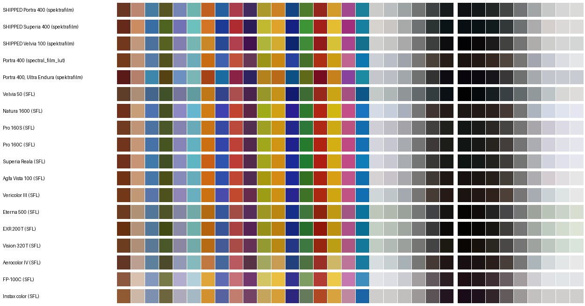

# Other sources of film simulations: four open-source projects

Date: 2026-11-19. Desk work only: no flash, no new film in the catalogue. Labels: **V** = measured or read here,
**I** = inferred.

Question (owner): can these projects give us more film simulations? Owner's rule: only sources whose licence is not
ambiguous.

- spektrafilm, https://github.com/andreavolpato/spektrafilm (our current source)
- spectral_film_lut, https://github.com/JanLohse/spectral_film_lut
- t3mujinpack, https://github.com/t3mujin/t3mujinpack
- Film-Luts, https://github.com/YahiaAngelo/Film-Luts

## 1. Short answer

| Source | Licence of the colour data | Usable (owner's rule) | New films for us |
|---|---|---|---|
| spektrafilm | CC BY-SA 4.0 on profiles and on LUTs and other derivatives (SPEKTRAFILM_LICENSE.txt); code GPL-3.0 | Yes; we already follow it (NOTICE.md, data/films/README.md, the site's film credit) | No new film stock: all 22 of its films are in our catalogue. Other print papers: only Ultra Endura is clearly different |
| spectral_film_lut | MIT (code and the digitized datasheet curves) | **Yes** | Yes, see section 3 |
| t3mujinpack | MIT label; looks hand-tuned against G'MIC's film LUTs, which imitate commercial preset packs | **No**: the lineage makes it ambiguous | (not tested) |
| Film-Luts | MIT label, but its README disclaims ownership; upstream files have no licence; part is a capture of Fujifilm's own rendering | **No** | (not tested) |

## 2. Licences (background research, quoted sources)

- **spektrafilm** (**V**): SPEKTRAFILM_LICENSE.txt puts the profiles and "all direct derivatives of the profiles, such
  as copies in other projects, LUTs, or any other format that encodes the same content" under CC BY-SA 4.0, with
  attribution on every copy and derivative (Andrea Volpato, the repository, the licence, a note of the change). The
  profiles say their data comes from data sheets and papers. Our fitted films follow this already (NOTICE.md row
  "Film look data"). Stale wording found: that row still says "the seven film looks".
- **spectral_film_lut** (**V**): MIT, "Copyright (c) 2026 Jan Lohse". README: "its datasheet was digitized"; the
  stock files hold digitized curve points. No other terms on data or exported LUTs. Credit Jan Lohse and keep the MIT
  notice. Note (**I**): film names (Kodak, Fuji) are trademarks used descriptively, as we already do.
- **t3mujinpack** (**V**): MIT; README: driven "mostly by G'MIC film emulation, which has been one of the main
  references"; Lab tone curves tuned by hand (issue #6). G'MIC's film LUTs come from Pat David, who set out to
  replicate "a very popular set of film emulation presets that are available commercially"
  (https://patdavid.net/2013/08/film-emulation-presets-in-gmic-gimp/). (**I**) Not copied data, but the look traces
  back to commercial packs: ambiguous.
- **Film-Luts** (**V**): README: the maintainer "does not claim ownership of the LUTs" and they "might be subject to
  copyrights ... of their respective owners". Its folders are G'MIC's film set; `fujixtransiii` is Stuart Sowerby's
  capture of Fujifilm's RAW FILE CONVERTER rendering (http://blog.sowerby.me/fuji-film-simulation-profiles), with no
  licence. The MIT label cannot cover files the maintainer did not make.

## 3. spectral_film_lut as a target source

### 3.1 It fits our pipeline (**V**)

- `pip install spectral_film_lut` (0.18.14, Python 3.11+; kept out of the project environment, in a separate venv).
- Headless export: `scripts/sfl_build.py` opens the app's own window off-screen and calls its `generate_lut`, so every
  setting is the app's default. Input V-Gamut with the V-Log curve (it decodes the curve:
  `RGB_to_XYZ(..., apply_cctf_decoding=True)`), output Rec. 709 primaries with the sRGB curve, 33 points: the format
  of our targets (`spektrafilm-lut build --input vlog --output srgb --resolution 33`). About 2 s per LUT.
- `fit_film2.py --lut` takes these LUTs unchanged.

### 3.2 It is a different simulation of the same films (**V**)

Same film and paper in both, mean ΔE2000 (`scripts/cmp.py`: ColorChecker at mid grey 0.18, grey ramp, 2000 random
scene colours):

| Film | ColorChecker | random | For scale |
|---|---|---|---|
| Portra 400 on Portra Endura | 6.2 | 7.2 | spektrafilm Portra 400 vs Portra 160: 1.3; Portra 400 on Endura vs on 2383: 3.1 |
| Portra 160 on Portra Endura | 5.1 | 6.2 | |
| Superia X-Tra 400 on Crystal Archive | 7.2 | 9.2 | |
| Ektachrome (viewed as a slide) | 5.2 | 5.2 | |

Where (`scripts/profile.py`, Portra 400): the tone curves nearly agree (grey L* within 3). The hues do not: cyan 261°
vs 230°, magenta 351° vs 335°, blue 294° vs 282°; blue and red more saturated. Its negatives also tint the grey
scale: shadows warm (b* +3 to +5 at −3 EV) and highlights cool (b* −4 to −7 at +2 EV), where spektrafilm stays
within ±2. Its white-balance option is for slide film only. Its slides come out darker and tinted at mid grey
(Ektachrome L* 45, b* −4.8). So a spectral_film_lut film would not look like a sibling of our spektrafilm films, and
whites and skies would come out a little blue.

### 3.3 New films and how distinct they are (**V**)

Distance to the nearest film, both from spectral_film_lut (so the simulator offset does not count), mean ΔE2000 over
ColorChecker and 600 random colours (`scripts/nearest.py`). The camera reproduces a target to about ΔE 1–2, so a
distance under about 3 is a variation, not a new look.

| New film | Nearest film we already ship (its SFL version) | Distinct? |
|---|---|---|
| Fuji FP-100C (instant) | Portra 400, 10.1 | Yes |
| Fuji Instax color (instant) | Portra 400, 9.4 | Yes |
| Kodak Aerocolor IV 2460 (aerial negative) | Portra 160, 6.5 | Yes |
| Agfa Vista 100 | Portra 400, 3.6 | Somewhat |
| Fuji Superia Reala | Superia X-Tra 400, 3.5 | Somewhat |
| Kodak EXR 200T 5293 (cine) | Vision3 500T, 3.2 | Somewhat |
| Fuji Velvia 50 | Ektachrome, 2.8; Provia, 3.2 | Variation |
| Kodak Vericolor III | Superia X-Tra 400, 2.9 | Variation |
| Fuji Pro 160S | Superia X-Tra 400, 2.8 | Variation |
| Fuji Eterna 500 (cine) | Vision3 500T / 200T, 2.5 | Variation |
| Fuji Natura 1600 | Superia X-Tra 400, 2.4 | Variation |
| Fuji Pro 160C | Superia X-Tra 400, 1.9 | Variation |
| Kodak Vision 320T 5277 (cine) | Vision3 500T, 1.8 | Variation |

Other stocks it has and we did not build: Aerochrome III (infrared: a visible-light camera cannot reproduce it),
Kodak 5222 and Tri-X development variants, EXR 100T 5248, 5247, 5250, Technicolor, Ilfochrome and dye-transfer
prints, more Fuji papers.

Each row: the 24 ColorChecker patches and a grey ramp −4 to +4 EV through the target LUT. The first three rows are
films we ship (spektrafilm).

### 3.4 Can the camera reach them

`fit_film2.py --lut TARGET --name NAME` (the first fit of a new film, model only, no camera), predicted ΔE2000. Our
shipped films' first fits: weighted 0.57–1.11, ColorChecker 1.3–2.2 (`../2026-11-09-film-portra/out/film-*_report.txt`).

| Target | weighted | grays | ColorChecker | skin | natural |
|---|---|---|---|---|---|
| Portra 400 (SFL) | 0.92 | 0.78 | 1.79 | 1.26 | 0.79 |
| Eterna 500 | 0.71 | 0.52 | 1.71 | 0.95 | 0.79 |
| Vision 320T | 0.71 | 0.45 | 1.73 | 1.11 | 0.88 |
| Pro 160C | 0.77 | 0.54 | 1.83 | 0.93 | 0.90 |
| Velvia 50 | 0.79 | 0.50 | 2.11 | 1.22 | 0.86 |
| Agfa Vista 100 | 0.81 | 0.49 | 2.00 | 1.37 | 1.03 |
| Aerocolor IV | 0.83 | 0.71 | 1.64 | 0.96 | 0.72 |
| EXR 200T | 0.84 | 0.58 | 2.08 | 1.62 | 1.04 |
| Pro 160S | 0.84 | 0.72 | 1.73 | 0.94 | 0.74 |
| Superia Reala | 0.85 | 0.61 | 1.94 | 1.13 | 1.02 |
| Vericolor III | 0.93 | 0.61 | 2.17 | 1.21 | 1.12 |
| Natura 1600 | 1.12 | 0.94 | 2.22 | 1.35 | 1.26 |
| FP-100C | 1.17 | 0.82 | 2.32 | 1.25 | 0.79 |
| **Instax color** | **1.80** | 1.40 | **4.01** | 2.25 | 1.41 |
| Portra 400 on Ultra Endura (spektrafilm) | 1.13 | 0.64 | **3.17** | 1.47 | 1.59 |

All but Instax and the Ultra Endura paper are inside the range of our shipped films. Instax and Ultra Endura are
beyond it: the camera's stages cannot follow them as closely (**V** for the model; the camera check is the usual next
step). The fit took 5 min alone, 6 min with four in parallel at 2 maths threads each (unlimited threads oversubscribe
the 8 cores: 4× the CPU time).

## 4. spektrafilm's other print papers (**V**)

spektrafilm at our pinned commit 3bb2c2d (Python 3.13 venv). Portra 400 on other papers, ColorChecker ΔE2000 against
our Portra 400 on Portra Endura: Supra Endura 1.6, Ektacolor Edge 2.2, Endura Premier 3.3, **Ultra Endura 6.6**
(more contrast: grey L* 2 at −4 EV against 5; reds and greens rotated warmer). Vision3 250D on Kodak 2393 instead of
2383: 1.7. Only Ultra Endura gives a new look; same licence as our films.

## 5. Not done

- t3mujinpack and Film-Luts: no desk test (licence rule).
- No camera check; no film added to `data/films/catalogue.json`.
- Whether spectral_film_lut's or spektrafilm's version of a film is closer to the real film: neither is a measurement
  of real film; this needs scans of real prints.

## 6. Files

`scripts/sfl_build.py` (headless export), `scripts/cmp.py`, `scripts/profile.py`, `scripts/nearest.py`,
`scripts/swatch.py`; the LUTs and fits are outputs (not committed): LUTs in a scratch folder, fits in
`../2026-11-09-film-portra/out/fit_sfl-*.npz` and `out/sfl-*_report.txt`.

## 7. Added to the catalogue (2026-11-20)

Owner: list every viable film as a choice, not as a default, except films very close to one we ship. Added (fits
copied from `../2026-11-09-film-portra/out/fit_sfl-*.npz`, the `lut` field rewritten to how the target was built):
Velvia 50, Natura 1600, Pro 160S, Superia Reala, Agfa Vista 100, Vericolor III, Aerocolor IV, Eterna 500, EXR 200T,
FP-100C. Note in the catalogue: "simulated with Spectral Film LUT". The installer's preset (ART 1–12) is unchanged.

Left out: Vision 320T (ΔE 1.8 from Vision3 500T in the same simulator: another Vision3), Pro 160C (1.7 from Pro 160S,
1.9 from Superia X-Tra 400), Instax (fit ColorChecker 4.0, outside our range), Portra 400 on Ultra Endura (fit
ColorChecker 3.2, outside our range; another Portra).

Against the films we ship (spektrafilm), every added film is at least ΔE 4.5 away (part of that is the simulator
difference, section 3.2). None is camera-checked: each is a first fit (model only), like Provia or Ektar before.
