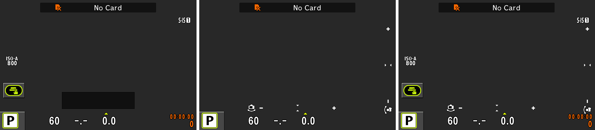
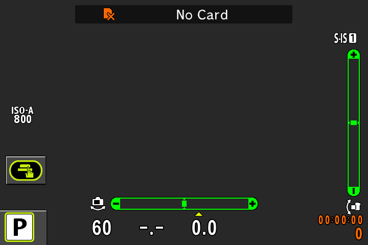
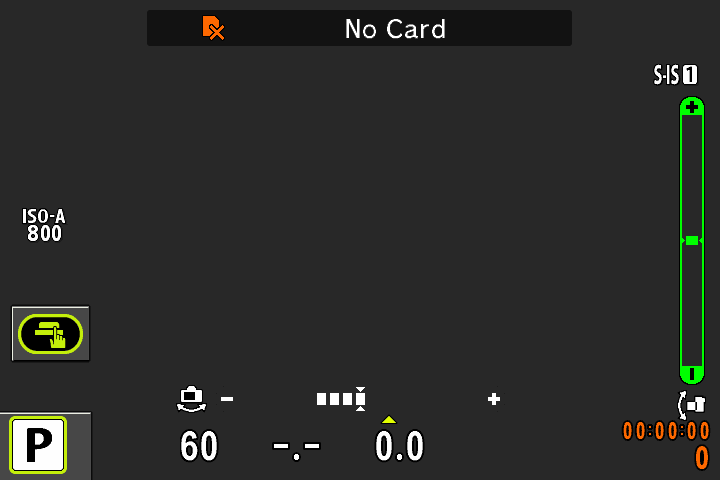

# Level Gauge screen with the shooting information (issue #1)

Date: 2026-11-19. Desk work and emulator runs. Nothing was flashed.

Labels: **V** = read in the firmware bytes or run in the emulator. **I** = inferred. **U** = unknown.
Addresses are runtime addresses of E-PM2 firmware 1.6, block 0 (base 0x7E421020).

## 1. Short answer

1. **Goal** (owner, from [issue #1](https://github.com/cfu288/EPM2Mod/issues/1)): the Level Gauge screen shows
   everything the histogram screen shows, with the two gauge bars in place of the histogram.
2. **Newer bodies do this.** The PEN-F manual (p. 23) shows its "Level gauge display (Custom display 2)" with the full
   shooting information (shutter, aperture, ISO, S-IS, counters) and both bars. Its LV-Info has Custom1 and Custom2
   (texts 1844, 1845, 2604, 2605 of its English table). The E-PL6 and the E-PM2 show the gauge with almost nothing else.
3. **Cause on the E-PM2** (**V**): the data producers of the live-view panel run only for the layouts in their list.
   The histogram screen is layout 8, the gauge screen layout 22. Eleven lists hold 8 and not 22.
4. **Candidate** `data/specs/gauge-info.json` (generator `scripts/mkspec_gauge_info.py`): each of the eleven lists gets a
   copy with 22 added (336 bytes in free data space of segment 3); its code points at the copy. 33 byte edits, no code,
   no hook. Build `data/builds/gauge-info.json`, sha256
   `c21ae4c4cf9c776a41f411216fd0599a228a6b005cfc7ce343e6181395f2ab0a`.
5. In the emulator the gauge screen now shows ISO-A, S-IS, the touch icon, the mode, shutter, aperture, exposure
   compensation, movie time and frame count, and the bars move with the tilt. The other INFO screens are pixel-equal to
   the pinned build. Free-space check, boot-test, update-path-test and hookcheck pass.

Left to right: histogram screen, gauge screen of the pinned build, gauge screen of the candidate.

| Candidate, level | Candidate, 3° roll |
|---|---|
|  |  |

## 2. How the screen gets its data

| Fact | Evidence | Label |
|---|---|---|
| The live-view panel (154 widgets, `../2026-11-17-osd-info/NOTES.md`) differs between the histogram and the gauge screen in 7 children only: ISO (id 113), S-IS (116), movie time (86), frame count (87), touch icon (135), histogram (196) hidden on the gauge screen; the gauge sub-panel (child 17) shown | child dump of both screens (`../2026-11-17-osd-info/scripts/trace.mjs` TRACE=kids, driver `scripts/drive.mjs`) | V |
| The widgets hide because their data is empty: e.g. the ISO item 0x7ED61709 hides when its value is 0 | code; data-model slots 31, 34, 37 differ between the screens (TRACE=set) | V |
| The rec-view update 0x7ED99847 calls the layout selector 0x7ED99ABF, then 77 producers from the table at 0x602BC070 | code | V |
| The selector maps the display-mode setting (28) to a layout in viewer +764 for still live view: 4 → 5 (information), 2 → 8 (histogram), 3 → 2 (image only), 14 → 22 (level gauge), 15 → 11, 13 → 19, else 20. Movie live view uses other layouts (gauge 23 or 24, histogram 9 or 10) | code 0x7ED99D28–0x7ED99D5E; selector inputs and result logged per screen (`scripts/selin.mjs`), matched to screenshots | V |
| Each producer gate: if viewer +760 = 1, run only if +764 is in a list of 32-bit layouts (`mov imm32,aN` loads the list, a one-byte `cmp`/`mov` holds its length). E.g. movie time and frame count: 0x7ED9B484, list 0x7EFCF9C8 = {5, 8, 11, 12, 19, 20} | code | V |
| All lists the rec-view code loads: `results/layout-lists.txt` (`scripts/lists.py`). 11 hold 8 and not 22; the histogram's own list 0x7EFCFA18 = {8, 9}; the gauge producers' lists 0x7EFD0F50/5C/68 = {1, 22, 23} | static | V |

## 3. The spec

For each of the 11 lists: a copy with 22 at the end in 0x7EE46DC0–0x7EE46F10 (`tools/freespace.py` USABLE-DATA area of
reclaimed code in segment 3, the segment of the readers), the 4-byte address in the `mov`, and the length byte. The
generator asserts every expected byte.

Not changed: the histogram list (no histogram on the gauge screen), the gauge lists, movie live view (layouts 23/24).

## 4. Open points

| Item | Label | Probe |
|---|---|---|
| iAUTO, A, S, M, ART, SCN: the gauge screen there | U: my key path to Level Gauge did not reach the row in the iAUTO state; the selector path is the same for still live view (I) | camera, or a menu path per mode in the emulator |
| Overlap on the real screen: the vertical bar's end icon ends about 3 px above the movie time; the horizontal bar's marks sit above the exposure value | V in the emulator (screenshots) | camera look |
| Items the emulator never shows (flash, face detection, card count with a card, warnings) follow the same lists | I | camera look |
| Movie mode keeps the old gauge screen | V by the lists (not changed) | – |
