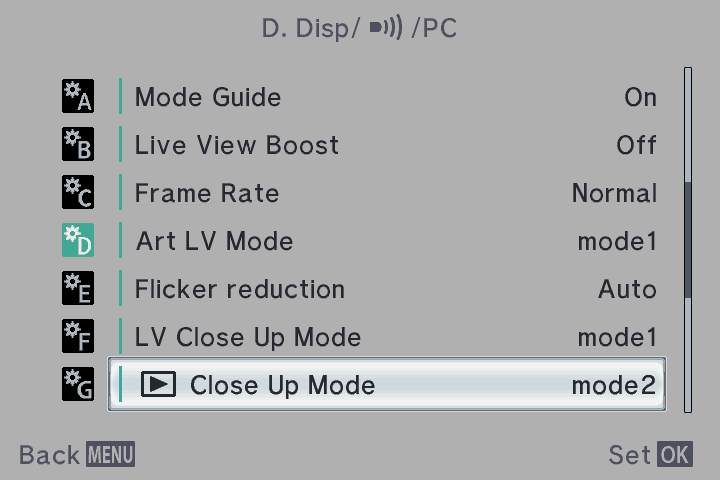
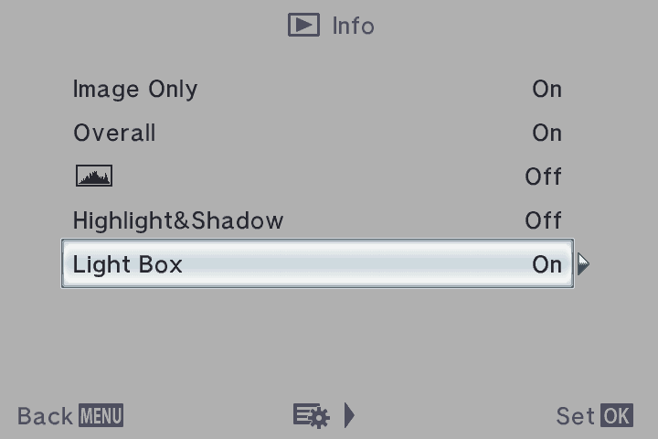
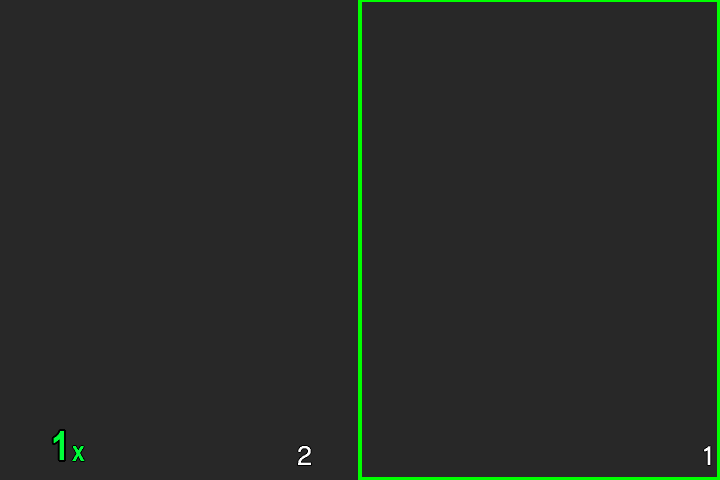

# Light Box: notes

The design and the acceptance criteria are in [design.md](design.md). Labels: **V** verified (firmware bytes,
emulator, manual), **I** inferred, **U** unknown.

## Build light-box (2026-11-24)

Emulator and desk only. Not flashed.

### What was built

`gen/light-box/mkspec.py` writes two specs. `data/builds/light-box.json` is the pinned build peaking-mf with
`custom-menu-rows-4` in place of `custom-menu-rows-3` and `light-box-row` added last. Data only: no code, no hook.
Label 2026.11.24.

| Spec | What it changes |
|---|---|
| `custom-menu-rows-4` (49 ops) | `custom-menu-rows-3` with one row more: ▶ Close Up Mode in group D after LV Close Up Mode. The row is the E-PL5 1.6 record `{3, text 208, setting 321, order 0, help 1126, value list 130, 0}`, and the child entry is (130, 321), both at index 34, as on the E-PL5. Item table: 84 rows at **0x7EBF1FD0**, 16 B earlier than before, in the free run 0x7EBF1FCA–0x7EBF1FE0; it still ends at 0x7EBF2512. Child list: 85 entries in place at 0x7EE3CBF4. Debug Log's value → text list moves 8 B to 0x7EE3CE9C. Constants: last index 83, count 84, row-state array 168 B (RAM to 0x606A31BF; the next object is at 0x606A32F0). Rows in group D: 17 → 18 |
| `light-box-row` (2 ops, 36 B) | The sub-item row of panel 594 for setting 449 (0x7EFF0438) becomes `{191, title 150, setting 257, 2, 7, 1, text 868}`, equal to the E-PL5 row. Panel 191's child list (0x7EFF91FC) gets the fifth entry (198, 257) in place of its end entry, and the end entry moves 8 B into panel 192's old list 0x7EFF9224 |

Two choices differ from the plan in design.md §4:

- **No free space for panel 191's list.** Panel 192's old list at 0x7EFF9224 follows panel 191's list. No word in
  block 0 points at it since `level-gauge-lvinfo-row` moved panel 192's list (**V**, a scan of all four address
  aliases at every byte offset of the build's block 0). So the list grows in place, as the E-PL5's list does. The
  open point "free space for a 48-byte child list" is settled: none is needed.
- **The item table moved 16 B earlier**, as `custom-menu-rows-3` did. The free run before the table is 22 B
  (`tools/freespace.py area 0x7EBF1FE0`).

The texts 208, 1126 and 868, the value list of panel 130 (mode1 / mode2, at 0x7F014584) and the list of setting 257
(Off / On) are stock, so both rows read the same in every menu language (**V**: text table; the value lists from the
build's bytes).

### Checks

sha256 **`4c689d47520f6d7d09c6751174fb8846f7735b8f66c5f4688b564784a3945917`** (`uv run epm2mod make light-box`).

| Check | Result |
|---|---|
| `uv run epm2mod make light-box` with the free-space check | exit 0; check PASS (0 FAIL); 21 specs, 25,278 bytes changed |
| `emulator/hookcheck.py` (all 21 specs) | exit 0; 260 transfers, 0 FAIL |
| `emulator/opcheck.py data/builds/light-box.json` | exit 0; 578 byte ops, 0 FAIL |
| `emulator/boot-test data/builds/light-box.json` | exit 0, PASS |
| `emulator/update-path-test data/builds/light-box.json` | exit 0, PASS |
| Crawl `p-nocard-shallow`, `crawlcmp.py` against peaking-mf | exit 0. 268 screens equal by name; 1 differs: the Firmware screen's label (2026.11.24 against 2026.11.20, `results/firmware-label.png`). Custom Menu rows 83 → 84: 10 screens lost and 11 new, all cursor positions of group D's second page (custrows 28–38). The same firmware errors on both (`0x2a001001` at start) |
| Crawl `p-nocard-full`, `crawlcmp.py` against peaking-mf | exit 0. Units other than the Custom Menu rows: 820 screens, all equal (the full setup unit does not reach the Firmware screen; it ends early on both images). Custom Menu rows, by content: 1,537 screens in both; 41 lost and 47 new, all under group D: the ▶ Info list and its value boxes (5 rows in place of 4), and the value boxes of D's rows, where the greyed list behind the box shows ▶ Close Up Mode in place of Backlit LCD (checked by eye: `lost-12` / `new-15`, Mode Guide). LV-Info and ▦ Settings and their sub-screens: in both. The same firmware errors on both |
| `uv run python -m unittest discover -s cli/tests` | 279 tests OK (6 skipped) |
| `uv run epm2mod generate --check` | up to date |

### Emulator runs

`scripts/lbprobe.mjs` is the boot lab's play with probes in `CPlaySingleFrame::getJumpState` 0x7ED09135 and a
`tag:HEX[:I]` step that reads a stored setting. The card holds two E-PM2 JPEGs. Screens: `results/`.

 


| Run | Result |
|---|---|
| A new settings state (`emulator/mkstate`) | ▶ Close Up Mode shows mode1 (`results/closeup-row-mode1.png`); prm 0x91A1 = 1. ▶ Info shows Light Box Off as the fifth row (`results/info-list-lightbox-off.png`); prm 0x9171[4] = 0 |
| Custom Menu D → ▶ Close Up Mode → ▶ → ▼ → OK | the value screen shows mode1 and the help "Zoom a picture." (`results/closeup-list.png`); the row shows mode2; prm 0x91A1 = 2 |
| ▦/Info Settings → ▶ Info → Light Box → ▶ → ▼ → OK → OK | the Off / On box (`results/lightbox-picker.png`); the row shows On; prm 0x9171[4] = 1 (elements 0–3 unchanged: 1, 1, 0, 0) |
| A restart with the kept settings state | both rows show their values (`results/closeup-mode2-after-restart.png`, `results/lightbox-on-after-restart.png`); 0x91A1 = 2, 0x9171[4] = 1 |
| Playback, Light Box On, mode2, Overall Off | PLAY: getJumpState returns 8 (`ID_ST_DISP_SIMPLE`). INFO: it reads 257 = 1, 321 = 2, check 0x7ED009D6 = 1, sets the display mode to 11 and returns **15, `ID_ST_DISP_LIGHTBOX_PREPARE`**. The screen shows two frames side by side, "1x" and the picture numbers 2 and 1, the right frame green (`results/lightbox-display.png`). INFO again: 2, then 6 (`ID_ST_DISP_OFF`, image only); INFO: 8; INFO: 15 again |
| In Light Box | ▶: the right frame shows picture 2 (`results/lightbox-right.png`); ◀: back to 1; OK: picture 1 goes to the left frame (`results/lightbox-ok.png`), as the E-PL5 manual says. MAGNIFY: the emulator stops on a division by zero at 0x7ED00CF6 (I: the size of a picture that was not decoded; om-emu traps a division by zero, the MN103 does not) |
| Playback, Light Box On, **mode1**, Overall Off | INFO: getJumpState reads 257 = 1, 321 = 1 and returns 6; the cycle is 8 → 6 → 8, without Light Box. This is the rule of design.md §3 |

**Playback in the emulator** (the open point of design.md §6), **V** on peaking-mf too:

- With a picture on the card and the lab's defaults, PLAY stops on a fault at 0x7E557770: the JPEG codec at
  0x99400000 is not modelled. `lbprobe.mjs` answers the PLAY module's API commands (queue 80) as done (S-TAKEAPI's
  `apiFake`). No picture is decoded or drawn; the GUI's states run.
- With Overall On, INFO goes to `ID_ST_DISP_DETAIL_PREV` (10) and stays there: that state waits for the picture's
  data. The same with the codec blocks 0x99400000 and 0x99600000 as plain storage. So the runs above switch Overall
  off, and the cycle is Simple → Light Box → Image Only.
- The first check 0x7ED009D6 returned 1 with two pictures on the card. The second check 0x7ED00A1D was not reached
  by the probe: the state-15 return came through the display-mode-11 branch (0x7ED0941A). What either check tests is
  still not read (**U**).

### Acceptance criteria (design.md §5)

| # | Criterion | Result |
|---|---|---|
| 1 | Custom Menu D has ▶ Close Up Mode, mode1 / mode2, mode1 at first | **pass** (E) |
| 2 | ▶ Info has a fifth row Light Box, Off / On, Off at first | **pass** (E) |
| 3 | Light Box On + mode2: INFO reaches two pictures side by side | **pass in the emulator for the GUI** (state 15, two frames); the pictures: not checked (C) |
| 4 | Choose the picture on each side, zoom both, scroll both | choosing: **pass** (E: ▶ / ◀ and OK); zoom and scroll: not checked (C) |
| 5 | mode2: the playback zoom shows a zoom frame first | not checked (C) |
| 6 | Both settings kept after power-off | **pass** for a restart with the kept state (E); a power-off: not checked (C) |
| 7 | Every other Custom Menu row is where it was and works | **pass** (E, crawls) |
| 8 | The other ▶ Info rows and the LV-Info rows unchanged | ▶ Info rows 1–4: **pass** (E: same values, same order, the elements 0–3 of 0x9171 unchanged); LV-Info: **pass** (E, full crawl: its screens are equal) |
| 9 | Light Box Off or mode1: playback, INFO cycle and zoom as today | the INFO cycle with mode1: **pass** (E); zoom and the rest: not checked (C) |
| 10 | Shooting, film simulations, peaking, interval, level gauge as today | not checked (C) |

### What only the camera settles

- Whether the Light Box display draws both pictures, and its zoom and scroll (criteria 3 and 4). Which control
  zooms in Light Box on the E-PM2: the E-PL5 manual says the zoom button (U); the E-PM2 has no zoom button, but
  U (Magnify) can be put on a button with Button Function (E-PM2 manual p.78–79), and the Light Box state has a
  handler for the control dial (`…_StDispLightBox_EvtStChgMainDial` 0x7ED0E05B, feature map 10d).
- Whether mode2's zoom frame exists on the E-PM2 (criterion 5). The E-PM2 zooms in playback with the control dial
  (E-PM2 manual p.38). The survey found `CPlayZoom::setDbZoomInfo` shorter than on the E-PL6 (**I**: mode2 may be
  cut).
- Both settings after a power-off (criterion 6), and that nothing else changed (criteria 9 and 10).
- The owner's stored values of settings 257 and 321 (**U**; the defaults are Off and mode1).

### How it combines with the spot-metering branch

Both changes add a Custom Menu row with a new version of the item-table spec in place of `custom-menu-rows-3`. Two
such specs cannot be in one build: each rewrites the same item table, the same 10 address loads, the same child list
and constants. Combined, one spec holds both rows: `rows4()` of `gen/light-box/mkspec.py` applied to the other
branch's spec gives an 85-row table (constants 84 / 85, row-state array 170 B, child list 86 entries, Debug Log's
value list 8 B later again, at 0x7EE3CEA4: inside the free run that ends at 0x7EE3CFE2). The table itself does not
fit: 85 rows need 1,362 B, 32 B more than `custom-menu-rows-3`, and the free run before 0x7EBF1FE0 holds 22 B (it
starts where `osd-battery` ends, 0x7EBF1FCA). The combined spec needs another place for the table (**I**; not
tried).

### Camera test (draft)

Flash: `epm2flash light-box 4c689d47520f6d7d09c6751174fb8846f7735b8f66c5f4688b564784a3945917`

Go back: `epm2flash peaking-mf 6a47806dfafce15d281358eae2beffe397132e5999c50b28c69b2a2467efcf39`

Menu paths: the E-PM2 manual p.57 (MENU shows the top menu; [SETUP] and OK show the menu tabs; ▲ ▼ and OK choose)
and the firmware's texts as the emulator draws them (`results/`). Each path was walked in the emulator with OK. The
Custom Menu tab must be shown (Setup Menu → c/# Menu Display → c Menu Display: On); it is on when Load Looks is in
use. ▲ ▼ ◀ ▶ are the arrow pad; "playback button" is the ▶ button beside it.

1. Update the firmware as usual. Then MENU → [SETUP] → OK → Setup Menu → Firmware → OK.
   Expected: "Body : 1.6  EPM2Mod 2026.11.24". Another date: the update did not take; flash again.
2. Take two photos (any subject; JPEG or RAW+JPEG).
3. MENU → [SETUP] → OK → Custom Menu → D. Disp/(speaker)/PC → ▶ Close Up Mode.
   Expected: the row is after LV Close Up Mode and shows mode1. No row: note the last rows of D and stop.
4. OK → ▼ to mode2 → OK.
   Expected: the value box shows "Display an enlargement frame and push again to enlarge a picture in it." under
   mode2; the row shows mode2.
5. ▲ to ▦/Info Settings → OK → ▶ Info → OK.
   Expected: five rows: Image Only, Overall, (histogram), Highlight&Shadow, Light Box; Light Box Off.
6. ▼ to Light Box → ▶ → ▼ to On → OK → OK.
   Expected: back in D, no message.
7. Close the menu with MENU. MENU → [SETUP] → OK → Custom Menu → B. Button/Dial → Button Function → OK → Fn Function
   → OK → ▼ ▼ to Magnify → OK. Close the menu.
   Expected: Fn Function shows the magnifier. This puts the zoom button of the E-PL5 manual on Fn for steps 10–12;
   step 15 sets it back.
8. Power off, power on. Walk the paths of steps 3 and 5 and read both rows; close the menu.
   Expected: mode2 and Light Box On. mode1 or Off: that setting is not kept (criterion 6); note which.
9. Playback button, then INFO, one press at a time, up to six presses.
   Expected: one press shows two pictures side by side, the right one in a green frame, "1x" at the bottom left.
   Never: note the displays that came (criterion 3 fails). A freeze: battery out, note the step.
10. In the two-picture display: ▶, then OK.
    Expected: ▶ changes the picture on the right; OK puts that picture on the left.
11. Press Fn. Then turn the control dial clockwise one step. Then ▲ ▼ ◀ ▶. Then Fn again.
    Expected: Fn zooms both pictures (the number at the bottom left changes from 1x); the dial changes the zoom; the
    arrows move the view of both; the second Fn changes which side is shown zoomed (E-PL5 manual). Note what each key
    did (criterion 4).
12. INFO until one picture shows. Press Fn, then Fn again. Then turn the dial counterclockwise until the whole picture
    shows, and clockwise one step.
    Expected with mode2: the first Fn shows a frame on the picture, the second zooms into it (criterion 5). A zoom at
    the first Fn: mode2's frame is not in this firmware. Note what the dial does.
13. MENU → [SETUP] → OK → Custom Menu → D. Disp/(speaker)/PC → ▶ Close Up Mode → OK → ▲ to mode1 → OK. Close the
    menu.
14. Playback button, then INFO up to six presses, then the dial clockwise one step.
    Expected: no two-picture display in the cycle; the dial zooms in as before the update (criterion 9).
15. MENU → [SETUP] → OK → Custom Menu → B. Button/Dial → Button Function → Fn Function → OK → ▲ ▲ to Live Guide →
    OK. Close the menu.
16. Short checks (criterion 10): one photo in P; one with an ART film simulation; MF with Peaking on (the lines);
    INFO in shooting to the level gauge.
    Expected: as on peaking-mf.

## Rebuild on main (2026-11-26)

Emulator and desk only. Not flashed. The build of 2026-11-24 does not apply to main: main's spot metering
(`gen/spot-menu`) has its own `custom-menu-rows-4` (Spot Metering in E) and uses panel 594 and list 198. This build
is film-tables-fix (camera-tested 2026-11-25) with `custom-menu-rows-5` in place of `custom-menu-rows-4` and
`light-box-row` last. Data only: no code, no hook. Label 2026.11.27.

### What was built

`gen/light-box/mkspec.py` (rewritten) writes both specs from the specs before them in `data/builds/light-box.json`.

| Spec | What it changes |
|---|---|
| `custom-menu-rows-5` (49 ops) | main's `custom-menu-rows-4` with ▶ Close Up Mode in D at index 34 (the E-PL5 record, as before; Spot Metering moves to index 49). Item table: 85 rows (1,362 B) at **0x7EBF1FC0**, 16 B earlier than rows-4's, same end 0x7EBF2512. Child list: 86 entries in place at 0x7EE3CBF4, to 0x7EE3CEAC. Debug Log's value → text list moves to **0x7EE3CF04**, after spot-menu's page list 0x7EE3CEE4 (rows-4's place 0x7EE3CE9C is under the longer child list). Constants: last index 84, count 85, row-state array 170 B (RAM to 0x606A31C1; next object 0x606A32F0). Group D 17 → 18 |
| `light-box-row` (4 ops) | Sub-item record 119 (0x7EFEFE48, panel 651 "Mode Dial Function", Myset4) takes panel 191's first row (Image Only, setting 253); records 139–142 (0x7EFEFFD8) take panel 191's rows 2–4 and `{191, title 150, setting 257, 2, 7, 1, text 868}`. List 655's descriptor (0x7F00C78C, Myset4's picker: setting 493, 9 items) becomes `{257, 2, 0, 1, 0x7F008C88}`, the stock descriptor of list 198. Panel 191's child list gets `(655, 257)` and its end entry moves into panel 192's old list 0x7EFF9224, as before |

Four things differ from the build of 2026-11-24:

- **The item table needed 10 B of osd-battery's run.** The 85-row table needs 1,362 B. With rows-4 replaced, the
  largest free run in segments 2 and 3 under the ledger was 1,352 B (0x7EBF1FCA–0x7EBF2512, rows-4's own place);
  every other run was 768 B or less (**V**, the ledger's ops against the listed areas). level-adjust-row's two dead
  table copies (0x7EBF3000, 1,906 B; no word at any alias points into 0x7EBF2FF1–0x7EBF3780, **V**) are refused by
  `make`: "changes block0+0x7d207c, a byte that level-adjust-row covers and keeps", at every 2-aligned start (**V**).
  The owner released osd-battery's bytes on 2026-11-26 (`tools/space-ledger/superseded.tsv`: history). The table
  uses 0x7EBF1FC0–0x7EBF1FCA of them. Free-space check: PASS.
- **Another sub-item record.** spot-menu uses all three of panel 594's records. Panel 651 ("Mode Dial Function",
  settings 490–493) is in no child list of the 361 panel records (**V**, `scripts/subrows.py` on film-tables-fix and on
  cold-start-fix), no Custom Menu row names it (**V**), and the code has no `mov 651` but GL register writes and the
  page creator's bound `cmp 651` (**V**, `build/map/linear.txt`). Its menu row exists only on the E-PL5 and E-PL6
  (Custom Menu B; `experiments/2026-11-15-feature-survey/firmware-diff.md`). No word at any alias points at the records
  119 or 139–142 (`scripts/wordscan.py`; two unaligned hits in data at 0x7E857FCA and 0x7E85C056). The table is walked
  from top to bottom, so record 119 alone would put Light Box first: panel 191's rows move one record each, in order.
- **Another picker.** spot-menu re-keyed list 198, Light Box's stock picker, to Spot (setting 593). A build with
  `(198, 257)` wrote Spot = 1 when Light Box was set On (**V** emulator: tag 0x94D1 = 1, 0x9171[4] = 0). List 655 is
  the picker of panel 651's Myset4 row; it is a generic list page (registry 0x7EFE1ED4 → 0x7EDC7ECB) and its
  `{list, descriptor}` entry is 0x7F00DDD8; nothing else points at its descriptor (**V**, word scan).
- **Panel 191's list still grows in place**: no word points at 0x7EFF9224–0x7EFF922C on film-tables-fix (**V**); the
  nearest hit is 0x7EFF9244, panel 193's list, from its record 0x7EFFB180.

### Checks

sha256 **`44925a07bfc29cc203c86ac63b99ef7c134c46142f78233ff18c1d5c01c0363f`** (`uv run epm2mod make light-box`).

| Check | Result |
|---|---|
| `uv run epm2mod make light-box` | exit 0; free-space check PASS (0 FAIL), load-order check 62 transfers, 0 not in the pinned build; 23 specs, 25,811 bytes changed; boot-test PASS; update-path-test PASS |
| `uv run python emulator/hookcheck.py data/builds/light-box.json` | exit 0 |
| `uv run epm2mod lint light-box` | 1 warning: the build changes early-loaded bytes, so test a cold start (camera off 2 minutes). The early-loaded bytes are rows-4's own ops on the kernel range, unchanged here |
| Crawl `p-nocard-shallow`, `crawlcmp.py` against film-tables-fix | exit 0. 268 screens equal by name; 1 differs: the Firmware screen (`results/rebuild/firmware-label.png`). Custom Menu rows 84 → 85: 10 lost, 11 new, all cursor positions of group D's second page (custrows 28–38). Firmware errors equal (36 × 0x2a001001) |
| Crawl `p-nocard-full`, `crawlcmp.py` against film-tables-fix | exit 0. Units other than the Custom Menu rows: 820 screens, all equal (the setup unit ends early on both images and does not reach the Firmware screen). Custom Menu rows, by content: 1,547 screens in both; 41 lost and 47 new, all in group D: the ▶ Info list and its value boxes (5 rows in place of 4) and the screens of D's rows whose list shows ▶ Close Up Mode. LV-Info, ▦ Settings and Custom Menu E with Spot Metering: in both. Firmware errors equal (92 × 0x2a001001). Six units of the light-box run stopped with "no .BIN for BLOCKS" while `tools/ci.sh` ran (I: it remade the image cache); they were run again on the same image (44925a07…) and merged. No other screen differs, so no crawled path shows panel 651: its record 119 now reads Image Only, and a screen that drew it would differ. The crawl covers the P-mode menus without a card (I: other modes and the accessory menus with an EVF are not crawled) |
| `uv run python -m unittest discover -s cli/tests` | 293 tests OK (6 skipped) |
| `gen/run.sh --check`, `uv run epm2mod generate --check` | every generated spec is as committed; the documents are up to date |
| `tools/ci.sh python` | exit 0: "every check passed. Builds made and checked: cold-start-fix light-box"; cold-start-fix comes out as its pinned sha256 eab0c64e… |

### Emulator runs

`scripts/lbprobe.mjs` as before, the card with two E-PM2 JPEGs, Overall Off for playback. Restarts: the state saved
by `play.mjs` after the same keys. Screens: `results/rebuild/`.

| Run | Result |
|---|---|
| New settings state | 0x91A1 = 1 (mode1); 0x9171 = 1, 1, 0, 0, 0; Spot tags 0x94D1, 0x9F91, 0x9821 = 0 |
| D → ▶ Close Up Mode → ▶ → ▼ → OK | the value screen with the mode2 help (`closeup-list-mode2.png`); the row shows mode2; 0x91A1 = 2 |
| D → ▦/Info Settings → ▶ → ▶ Info → ▶ → ▼ ×4 → ▶ → ▼ → OK → OK | five rows, Light Box fifth (`info-list-lightbox-off.png`), the Off / On box (`lightbox-picker-on.png`); back in D; 0x9171[4] = 1, elements 0–3 unchanged; Spot tags 0 |
| Restart with the kept state | 0x91A1 = 2, 0x9171[4] = 1; both rows show their values (`closeup-mode2-after-restart.png`, `lightbox-on-after-restart.png`) |
| Playback, Light Box On, mode2 | PLAY: getJumpState returns 8. INFO: reads 257 = 1, 321 = 2, check1 = 1, display mode 11, returns **15** (`ID_ST_DISP_LIGHTBOX_PREPARE`): two frames, "1x", pictures 2 and 1 (`lightbox-display.png`). INFO: 2, 6; INFO: 8; INFO: 15 again. ▶: right frame picture 2 (`lightbox-right.png`); ◀: 1; ▶ then OK: picture 2 on the left (`lightbox-ok.png`) |
| Playback, Light Box On, **mode1** | INFO: reads 257 = 1, 321 = 1, returns 6; then 8, 6, 8: no Light Box |
| E → Spot Metering → ▶ | the page with Spot, Spot Hilight, Spot Shadow; each row On alone writes only its own tag (0x94D1, 0x9F91, 0x9821) and not 0x9171[4]; the page, the three rows On and the way back draw the same as film-tables-fix (`spot-page.png`, `spot-all-on.png`) |
| Custom Menu B → Button Function → Fn Function → ▶ → ▼ ▼ | Magnify, for the test sheet's step 8 (`fn-function-magnify.png`) |

### Acceptance criteria (design.md §5)

| # | Criterion | Result |
|---|---|---|
| 1 | Custom Menu D has ▶ Close Up Mode, mode1 / mode2, mode1 at first | **pass** (E) |
| 2 | ▶ Info has a fifth row Light Box, Off / On, Off at first | **pass** (E) |
| 3 | Light Box On + mode2: INFO reaches two pictures side by side | **pass** in the emulator for the GUI (state 15, two frames); the pictures: not checked (C) |
| 4 | Choose the picture on each side, zoom both, scroll both | choosing: **pass** (E); zoom and scroll: not checked (C) |
| 5 | mode2: the playback zoom shows a zoom frame first | not checked (C) |
| 6 | Both settings kept after power-off | **pass** for a restart with the kept state (E); a power-off: not checked (C) |
| 7 | Every other Custom Menu row is where it was and works | **pass** (E: crawls; Spot Metering's page and its three rows) |
| 8 | The other ▶ Info rows and the LV-Info rows unchanged | ▶ Info rows 1–4: **pass** (E); LV-Info: **pass** (E, full crawl: its screens are equal) |
| 9 | Light Box Off or mode1: playback, INFO cycle and zoom as today | the INFO cycle with mode1: **pass** (E); zoom and the rest: not checked (C) |
| 10 | Shooting, film simulations, peaking, interval, level gauge, spot metering as today | not checked (C) |

### Camera test (draft)

Flash: `epm2flash light-box 44925a07bfc29cc203c86ac63b99ef7c134c46142f78233ff18c1d5c01c0363f`

Go back: `epm2flash film-tables-fix e029facb38569880c0cec4c16b0f295ca2a96214ed75900fe00585f6b0cedd28`

Menu paths: the E-PM2 manual p.57 (MENU shows the top menu; select [SETUP] and press OK to show the menu tabs) and
the firmware's texts as the emulator draws them (`results/`, `results/rebuild/`). Each path was walked in the
emulator. The Custom Menu tab must be shown (Setup Menu → c/# Menu Display → c Menu Display: On); it is on when Load
Looks is in use. ▲ ▼ ◀ ▶ are the arrow pad; "playback button" is the ▶ button beside it.

1. Update the firmware as usual. Then MENU → [SETUP] → OK → ▼ to Setup Menu (the wrench) → ▶ → ▼ to Firmware → ▶.
   Expected: "Body : 1.6  EPM2Mod 2026.11.27". Another date: the update did not take; flash again.
2. Take two photos (any subject; JPEG or RAW+JPEG).
3. MENU → [SETUP] → OK → ▼ to Custom Menu (the gear) → ▶ → ▼ to E. Exp/▣/ISO → ▶ → ▼ to Spot Metering → ▶. Note
   the three values (Spot, Spot Hilight, Spot Shadow). MENU (back to the rows of E).
4. ◀ to the groups → ▲ to D. Disp/♪/PC → ▶ → ▼ to ▶ Close Up Mode.
   Expected: the row is after LV Close Up Mode and shows mode1. No row: note the last rows of D and stop.
5. ▶ → ▼ to mode2 → OK.
   Expected: the value screen shows "Display an enlargement frame and push again to enlarge a picture in it." under
   mode2; the row shows mode2.
6. ▲ to ▦/Info Settings → ▶ → ▶ Info (the first row) → ▶.
   Expected: five rows: Image Only, Overall, (histogram), Highlight&Shadow, Light Box; Light Box Off.
7. ▼ to Light Box → ▶ → ▼ to On → OK → OK.
   Expected: back in D, no message.
8. ◀ to the groups → ▲ ▲ to B. Button/Dial → ▶ → Button Function (the first row) → ▶ → Fn Function (the first row)
   → ▶ → ▼ ▼ to Magnify → OK. Close the menu with MENU.
   Expected: Fn Function shows the magnifier. This puts the zoom button of the E-PL5 manual on Fn for steps 11–13;
   step 16 sets it back.
9. Power off, power on. Walk the paths of steps 3, 4 and 6 and read the rows; close the menu.
   Expected: mode2, Light Box On, and the three Spot Metering values of step 3. mode1 or Off: that setting is not
   kept (criterion 6). A Spot value changed: the Light Box row writes a spot setting; note which, and go back.
10. Playback button, then INFO, one press at a time, up to six presses.
    Expected: one press shows two pictures side by side, the right one in a green frame, "1x" at the bottom left.
    Never: note the displays that came (criterion 3 fails). A freeze: battery out, note the step.
11. In the two-picture display: ▶, then OK.
    Expected: ▶ changes the picture on the right; OK puts that picture on the left.
12. Press Fn. Then turn the control dial clockwise one step. Then ▲ ▼ ◀ ▶. Then Fn again.
    Expected: Fn zooms both pictures (the number at the bottom left changes from 1x); the dial changes the zoom; the
    arrows move the view of both; the second Fn changes which side is shown zoomed (E-PL5 manual). Note what each key
    did (criterion 4).
13. INFO until one picture shows. Press Fn, then Fn again. Then turn the dial counterclockwise until the whole picture
    shows, and clockwise one step.
    Expected with mode2: the first Fn shows a frame on the picture, the second zooms into it (criterion 5). A zoom at
    the first Fn: mode2's frame is not in this firmware. Note what the dial does.
14. MENU → [SETUP] → OK → ▼ to Custom Menu → ▶ → ▼ to D. Disp/♪/PC → ▶ → ▼ to ▶ Close Up Mode → ▶ → ▲ to mode1 →
    OK. Close the menu.
15. Playback button, then INFO up to six presses, then the dial clockwise one step.
    Expected: no two-picture display in the cycle; the dial zooms in as before the update (criterion 9).
16. MENU → [SETUP] → OK → ▼ to Custom Menu → ▶ → ▼ to B. Button/Dial → ▶ → Button Function → ▶ → Fn Function → ▶ →
    ▲ ▲ to Live Guide → OK. Close the menu.
17. Short checks (criterion 10): one photo in P; one with an ART film simulation; MF with Peaking on (the lines); INFO
    in shooting to the level gauge; with Spot Metering's Spot On, a photo in spot metering (as on film-tables-fix).
    Expected: as on film-tables-fix.

### Camera run (2026-11-26)

The owner flashed light-box (`44925a07…`) and ran the test sheet above. Their words: "Everything but fn set to
magnify does not work, but idk if it was ever supposed to work considering normal review images also do not magnify
with fn", and for step 3: "Spot on, other two off. Shadow was on but I turned it off." Read as: every step passed but
the Fn parts of steps 12 and 13. Result and log row: [camera log](../../docs/camera-log/2026-11-26-light-box.md).
Pinned on 2026-11-26.

**The Fn steps of the sheet were wrong.** Fn set to Magnify does not zoom in playback on the E-PM2, also not for a
normal review picture (**V** camera). That is stock: Magnify zooms in on the frame when focusing (E-PM2 manual p.79),
and playback zooms with the control dial (p.38). Steps 12 and 13 took the Fn key from the E-PL5's zoom button. In
Light Box the control dial zooms and the arrows scroll (**V** camera, under "everything").

| # | Criterion | Camera result |
|---|---|---|
| 1 | Custom Menu D has ▶ Close Up Mode, mode1 / mode2, mode1 at first | **pass** (C) |
| 2 | ▶ Info has a fifth row Light Box, Off / On, Off at first | **pass** (C) |
| 3 | Light Box On + mode2: INFO reaches two pictures side by side | **pass** (C) |
| 4 | Choose the picture on each side, zoom both, scroll both | **pass** (C: ▶ / ◀ and OK; the control dial and the arrows) |
| 5 | mode2: the playback zoom shows a zoom frame first | **not checked**: the frame shows only with a zoom button, which the E-PM2 lacks; Fn's Magnify does not work in playback |
| 6 | Both settings kept after power-off | **pass** (C); the Spot Metering values unchanged |
| 7 | Every other Custom Menu row is where it was and works | **pass** (C) |
| 8 | The other ▶ Info rows and the LV-Info rows unchanged | **pass** (C) |
| 9 | Light Box Off or mode1: playback, INFO cycle and zoom as today | **pass** (C) |
| 10 | Shooting, film simulations, peaking, interval, level gauge, spot metering as today | **pass** (C, the short checks of step 17; interval shooting was not among them) |

The Debug Log of the run is pending (not sent yet).

## Light Box as one switch (2026-11-26)

Emulator and desk only. Not flashed. The owner, after the camera run of light-box: "light box should show up once
enabled and shouldn't be hidden artificially". So Light Box becomes one switch, as on the E-M10 and later bodies: no
▶ Close Up Mode row, no mode2 test. The build light-box and its test record stay as they are; it is not pinned. The
new build is `light-box-2`: film-tables-fix (with main's `custom-menu-rows-4`) plus `light-box-row-2` and
`light-box-switch`, label 2026.11.28. `gen/light-box/mkspec.py` writes both specs; `custom-menu-rows-5` and
`light-box-row` stay as committed files that the build light-box names. In `tools/space-ledger/superseded.tsv`
`light-box-row` → `light-box-row-2` is new; the rows `custom-menu-rows-4` → `custom-menu-rows-5` and osd-battery →
history stay. `tools/ci.sh` runs the free-space check on each camera-tested build that the branch adds, here light-box
too, and light-box's table overlaps osd-battery's first run (10 B) and main's `custom-menu-rows-4`: with either row
removed that check fails (**V**: 10 FAIL, "overlaps ledgered spec"). With the version row, a build that names
`custom-menu-rows-4` skips `custom-menu-rows-5` as its later version, so light-box-2 and film-tables-fix pass too.

### The mode2 test

`CPlaySingleFrame::getJumpState` 0x7ED09135, the INFO key in single-picture playback (**V**, disassembly):

```
7ed093d8  mov sp,a0; add 32,a0; mov 257,d0; call getSetting      ; (32,sp) = 257, Light Box
7ed093e5  mov sp,a0; add 20,a0; mov 321,d0; call getSetting      ; (20,sp) = 321, ▶ Close Up Mode
7ed093f9  call 0x7ed009d6                                       ; d0 = check 1
7ed09400  mov (32,sp),d1; cmp 1,d1; bne 0x7ed0941e               ; Light Box On?
7ed09406  mov (20,sp),d1
7ed09408  cmp 2,d1                                               ; a5 02
7ed0940a  bne 0x7ed0941e                                         ; c9 14  -> cb cb (nop nop)
7ed0940c  cmp d3,d0; beq 0x7ed0941e                              ; check 1
7ed0940f  setSetting(27, 11); return 11                          ; display mode 11: the next step is state 15
```

`light-box-switch` changes the 2 bytes of the `bne` at 0x7ED0940A, not the `cmp` at 0x7ED09408 that design.md §4
named: with the branch gone, nothing tests 321, without relying on the flags of the `cmp 1,d1` before it. The same
test is in a second method, 0x7ED09616 (**V**: 0x7ED097D3–0x7ED09817, `cmp 2,d1` at 0x7ED09803, `bne` at 0x7ED09805,
`c9 15` → `cb cb`). The function index lists the same getJumpState string for it; it is called by 0x7ED0D77C, 0x7ED0D8D6,
0x7ED0DFA0, the Light Box state's main-dial handler 0x7ED0E05B and the state-17 dial handler 0x7EDBD84E (**V**,
`build/map/calls.tsv`), so it picks the display after a zoom with the dial (**I**). Both are patched: 4 bytes in all.

The state-15 step (0x7ED095E8–0x7ED0960F, display mode 11) reads setting 257 and check 2 (0x7ED00A1D) only; neither
check 0x7ED009D6 nor 0x7ED00A1D loads setting 321 in its own body (**V**; their callees are not traced, **I**). Other
readers of 321 stay: the playback zoom (0x7ED0E891 and 0x7ED0F0DE, 0x7ED0F4FB, 0x7ED0F9D0: mode2's zoom frame) and
0x7ED0D8D6 (`cmp 1` then 0x7ED0F073). They follow the stored value, which no menu can change in light-box-2 (**V**: no
row). A camera that ran light-box keeps the value it stored there (**I**: the emulator keeps it from a light-box state:
0x91A1 = 2 after the change of firmware); a camera that did not has mode1.

### Checks

sha256 **`f86d135efadbf0ff7adc2b46ec66fa488ac89681beeb2e0f5a2a6fa46cee1fec`** (`uv run epm2mod make light-box-2`).

| Check | Result |
|---|---|
| `uv run epm2mod make light-box-2` | exit 0; free-space check PASS (0 FAIL), load-order check 62 transfers, 0 not in the pinned build; boot-test PASS; update-path-test PASS |
| `uv run python emulator/hookcheck.py data/builds/light-box-2.json` | exit 0 |
| `uv run epm2mod lint light-box-2` | 1 warning: "camera test: the build changes early-loaded bytes. Test a cold start". The early-loaded bytes are film-tables-fix's own (kernel-range code of `custom-menu-rows-4`, peaking); light-box-2 adds none (its 8 ops are in segment 3) |
| `uv run epm2mod make light-box` | the tested build still comes out as 44925a07… |
| Crawl `p-nocard-shallow`, `crawlcmp.py` against film-tables-fix | exit 0. 268 screens equal by name, 1 differs: the Firmware screen (2026.11.28, `results/switch/firmware-label.png`). Custom Menu rows: 84 screens, all 84 in both (lost 0, new 0): Custom Menu D is equal (`results/switch/d-rows-2.png`). Firmware errors equal |
| Crawl `p-nocard-full`, `crawlcmp.py` against film-tables-fix | exit 0. Units other than the Custom Menu rows: 820 screens, all equal. Custom Menu rows, by content: 1,576 in both, 12 lost and 15 new, all of them the ▶ Info list and its value boxes (custrows03.00.00: 5 rows in place of 4). Custom Menu D, LV-Info, E with Spot Metering: equal. Firmware errors equal (92 × 0x2a001001). The setup unit ends early on both images (it does not reach the Firmware screen). No crawled screen shows panel 651, whose record 119 now reads Image Only (I: P mode without a card only) |
| `tools/ci.sh python` (unit tests, generators, the builds) | exit 0: "every check passed. Builds made and checked: film-tables-fix light-box light-box-2"; film-tables-fix comes out as its pinned sha256 e029facb…, light-box as its tested 44925a07… |
| `tools/ci.sh web` | exit 0 |

### Emulator runs (`scripts/lbprobe.mjs`, two E-PM2 JPEGs, Overall Off)

| Run | Result |
|---|---|
| New settings state | 0x91A1 = 1 (mode1), 0x9171 = 1, 1, 0, 0, 0; Spot tags 0 |
| D → ▦/Info Settings → ▶ → ▶ Info → ▶ → ▼ ×4 → ▶ → ▼ → OK → OK | five rows, Light Box Off (`results/switch/info-off.png`); 0x9171[4] = 1, elements 0–3 and the Spot tags unchanged |
| Restart with the kept state | 0x9171[4] = 1, the row shows On (`results/switch/info-on-after-restart.png`) |
| Playback, Light Box On, 321 = 1 (mode1) | PLAY: 8. INFO: reads 257 = 1, 321 = 1, check1 = 1, display mode 11, returns **15**: two frames, "1x" (`results/switch/lightbox-display.png`). Then 2, 6; 8; 15 again. ▶ / ◀ change the right picture, OK moves it to the left (`results/switch/lightbox-ok.png`) |
| Playback, Light Box On, a state saved by light-box (321 = 2) | 0x91A1 = 2 is kept; INFO returns 15, as with mode1 |
| Playback, Light Box Off | INFO: 6, 8, 6, 8: the same as film-tables-fix with the same keys |
| E → Spot Metering → ▶, each row On | the three tags set; the row, the page, the pickers and the way back draw the same as film-tables-fix (5 of 5 screens equal) |

The dial's zoom in Light Box does not run in the emulator (no dial key in the lab); with mode1 it is the one unknown
for the camera (0x7ED0D8D6 reads 321).

### Acceptance criteria (design.md §5, for one switch)

| # | Criterion | Result |
|---|---|---|
| 1 | No ▶ Close Up Mode row; Custom Menu D as film-tables-fix | **pass** (E, crawls) |
| 2 | ▶ Info has a fifth row Light Box, Off / On, Off at first | **pass** (E) |
| 3 | Light Box On alone: INFO reaches two pictures side by side | **pass** in the emulator for the GUI (state 15 with 321 = 1); the pictures: not checked (C) |
| 4 | Choose the picture on each side, zoom both, scroll both | choosing: **pass** (E); zoom and scroll with mode1: not checked (C) |
| 5 | (mode2's zoom frame) | dropped: no row for it |
| 6 | Light Box kept after power-off | **pass** for a restart (E); a power-off: not checked (C) |
| 7 | Every other Custom Menu row is where it was and works | **pass** (E: crawls, Spot Metering) |
| 8 | The other ▶ Info rows and the LV-Info rows unchanged | ▶ Info rows 1–4: **pass** (E); LV-Info: **pass** (E, full crawl) |
| 9 | Light Box Off: playback and the INFO cycle as today | the INFO cycle: **pass** (E); zoom: not checked (C) |
| 10 | Shooting, film simulations, spot metering as today | not checked (C) |

### Camera test (draft)

Flash: `epm2flash light-box-2 f86d135efadbf0ff7adc2b46ec66fa488ac89681beeb2e0f5a2a6fa46cee1fec`

Go back: `epm2flash film-tables-fix e029facb38569880c0cec4c16b0f295ca2a96214ed75900fe00585f6b0cedd28`

light-box-2 has no ▶ Close Up Mode row. The camera keeps the value that light-box stored; step 14 of the last sheet
set it to mode1. Light Box shows with mode1 and with mode2 (emulator); the value cannot be changed without the row,
and only the dial's zoom may depend on it. Step 1 checks it while the row is still there. Menu paths as in the sheets
above (E-PM2 manual p.57 and the firmware's texts; each walked in the emulator).

1. Before the update, if the camera still runs light-box (the Firmware screen shows EPM2Mod 2026.11.27): MENU →
   [SETUP] → OK → ▼ to Custom Menu (the gear) → ▶ → ▼ to D. Disp/♪/PC → ▶ → ▼ to ▶ Close Up Mode. Note the value.
   mode2: ▶ → ▲ to mode1 → OK. Close the menu. (Another firmware: skip this step.)
2. Update the firmware as usual. Then MENU → [SETUP] → OK → ▼ to Setup Menu (the wrench) → ▶ → ▼ to Firmware → ▶.
   Expected: "Body : 1.6  EPM2Mod 2026.11.28". Another date: the update did not take; flash again.
3. Take two photos (any subject; JPEG or RAW+JPEG). One in P is the normal photo of step 11.
4. MENU → [SETUP] → OK → ▼ to Custom Menu → ▶ → ▼ to D. Disp/♪/PC → ▶, then ▼ through the rows.
   Expected: LV Close Up Mode is followed by Backlit LCD: no ▶ Close Up Mode row.
5. ▲ to ▦/Info Settings → ▶ → ▶ Info (the first row) → ▶.
   Expected: five rows, Light Box last.
6. ▼ to Light Box → ▶ → ▼ to On → OK → OK. Close the menu with MENU.
   Expected: back in D, no message.
7. Playback button, then INFO, one press at a time, up to six presses.
   Expected: one press shows two pictures side by side, the right one in a green frame, "1x" at the bottom left.
   Never: note the displays that came (Light Box does not work as one switch). A freeze: battery out, note the step.
8. In the two-picture display: ▶, then OK.
   Expected: ▶ changes the picture on the right; OK puts that picture on the left.
9. Turn the control dial clockwise one step. Then ▲ ▼ ◀ ▶. Then turn the dial counterclockwise until "1x" shows.
   Expected: the dial zooms both pictures, the arrows move the view of both, as on light-box. Note anything else:
   this is the one point the emulator cannot show.
10. MENU → [SETUP] → OK → ▼ to Custom Menu → ▶ → ▼ to D. Disp/♪/PC → ▶ → ▼ to ▦/Info Settings → ▶ → ▶ Info → ▶ →
    ▼ to Light Box → ▶ → ▲ to Off → OK → OK. Close the menu. Playback button, then INFO up to six presses, then the
    dial clockwise one step.
    Expected: no two-picture display in the cycle; the dial zooms into the picture as on film-tables-fix.
11. Short checks: the P photo of step 3 looks as usual; one photo with an ART film simulation; MENU → [SETUP] → OK →
    ▼ to Custom Menu → ▶ → ▼ to E. Exp/▣/ISO → ▶ → ▼ to Spot Metering → ▶.
    Expected: as on film-tables-fix; the Spot Metering page shows Spot, Spot Hilight and Spot Shadow with the values
    set before.
