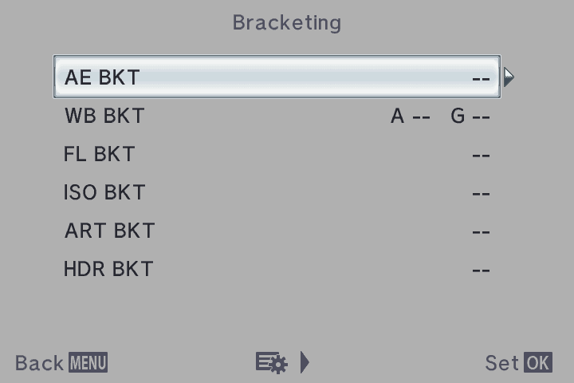
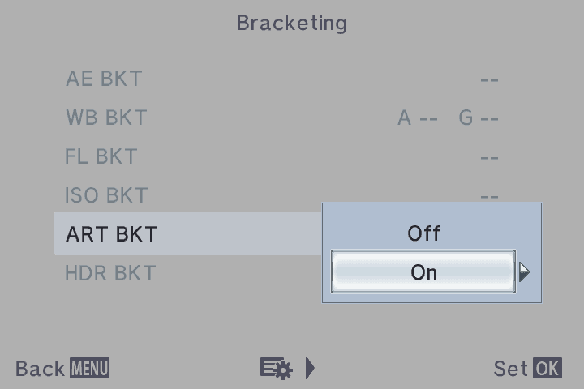
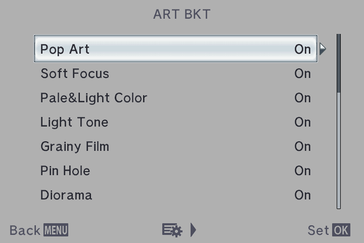
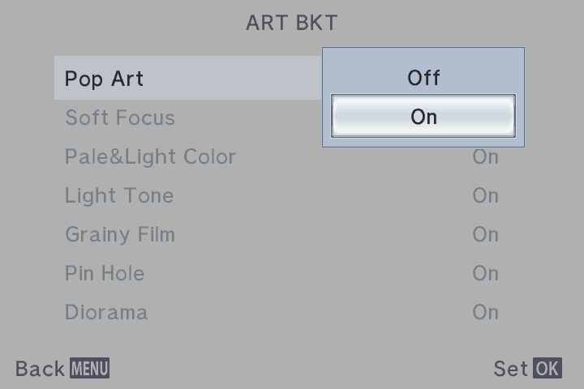
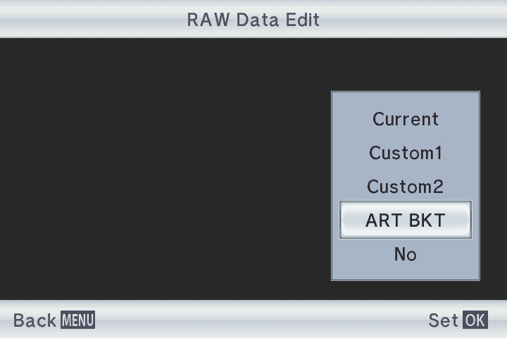

# Draft: docs/guide/raw-art-bkt.md (2026-11-24)

Draft for the guide, not a user document yet. Marks after a sentence: **[E]** shown in the emulator only, **[U]** not
shown anywhere yet; the camera test of `plan.md` §6 settles each one. A sentence without a mark is camera-verified
(`plan.md` §1). Images are emulator screenshots of the pinned build (`shots/`, and the results of
`../2026-11-20-raw-edit-art-bkt/`); the guide copies them to `docs/images/ui/`. Remove this paragraph and every mark
before the guide moves to `docs/guide/`.

---

# RAW Data Edit: ART BKT

Develop one RAW photo in each film simulation or art filter you choose, in the camera, to compare them side by side.

## Setup

Choose the entries once. Go to **MENU → SETUP → Shooting Menu 2 → Bracketing → ART BKT**, highlight **On** without
pressing OK, and press **RIGHT**. **[E]**

The screen **ART BKT** lists the 12 ART entries, with the names of your film simulations, and the 7 Picture Modes.
For each row you want, press **RIGHT**, select **On**, and press **OK**. Press **MENU** to leave. **[E]**

This does not turn on bracketing for shooting: the Bracketing screen still reads `--` for ART BKT. **[E]**

## Usage

1. Set the Picture Mode you want as the reference (for example Natural) and the white balance. Each JPEG uses the
   camera's current settings, as RAW Data Edit → Current does.
2. Press **▶**, show a RAW photo, press **OK**, and select **RAW Data Edit** → **ART BKT** → **OK**.

   
3. Select **Yes** and press **OK**. The camera shows **Busy** while it makes the JPEGs, about 3 seconds each.
4. Select **No** and press **OK** to go back to playback.

You get one JPEG in the current Picture Mode, then one per row that is On, in the order of the ART BKT screen. Each
JPEG takes the next file number, so the files sort in that order.

## Limits

- Each JPEG keeps the RAW's Image Description, so it does not record its own film simulation's name: tell the files
  apart by their order. *(Only if D2 = b; with D2 = a: "Each JPEG records its film simulation's name in its metadata
  (EXIF Image Description)." [U])*
- 12 entries take about 35 seconds. There is no cancel. **[U: no cancel]**
- If the card fills up, the camera stops and keeps the JPEGs it made. **[U]**
- The Olympus art filters Dramatic Tone, Key Line and Watercolor: **[U: whether they act; drop or keep this line
  after the test]**
- Switching the camera off during Busy: **[U: what happens to the Picture Mode]**
- With no row On, ART BKT makes one JPEG, as Current does. **[U]**

For implementation details, see the [notes](../../experiments/2026-11-20-raw-edit-art-bkt/NOTES.md).
