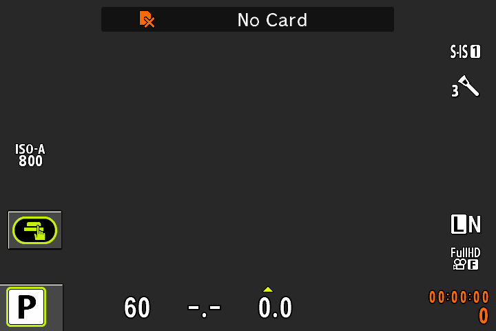
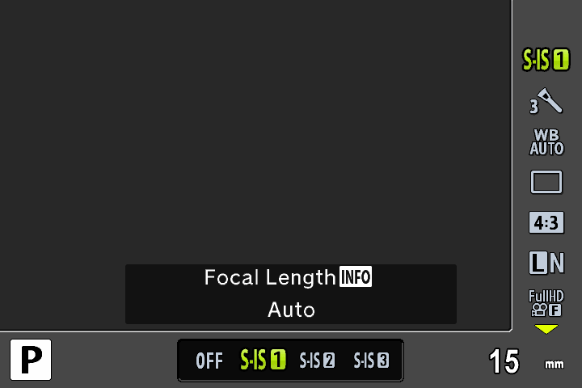
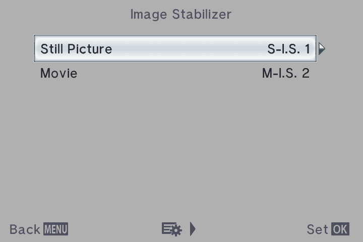

# No IBIS: a build for a body whose image stabilizer is broken

Started 2026-11-27 from issue 7. A reporter's E-PM2 has a faulty in-body stabilizer: at power-on it makes an abnormal
noise and the IS icon blinks red, also with Image Stabilizer set to Off. The reporter tested a three-byte patch on
their body: the noise and the blinking icon went away and photos could still be taken. The owner chose a separate
build (no menu row) and has a body with a broken stabilizer of their own ("icon in top right just blinks").

Labels: **V** verified (firmware bytes, the emulator, the manual), **I** inferred, **U** unknown, **R** the reporter's
camera (not measured here).

## Design

Build `no-ibis` = light-box-2 + `data/specs/no-ibis.json` (3 bytes, segment 1, no hook, no new code), label
2026.11.30.

| Address (block-0 offset) | Stock → new | Effect |
|---|---|---|
| 0x7E506FE3 (0xe5fc3) | `01` → `00` | The setter 0x7E506FE2 (`mov 1,d0; movhu d0,(0x604F3464); retf`) stores stabilizer type 0: the firmware treats the body as one without a stabilizer |
| 0x7E53DCDE (0x11ccbe) | `c916` → `cbcb` | BC sync request 30 (0x7E53DCD3) always takes its existing "unavailable" path (reply 0x8202) and is never sent to the unit |

The issue gives the place of each edit and "three bytes", not the bytes of the second edit. Two `nop` (0xCB) are the
only two-byte change that always takes the path; `light-box-switch.json` uses the same form for a `bne`.

## Evidence

- The setter runs once per start, from Usr0 at 0x7E503FA0, also on the update path (V, disassembly; emulator: reached
  at 5.5 ms). Nothing else writes 0x604F3464 (V, references). Its getter 0x7E506FED has 8 callers: the stabilizer
  module (BC), the updater, overlay B (V).
- The stabilizer start 0x7E53E130 (first thing of task BC_MAIN 0x7E53D96D) starts the sensor stage when the type is 1
  and the setting tag 0x1FF1 (`prm_bc_disable`) is 0. It reads no user setting, so Image Stabilizer Off does not stop
  it (V for the function; I for its callees). A failure records firmware error 0x2D000001, calls the damage report
  0x7E53A76C and sets the damage byte 0x60503AD1 (V). That the blinking icon comes from this is I.
- Request 30 is sent by the mechanism's power control (0x7E517207 acquire, 0x7E5172CE release, module MEC_PCNT). Its
  handler tests only `damage == 2`, a value no code writes (V, references), so without the second edit it reaches the
  unit whatever the type (V). What command 0x25 does in the unit is U.
- The updater with type 0 prints `[firmup]NON_STAB` and goes on with success; it skips only the stabilizer's own
  firmware (sections EXTMOD and BURE) (V, disassembly 0x7E543C5B, 0x7E544394). In the emulator, with OK held and
  light-box-2.BIN on the card, no-ibis skips that step (0x7E5443DC), writes all sections and reaches
  `TYPE_FIRMUP_WRITE_OK`, "Seikou" and the success screen; light-box-2 stops at the stabilizer step
  (`BURE USBFUP ERR : 00008306`), because the emulator has no stabilizer (V, emulator).
- Level gauge: its own accelerometer driver and task (PER_SLOPE), not the stabilizer
  ([level gauge notes](../2026-11-14-level-gauge/NOTES.md)) (V, static). Full-time AF's pan detection reads the
  stabilizer's gyro through sync codes 20/31 and gets nothing (I). The sensor is not held or centred by the
  stabilizer (I); whether that shows in photos is U.
- Manual (E-PM2 p.46): Image Stabilizer, Still Picture OFF / S-IS1 / S-IS2 / S-IS3, Movie OFF / M-IS1 / M-IS2; no
  entry for a blinking IS icon (V).

## Emulator results (2026-11-27)

- `boot-test` against stock differs in four lines, each declared in the build's `boot_differs`: the console's `BS.`
  (the damage report's settings save, 3 characters), a file-task buffer address 0x300 lower, the stand-in counts
  (`S-BC x9` gone, one bank save fewer), `BC transactions 9` → `0`. In a normal-start run the stock firmware reaches
  the stabilizer start at 10.4 ms and, at 1014 ms, error 0x2D000001 with code 0x8228 and "[damage info] … 8228";
  no-ibis has none of it (V). The emulator's stabilizer stand-in answers 0, which the firmware takes as a failure:
  the stock run is the broken-unit case.
- `update-path-test` PASS; `hookcheck` 0 new transfers; free space PASS; lint 0 warnings.
- Screens, no-ibis against light-box-2, byte-equal PNGs: the live view keeps the white S-IS1 icon, Live Control's
  stabilizer item still offers OFF / S-IS1 / S-IS2 / S-IS3, Shooting Menu 2 → Image Stabilizer still shows Still
  Picture S-I.S. 1 and Movie M-I.S. 2 (`results/`). The emulator's play runs show no stabilizer error on light-box-2
  either, so the red blinking icon is not reproduced there (U why: another stand-in timing in play runs).

## Acceptance criteria

| # | Criterion (user's view) | Checked by |
|---|---|---|
| 1 | The body with the broken stabilizer starts without the noise and without a blinking IS icon | owner's broken body |
| 2 | Photos and movies are taken and saved; photos on a tripod at 1/60 and 1/250 are sharp and the frame is where it was | owner's broken body |
| 3 | The level gauge, a film simulation and Light Box work as on light-box-2 | owner's broken body |
| 4 | Starts and power-offs are normal, twice | owner's broken body |
| 5 | The camera can go back to light-box-2 with a normal update, and to no-ibis again | emulator (update path completes); owner's broken body |
| 6 | Nothing else changes at start-up | emulator (`boot-test` with the four declared lines) |

The Image Stabilizer setting stays in the menus (emulator); the test records what it shows and does on the camera.
The build must not go on a body whose stabilizer works: it gives that body no stabilization.

## Camera test (draft)

E-PM2 manual: p.17 (the top menu sets the shooting mode), p.26 (S mode: ▲, then ▲ ▼ for the shutter speed).

Flash: `epm2flash no-ibis 5500259802e6e203de89a4f309ee3d69b1b582d665a3d1e9a6035537fc18f94b`

Go back: `epm2flash light-box-2 f86d135efadbf0ff7adc2b46ec66fa488ac89681beeb2e0f5a2a6fa46cee1fec`

Body: the owner's E-PM2 with the broken stabilizer, on light-box-2. Menu paths: the E-PM2 manual p.57 (MENU shows
the top menu; select [SETUP] and press OK to show the menu tabs), p.46 (Image Stabilizer, Live Control) and the
firmware's texts as the emulator draws them (`results/`). ▲ ▼ ◀ ▶ are the arrow pad. Use a lens without its own
stabilizer, or set the lens's IS switch to Off.

1. Before the update, on light-box-2: power on. Note what you see and hear in the first 5 seconds: the noise, and the
   IS icon at the top right (blinking or not, its colour).
2. MENU → [SETUP] → OK → ▼ to Custom Menu (the gear) → ▶ → ▼ to J. Utility → ▶ → ▼ to Debug Log → ▶ → ▼ to On → OK. Close the
   menu with MENU. (Skip if Debug Log is already On.)
3. Power off. Update the firmware with the Flash line above (hold OK at power-on, as usual).
4. MENU → [SETUP] → OK → ▼ to Setup Menu (the wrench) → ▶ → ▼ to Firmware → ▶.
   Expected: "Body : 1.6  EPM2Mod 2026.11.30". Another date: the update did not take; flash again.
5. Power off, then on. Watch and listen for 5 seconds.
   Expected: no noise, no blinking IS icon. Note what the IS icon at the top right shows (S-IS1 in white is what the
   emulator draws).
6. MENU → [SETUP] → OK → ▼ to Shooting Menu 2 → ▶ → ▼ to Image Stabilizer → ▶.
   Expected (emulator): Still Picture S-I.S. 1, Movie M-I.S. 2. Note what it shows; close the menu with MENU.
7. In live view: OK (Live Control) → ▲ ▲ to the stabilizer item. Note the choices (the emulator shows OFF S-IS1 S-IS2
   S-IS3). Leave it at S-IS1. OK to close.
8. MENU (the top menu) → ◀ ▶ to the P/A/S/M column → ▲ ▼ to S → OK. Camera on a tripod, a detailed subject (text,
   a brick wall) at 1–3 m. Press ▲, then ▲ ▼ until 60 shows (1/60); take a photo. Press ▲, then ▲ ▼ until 250
   shows; take a photo.
   Expected: both sharp; the subject sits where it sat in the live view (not shifted, no dark corner).
9. Repeat the two photos of step 8 with the stabilizer item at OFF (step 7, ◀ to OFF), then set it back to S-IS1.
   Expected: the same as step 8.
10. Press the movie button (the red dot), record 5 seconds while you pan slowly, press it again.
    Expected: the movie is saved and plays back; no noise from the body.
11. In live view, INFO until the two level bars appear; tilt the camera.
    Expected: the bars move and turn green when level, as on light-box-2. (The bars need Level Gauge ticked:
    MENU → [SETUP] → OK → ▼ to Custom Menu → ▶ → ▼ to D → ▶ → ▼ to ▦/Info Settings → ▶ → ▼ to LV-Info → ▶ →
    ▼ to Level Gauge → OK.) Then back to P: MENU → ◀ ▶ to the P/A/S/M column → ▲ ▼ to P → OK.
12. MENU (the top menu) → ◀ ▶ to ART → OK → ▲ ▼ to an entry with a film simulation → OK; take one photo.
    Expected: the film simulation's colours, as on light-box-2.
13. Playback button, then INFO, one press at a time, up to six presses.
    Expected: one press shows two pictures side by side (Light Box On from the light-box-2 test).
14. Power off, power on; again power off, power on.
    Expected: each start as in step 5.
15. Go back: update with the Go back line above. MENU → [SETUP] → OK → ▼ to Setup Menu → ▶ → ▼ to Firmware → ▶.
    Expected: "EPM2Mod 2026.11.28", and at the next power-on the noise and blinking icon of step 1 again.
16. If you keep the build: update with the Flash line again and check the Firmware screen shows 2026.11.30.
17. Copy the photos, the movie and the log to this computer (card in the Mac):
    `scp /Volumes/Untitled/EPM2LOG.BIN /Volumes/Untitled/DCIM/100OLYMP/* USER@HOST:/path/to/epm2-tools/build/fw-test/no-ibis/`

What each other result means:

- Noise or blinking icon in step 5: the unit is started from another path than the two edits; send the log, flash
  back.
- A freeze or restart at power-on: take the battery out, then update with the Go back line (step 15).
- Blurred photos in step 8 only at 1/60, or a shifted frame: the loose sensor shows; note which and keep the photos.
- The update in step 15 fails: note the lamp; try again with the stock file (`uv run epm2mod restore`).
